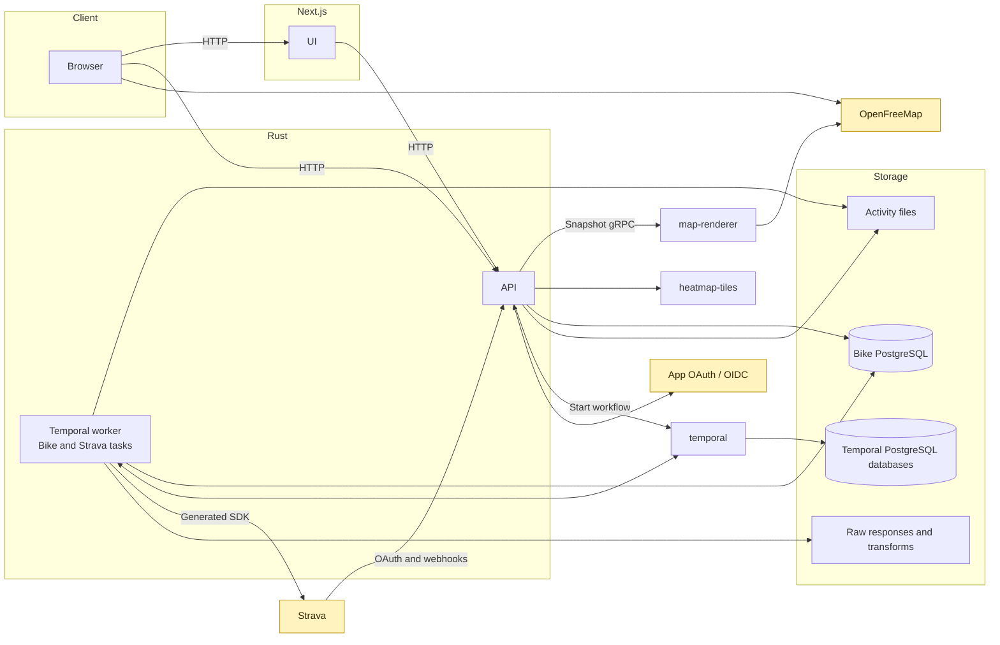

# Bike


**Activity analytics for cross-country and downhill riding.**

Bike brings ride history, route exploration, segment comparisons, and training
progress into one place. Import recordings from your cycling computer or connect
Strava, then explore the data behind your rides.

[Quickstart](#quickstart) · [Architecture](#architecture) · [Documentation](docs/)

## What you can do

- **Explore your rides.** Inspect interactive route maps, elevation, heart rate,
  cadence, laps, zones, and matched segments where the recording includes them.
- **Bring your own data.** Upload FIT, TCX, and GPX files, import activity export
  archives, or sync through Strava OAuth and webhooks. Original files remain
  available for download and reprocessing.
- **Compare segment efforts.** Build a segment from an activity or import a
  route, track personal bests, and replay selected efforts together in the race
  viewer.
- **Understand training progress.** Follow fitness, fatigue, and form alongside
  XC endurance and climbing trends, DH consistency, and event readiness.
- **Explore personal heatmaps.** Filter riding history by sport and date on an
  interactive map. Heatmaps are controlled by a feature flag and require prepared
  activity projections; see the [heatmap specification](docs/specs/heatmaps.md).
- **Inspect background work.** Admin views expose retained imports and integration
  events; Temporal shows workflow progress, failures, and retries.

## Quickstart

Install [Docker with Compose](https://docs.docker.com/compose/install/) and
[mise](https://mise.jdx.dev/getting-started.html). Start Docker before continuing.

```sh
git clone https://github.com/ericbutera/bike.git
cd bike
mise trust
mise install
mise run compose:up
```

Open **[localhost:3001](http://localhost:3001)**. The local environment enables a
development account, so no Strava credentials or external identity provider are
needed. The first build downloads dependencies and compiles the Rust services.

The stack starts PostgreSQL, Temporal, the Rust API and Temporal worker, the
Next.js UI, and the map renderer. The API and UI reload source changes; restart
`temporal-worker` after worker changes. Database migrations finish before the API
and worker start.
Activity data persists across restarts.

| Service    | Local address                           |
| ---------- | --------------------------------------- |
| Bike UI    | [localhost:3001](http://localhost:3001) |
| HTTP API   | `http://localhost:3000/api`             |
| PostgreSQL | `localhost:5432`                        |

To try the import workflow, open [Upload](http://localhost:3001/upload) and select
a FIT, TCX, or GPX activity. Sample GPX recordings are checked in under
[`bike-rs/api/tests/fixtures/platform/uploads/activity-imports`](bike-rs/api/tests/fixtures/platform/uploads/activity-imports).
Those files contain synthetic test data. Importing a ride does not require Strava.

```sh
# Follow startup and import processing.
mise exec -- docker compose logs -f bike-rs temporal-worker ui

# Stop the stack; keep the database and uploaded activities.
mise run compose:down
```

See the [development guide](docs/development.md) for port overrides, tracing,
focused checks, contract generation, and startup troubleshooting.

## Architecture



Yellow nodes are third-party services.

## Built with

| Layer               | Technology                                                        |
| ------------------- | ----------------------------------------------------------------- |
| Application backend | Rust, Axum, SeaORM                                                |
| Frontend            | Next.js, React, TypeScript, React Query                           |
| Persistence         | PostgreSQL and stored activity files                              |
| Background work     | Temporal with one Rust worker for Bike and Strava task queues     |
| Maps                | MapLibre GL, a separate PNG renderer, Rust heatmap tiles          |
| Strava integration  | Generated vendor SDK, Rust OAuth/webhook API, Temporal activities |
| Operations          | Docker Compose, Woodpecker CI, Pulumi, Kubernetes, OpenTelemetry  |

The [specifications](docs/specs/README.md) define system behavior. The Rust
backend implements application workflows and owns data access. The frontend uses a
TypeScript client generated from its OpenAPI contract. Provider fetching and map
rendering have separate service boundaries; the
[architecture guide](docs/architecture.md) explains their responsibilities.

## Repository layout

| Directory                                                      | Responsibility                                                         |
| -------------------------------------------------------------- | ---------------------------------------------------------------------- |
| [`bike-rs/`](bike-rs/README.md)                                | Rust API, core models and services, Temporal worker, schema migrations |
| [`bike-ui/`](bike-ui/README.md)                                | Rider and admin UI, generated API client                               |
| [`map-renderer/`](map-renderer/README.md)                      | Internal Go gRPC Chromium snapshots                                    |
| [`contracts/`](contracts/openapi/README.md), [`proto/`](proto) | HTTP and gRPC contracts                                                |
| [`bike-rs/api/tests/`](bike-rs/api/tests/README.md)            | Native HTTP integration tests and deterministic fixtures               |
| [`docs/`](docs/)                                               | Development guides, design specifications, operations, backlog         |
