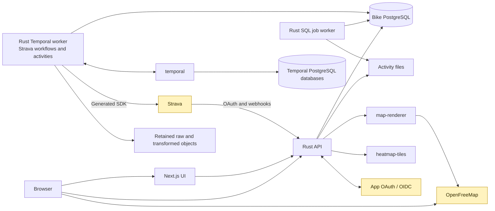

# Bike architecture

Bike has one Rust application backend and one Next.js frontend. PostgreSQL holds
normalized activity records, derived analytics, accounts, accepted Strava events,
and SQL jobs. Temporal stores workflow execution history in its own PostgreSQL
databases. Original activity files remain available for download and replay.

## Service boundaries

Yellow nodes are third-party services.

| Component        | Owns                                                                                                   |
| ---------------- | ------------------------------------------------------------------------------------------------------ |
| Rust API         | HTTP adaptation, application services, activity access, authentication, admin operations, map PNG cache |
| Rust core        | Domain models, database queries, import and segment behavior, analytics, platform modules               |
| SQL job worker   | Activity/archive processing, derived-data rebuilds, queued maintenance                                  |
| Temporal worker  | Durable Strava event handoff, native workflows and activities, provider calls, domain operations         |
| Temporal service | Orchestration, retries, child workflows, cancellation, execution history                                 |
| Next.js UI       | Rider/admin presentation, React Query state, generated API client, private map proxy                     |
| map-renderer     | Go gRPC snapshots, Chromium lifecycle, serialized MapLibre rendering, loopback browser assets            |
| heatmap-tiles    | Rust API tile rendering from prepared activity geometry, through the Next.js authenticated proxy        |

Controllers adapt HTTP requests and responses. Services compose workflows and
policy. Queries live on their owning entity/model modules. Axum and SeaORM
provide routing and persistence; Bike owns its platform modules inside
`bike-rs/bike-core`.

Use SeaORM entities and ActiveModels for ordinary reads, writes, joins,
aggregates, pagination, locks, and conflicts. Use SeaQuery when an expression
needs the database clock or a database function. Keep SQL escape hatches small,
bind dynamic values, and explain the unsupported primitive or atomic operation
beside each one. The retained application SQL covers heatmap writable CTEs and
the PostgreSQL box-overlap expression used by the GiST index. Migration and
fixture DDL remain schema records. The
[shared engineering quality skill](../.agents/skills/bike-engineering-quality/SKILL.md)
defines the review and verification requirements.

## Activity data flow

File uploads and archive imports retain their source data and enter the durable
processing workflow. Parsing normalizes FIT, TCX, or GPX into an activity record.
Processing then matches segments and rebuilds activity and training analytics.
Derived data can be regenerated from retained sources when parsers or rules
change. See the [ingestion specification](specs/activity-ingestion.md).

- The Rust API handles Strava OAuth and acknowledges webhooks after storing a
  durable Strava event in Bike PostgreSQL.
- The dedicated Rust Temporal worker retries event handoff using deterministic
  workflow IDs, then polls Temporal to execute native workflows and activities.
- Activities call Strava through the generated SDK and invoke Bike domain
  operations for persistence, deletion, analytics, and publication. They retain
  raw provider responses and transforms on the existing uploads volume.
- Temporal owns retries, child workflows, cancellation, and execution history in
  separate PostgreSQL databases. The SQL job worker handles other background work.
- The admin integration feed links accepted events to their native Temporal jobs.
  See [the Strava Temporal specification](specs/strava-temporal.md) for workflow
  types, typed activities, correlation, retention, and recovery.

## Maps and privacy

Interactive activity and segment views use MapLibre. Activity-card PNGs pass
through the UI's private image route to the Rust API, which owns access and PNG
caching. A miss calls `map-renderer` over gRPC. The
[maps specification](specs/maps.md) defines the HTTP and gRPC contracts,
privacy, cache lifecycle, and required OpenTelemetry visibility.

Personal heatmaps use Rust-owned activity projections and the private
`heatmap-tiles` route through Next.js. Worker preparation and feature flags are
described in the [heatmap specification](specs/heatmaps.md).

## Contracts and ownership

- Rust generates the canonical HTTP contract directly in `contracts/openapi/`.
  The frontend and test harnesses consume its YAML and JSON representations.
- `bike-ui/lib/openapi/react-query/api.ts` is generated from that contract,
  including runtime enum values for frontend controls.
- Versioned protobuf definitions under `proto/` describe the internal renderer interface.
- `mise run assets:sync` copies canonical assets into required build contexts;
  `mise run contracts:check` compares those copies with their owners.
- `mise run rust:check` verifies the HTTP contract against fresh Rust output.
- Schema migrations are append-only records. Preserve their order and history.

## Deployment

Root Docker Compose supplies the local application environment. Production definitions and release
promotion are maintained separately.

Woodpecker jobs run checks for the owning component, publish images with
immutable commit tags, and call the Pulumi release helper. Backend promotion
runs migrations before API, SQL worker, and Temporal worker rollout; the UI and
renderer have their own image boundaries. Existing namespace and image names are
deployment identities and do not depend on the repository's display name.

OpenTelemetry supports tracing; internal metrics, dashboards, alerts, and
protected failure captures support diagnosis. See the
[Strava workflow specification](specs/strava-temporal.md) and
[admin recovery procedures](specs/admin-operations.md#failed-import-recovery) for recovery procedures.
