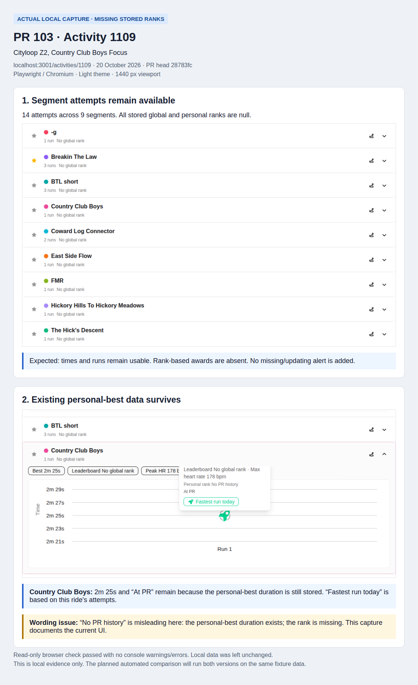

# PERF01 stored activity ranks

PERF01a completes the existing worker output; PERF01b reads it without ranking
other activities during a request. The UI shows available values without notices.

- Persist completed-empty analytics for surviving activities; retries replace
  output atomically without reviving deleted activities.
- Retry changed rank input instead of silently completing. Segment rematching
  commits removed achievements with effort replacement, before rank rebuilding.
- Reuse the existing paged user-segment task for backfill; see the
  [rollout procedure](../specs/activity-details.md#stored-segment-rankings).
  No production backfill has been run as part of this PR.

## Visual review



Captured 20 October 2026 at feature revision `28783fc`: Chromium, light theme,
1440 px viewport, [local activity 1109](http://localhost:3001/activities/1109).
The read-only check passed with no console warnings or errors.

- All 14 attempts across nine segments remain; their global/personal ranks are null.
- Country Club Boys keeps its 2m 25s time, “At PR,” and “Fastest run today.”
  Its shared personal-best duration still exists; rank-based awards are absent.
- No missing/updating alert appears. Existing “No PR history” wording is misleading
  when only the rank is missing; this is a follow-up UI finding.

The live-production comparison was not captured. Manual production login is no
longer the review strategy; the next slice below makes comparisons repeatable.
With ready data, displayed ranks and awards should match. With missing data,
the reader should omit unavailable ranks instead of reconstructing them.

The [original FIT fixture](../../bike-rs/api/tests/fixtures/segment_matching/activities/cityloop-z2-country-club-boys.fit)
is 526,299 bytes, SHA-256
`1aec0b312827d804ec78a42f00fa14bf99021110dcd756dffc648fd6b0c43888`.
Reuse it through the normal upload/worker flow in an isolated test stack with
existing segment fixtures. It supplies the recording, not segment definitions,
history, or saved ranks; those remain explicit scenario setup. This is the real
ride, separate from the synthetic E2E fixture also numbered 1109.

### Next slice: repeatable local comparison

Implement separately from PERF01. Reuse the existing [E2E runner](../../scripts/e2e.sh),
[scenario fixtures](../../bike-ui/tests/e2e/helpers/seeds.mjs), and
[reset/session helpers](../../bike-ui/tests/e2e/helpers/environment.mjs).

- Run the deployed UI/API image digests and the PR images against separate,
  freshly migrated databases seeded with the same versioned scenario data.
  Label results “production version on fixtures,” not live production.
- Use this ride, matching segment definitions, and a small explicit effort history.
  The FIT alone cannot reproduce ranks. Keep timestamps, preferences, map assets,
  viewport, and theme consistent; record image digests and the fixture checksum.
- Reuse automatic fixture-user sessions and database/upload reset. No manual
  login, saved production cookies, production data dependency, or new auth endpoint.
- Start with activity details in **ready** and **missing-rank** states, preserving
  repeated attempts. Produce screenshots side by side with expected differences.
- Completion: two clean runs from the same inputs produce the same asserted
  values and stable screenshots without user intervention. Both runs preserve
  the normal local stack and clean up their disposable resources.

This first slice verifies reads and rendering of stored fixture data; it does not
prove worker generation. Existing producer tests retain that responsibility.
Staging deployment, worker lifecycle E2E, capacity testing, other screens, and an
interactive preview mode are separate work. No comparison runner was added here.

## Earlier read benchmark

The comparison below measures the earlier PERF01b reader revision. PERF01a
does not change that read path; these are retained measurements, not a new
worker-throughput or final-revision benchmark.

Compared release API `9139a674e` (baseline) with `37b83271d` (candidate), using
PR 102 runner `7c28f98da`, fixture version 2/seed 8, and two fresh databases.
[Raw results](PERF01b-results.json) contain full revisions, image IDs, fixture hash,
resource limits, returned states, bytes, SQL totals, and individual runs.

Run from PR 102's checks container, once for each release API image:

```sh
BIKE_API_IMAGE=<baseline-or-candidate-image> BIKE_PERF_RANK_GROWTH=1 mise run perf:small
```

- Same ARM64 Docker host; PostgreSQL 17.11. API/database each limited to 2 CPUs
  and 1 GiB RAM. No concurrent builds or controlled worker load.
- Ten warmups, then three batches of 200 requests per scenario. Warm reads;
  database/OS caches were not reset. All **12,000 measured requests passed**.
- Start with 1,000 activities and 198 efforts on the measured segment. Add 1,728
  slower synthetic efforts to other activities, then repeat the three detail
  scenarios. Requested effort rows, recordings, and stored ranks stay fixed;
  the added rows test history growth, not matching or playback correctness.

| History | Detail state | Baseline p95 ms | Candidate p95 ms | SQL calls/request | SQL rows/request |
| ------- | ------------ | --------------- | ---------------- | ----------------- | ---------------- |
| 198     | Ready        | 1.84–1.89       | 1.76–2.90        | 7 → 7             | 7 → 7            |
| 198     | Missing      | 2.58–2.87       | 2.29–2.60        | 8 → 7             | 205 → 7          |
| 198     | Stale        | 2.66–3.05       | 2.17–2.80        | 8 → 7             | 205 → 7          |
| 1,926   | Ready        | 1.99–2.47       | 1.87–2.36        | 7 → 7             | 7 → 7            |
| 1,926   | Missing      | 5.09–5.61       | 2.17–2.62        | 8 → 7             | 1,933 → 7        |
| 1,926   | Stale        | 5.97–6.94       | 1.81–2.82        | 8 → 7             | 1,933 → 7        |

Rows count returned SQL rows, including authentication, not rows scanned.
Structural check: **pass**. Larger-history missing/stale latency improves beyond
observed variation. Small-history timing overlaps; no ready-read speedup claimed.
Ready p95 has one noisier candidate batch (2.90 ms); feed p95 ranges from
8.48–9.31 ms before to 8.71–9.66 ms after. Their rows/payloads are unchanged
except the detail state field. These runs do not establish a timing regression
or improvement for those unaffected paths.

Missing ranks stay null; stale ranks and both repeated attempts remain usable.
Empty details add one bounded analytics lookup (5 → 6 calls) to distinguish
completion from missing data. That fixture has no completion row and correctly
reports missing. PERF01a's producer tests verify writing completed-empty rows;
the API fixtures verify reading them as ready. Detail payloads grow by 30–40
bytes for diagnostic state.

Original comparison validation: 18 activity API tests, 38 detail UI tests, three
runner unit tests, existing Clippy/format/lint/type checks, and the release build
passed.

PERF01a validation: 698 workspace unit tests and 41 activity-detail UI tests pass
(three existing Rust tests remain ignored). The API/worker debug builds and
strict Clippy, formatting, ESLint, TypeScript, and staged hooks pass. Shared
PostgreSQL mocks verify completion, rollback, removals and repeated attempts;
native workflow fixtures verify import/reprocess ordering and bounded backfill.
No production worker/backfill or capacity run was performed.
PR 102's stale fixture was corrected because ordinary updates replaced its old
timestamp; both comparisons use that correction. CPU, peak memory, browser performance,
and capacity remain unmeasured. Both disposable stacks were removed.
