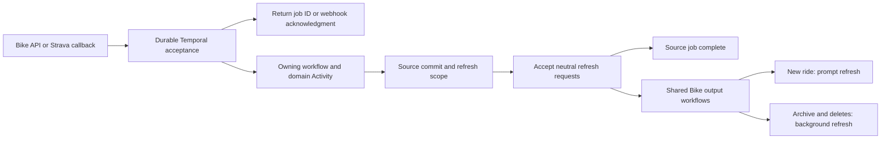

# Background work and Strava integration

- This is the owning specification for Bike worker migration, Temporal execution,
  Strava integration, activity change history, storage, and recovery. It replaces
  the separate task-workflow, durable-work, execution-policy, activity-history,
  Strava, and worker-conversion specifications.
- [The backlog](../TODO.md#worker-conversion) owns the task inventory, conversion
  status, first-deliverable checklist, findings F1–F6, and outstanding work.
  [The rollout record](../worker-rollout-2026-10-16.md) preserves dated unit and
  production evidence. Neither historical evidence nor a passing mock closes a
  production gate.
- Strava is already native. PR #66 consolidates the first Bike reprocessing review
  slice; #64 and #65 are superseded. Complete and vet `reprocess_activity_import`
  before broader rollout. This document authorizes no deployment or merge.

## Ownership and runtime

| Boundary                                | Strava            | Bike tasks                                              |
| --------------------------------------- | ----------------- | ------------------------------------------------------- |
| Workflow/Activity code and registration | `strava-temporal` | `bike-temporal`                                         |
| Task queue                              | `bike-strava`     | `bike-tasks`                                            |
| Workflow ID prefix                      | `strava-`         | `bike-task-`                                            |
| Owned object keys                       | `strava/`         | `bike/tasks/`; retained imports use `activity-imports/` |

- Run both queue pollers in one existing `temporal-worker` binary/process, sharing
  the SDK runtime, connection, database pool, uploads volume, and metrics endpoint.
  Either poller ending or failing drains its sibling. Signals, handoff failure,
  and metrics failure drain both. SDK metrics ownership ends on every exit.
- Keep domain code and queue registration separate; neither workflow crate imports
  the other's workflow/Activity types. Share neutral domain operations, storage,
  fixtures, and SDK helpers. Do not add another Cargo binary or Compose service.
- Temporal owns execution status, scheduling, retries, timers, cancellation,
  children, and continuation. PostgreSQL owns business data and domain history.
  Simple independent work may be one workflow and one Activity.
- Controllers adapt HTTP input/output. Convert request/query DTOs to service-owned
  commands/filters; application services do not accept controller request types.
  Owning models perform queries, uniqueness checks, and atomic writes.
- Strava owns callbacks, OAuth, quotas, fetching, normalization, provider captures,
  sync/backfill, deletion, and reconnection. Bike owns domain computations and
  shared fitness/segment/heatmap workflows. Provider Activities submit neutral
  typed change requests, without passing `StravaEvent` into Bike computations.
- Reuse natural keys, record versions, replacements/upserts, and transactions.
  No SQL scheduling bridge, custom queue, generic admission/receipt/result ledger,
  redundant attempt-stage lifecycle, contributor ledger, or per-request publication
  barrier is required. Every retained record must have a distinct domain purpose.
- Keep the SQL worker for unconverted tasks. Each converted mutation/output has
  one execution owner; drain or fence its legacy producers before activation.

## Identity and causal context

| Identity                      | Meaning and required behavior                                                                                                                         |
| ----------------------------- | ----------------------------------------------------------------------------------------------------------------------------------------------------- |
| Source                        | Provider, remote owner, object type/ID, and owning Bike user. Exists before a Bike activity; enforce the owned mapping using existing source records. |
| Connection generation         | Authorization lifecycle; reject delayed work from an older connection.                                                                                |
| Bike activity ID              | Optional at intake; resolve/link during persistence and preserve across updates/reprocessing.                                                         |
| Command/event key             | One immutable operation. Reuse on delivery/Activity retry; intentional new work gets a new key. Strava supplies no unique event ID.                   |
| Workflow/job ID               | Accepted command or shared output resource. Command IDs include task/user/command; output IDs use user, segment, or activity.                         |
| Correlation ID                | Diagnostic causal link, often the root command/event ID. Never an idempotency or authorization key.                                                   |
| Request/trace/run/attempt IDs | Delivery/execution diagnostics that may change on retry. Keep initiating actor separate from affected owner.                                          |
| Domain version                | Existing source/resource version checked when replacing data. Add a version only for a real stale-write race, not a revision ledger per output.       |

- No import-attempt lifecycle or local activity ID is needed to acknowledge work.
  A checksum identifies bytes; it does not identify an intentional reprocess.
  Capture selected source/import/target identity, relevant parser version, and
  expected activity revision before execution.
- Root and child command IDs derive from task, affected user, and retry-stable
  command ID. Use native `UseExisting` conflict and `RejectDuplicate` reuse
  policies. A running duplicate returns its canonical run; a retained closed
  execution returns its reference/status without automatically restarting failure.
- Temporal keeps the original input on duplicate start; it neither compares nor
  replaces payloads. Producers must not reuse a command key for changed work.
  Domain uniqueness/idempotency remains necessary after history retention expires.
- Capture `TaskCause` once: command/correlation identity, receive time, optional
  request ID, initiating actor, affected user, and W3C trace context. Carry it
  through starts, Activities, children, output handoffs, retries, replay, and
  Continue-As-New. Resets/continuation may change run ID without changing the job.
- Import submission currently carries context into its root and committed audit
  event. Complete propagation for other commands, children, and derived fan-in
  before their cutover. A shared refresh may combine causes; retain bounded
  log/trace links without assigning it exclusively to the last caller.

## Fast durable acceptance

- Bike API: retain necessary input bytes/metadata, submit directly through a typed
  application operation, await Temporal acknowledgment, and return HTTP 202 with
  `JobReference { job_id, namespace, run_id, workflow_type }`. Do not parse, fetch,
  mutate business records, or wait for a worker in that request path.
- A failed or uncertain start may fail the user API call. Retry with the same
  command and retained input. API startup connects lazily; worker downtime alone
  does not prevent durable acceptance.
- Strava callback: validate the supported event and use a bounded durable start.
  Return HTTP 200 within **two seconds**, with the start timeout below the total
  callback budget. Provider fetches and derived work belong in the worker.
- On unavailable/uncertain acceptance, return non-2xx promptly. Strava makes up to
  **three total deliveries**; direct submission cannot buffer a longer outage.
  Sync/backfill can recover live activities but cannot guarantee missed deletions.
- The deployed Strava inbox is an optional buffering adapter. While retained,
  its durable write is the acknowledgment boundary and its relay retries Temporal
  handoff. It is not a mandatory abstraction for Bike or a blocker for this slice.
  Never acknowledge work held only in process memory.
- [`TaskSubmissionService`](../../bike-rs/bike-temporal/src/submission.rs) owns the
  native import/reprocess submission contract. Callers pass domain inputs and
  context; SDK options, headers, and repeated logging construction stay inside it.

## Idempotent effects and activity history

- Temporal Activities may retry after a committed effect loses its completion
  reply. Protect effects with natural unique keys, replacement/upsert semantics,
  or an operation key on an existing domain/version record. A separate operation
  record is justified only when the model cannot represent the guarantee.
- Recomputing authoritative projections is acceptable. Duplicate business records
  and permanently lost changes are not. A retry must not create a fresh version
  that permits older content to overwrite newer state.
- Apply authoritative related changes atomically, using model-owned constraints
  and conditional writes. Check expected source/resource versions in the same
  transaction as publication; timed-out Activity attempts may still finish late.
  Deletion, privacy changes, and newer generations reject obsolete publication;
  a stale result must not recreate a deleted activity.
- Versioned replacement can publish one complete selected version and then reclaim
  older versions. Readers select the published version; outputs need not switch
  versions together.
- If an existing stored outcome supplies idempotency, recheck it under the lock
  before unchanged/superseded branches. Preserve the original retry outcome.
- A rematch `{A,B}` → `{B,C}` must eventually refresh A as well as B/C. Retain an
  old version, a version-validated plan captured before mutation, a small committed
  refresh scope, or rebuild a broader authoritative scope. Current replacement
  rows alone cannot recover discarded membership; a full result ledger is optional.
- `strava_activity_states` holds latest accepted state for the owned remote pair,
  connection generation, and known Bike activity PK. It is a source fence, not
  an execution queue/history archive. Retain the known PK on deletion tombstones.
- `activity_event_history` is the shared append-only activity-change archive for
  Strava, manual edits, and native imports/reprocessing. Append in the same domain
  transaction as the mutation/provider state. Audit failure rolls back the write.
- Archive before/after summaries and source/import metadata, not route/chart/zone
  payloads. Preserve the Bike PK after deletion without a cascading activity FK.
  Source-qualified event/command keys make repeated appends idempotent; activity ID
  alone is not an event key. Legitimate later edits have distinct event identities.
- Strava history retains event, remote owner/object, connection generation,
  accepted state/status, and root/request/trace context. Native import history
  retains command, actor/owner, request/correlation/trace, and native job/run.
- Lock the current activity before capturing a manual or Strava before snapshot.
  Unchanged Strava content may still advance accepted provider state and archive
  equal activity summaries. Superseded events keep their original event outcome
  without changing current state.
- Reprocess history carries minimal `refresh_scope`: revision, earliest dirty
  date, old/new segment union, and heatmap generation. Its audit key is
  `reprocess:user-{user_id}:{command_id}`. Recheck under the activity lock before
  stale-version rejection; a conflicting key/target rolls back the losing write.
- Preserve legacy attempts/history required by unconverted consumers. Remove
  native dependence on SQL stages as those consumers migrate. Finite retry
  exhaustion remains visible for native/operator retry or existing reconciliation;
  no new universal repair service is required.

## Cancellation, recovery, and completion

- Accepted cancellation stops new request work and propagates to request-owned
  children/Activities. Do not launch refresh handoffs after accepting it.
- Allow cancellation while queued/preparing. Close that window before invoking
  the mutating Activity and its small durable handoffs. A later racing request is
  too late, not successful cancellation. The workflow decides; a stale UI button
  cannot decide the boundary.
- A native cancellation RPC acknowledges a request, not completed cancellation.
  Report the workflow decision/status. Cooperative cancellation requests stop and
  awaits settlement; it does not instantly interrupt an in-flight database call.
  Use native cancellation policies and heartbeats for long Activities.
- Keep parsing/writing in one Activity when simpler; close its cancellation window
  before starting it. Split preparation only when useful.
- Batches stop at safe boundaries between items. A request during apply/handoff
  settles that item before acknowledging cancellation; start no later items.
  Preserve earlier completed items rather than rolling them back.
- Source completion waits for accepted handoffs, not aggregate computation.
  Shared output workflows can serve several parents and have independent
  lifetimes; canceling one import cannot cancel those shared computations.
- Worker loss resumes through Temporal history and idempotent Activities. Failures
  remain visible for retry. Existing reconciliation may repair stale projections
  without being continued work for an accepted canceled request.
- No general post-cancellation finalization, all-output transaction, or per-request
  derived-readiness record is required.

## Reprocessing review implementation

- `POST /admin/activity-imports/reprocess-activity` accepts `activity_id` and an
  optional UUID `command_id`. The UI creates and reuses the UUID across transport
  retries; omission asks the server to create a fresh operation.
- The controller maps HTTP input into required `ReprocessActivityCommand` and
  maps internal `AcceptedReprocessing` to the response. Compatibility `task_id`
  and `task_status` mean native job ID and acceptance status. Import history and
  replay likewise map HTTP DTOs into `HistoryFilter` / `ReplayCommand`.
- The API reads owned metadata only and submits directly. It takes no user-wide
  SQL import lock and queues no SQL task. The admin is the actor; the activity's
  owner is the affected user. Root correlation is the command UUID.
- Eligible sources are owned, parsable, checksummed retained imports. Reject
  checksumless legacy input until metadata repair. Current `strava_sync` imports
  stay provider-owned and use sync/backfill instead.
- The worker reads primary and supplemental artifacts through injected shared
  `ObjectStore`, verifies checksum/size, and reuses parsing/recording classification.
  Preserve existing `activity-imports/` keys and canonical lifetime.
- The [domain adapter](../../bike-rs/bike-core/src/activity_reprocessing.rs) locks
  and rechecks the activity/version and conditionally replaces parsed fields.
  Preserve activity/import IDs and activity type. Segment matching, per-activity
  analytics/training, import completion, and history share the source transaction.
- Committed retries reconstruct the original refresh scope without source reads
  or reparsing. Stale/deleted targets and changed command source reject new work;
  old parsed writers also use a timestamp predicate.
- Fitness, segment analytics, and heatmap handoffs are concrete for this slice.
  Other workflow adapters remain conversion work. The provider Activity sequence
  and retained Strava history are unchanged by this review slice.
- Vet the working admin flow in the existing Docker stack before extending its
  E2E suite. Single-endpoint wiring and mocked outputs are not producer-wide
  cutover, deployed recovery evidence, or first-milestone completion.

## Bike workflow composition and bounded batches

- Keep the twelve registered workflow names in the [task inventory](../TODO.md#task-inventory-and-conversion-order).
  Renaming requires user approval and explanation. Task 0 is email retirement,
  not a replacement workflow. Rust type names may follow Rust casing.
- Review [workflow `run` methods](../../bike-rs/bike-temporal/src/workflows.rs)
  first, then [named steps](../../bike-rs/bike-temporal/src/workflows/steps.rs),
  [batch paging](../../bike-rs/bike-temporal/src/workflows/batches.rs),
  [typed children](../../bike-rs/bike-temporal/src/workflows/children.rs), and
  [domain adapters](../../bike-rs/bike-temporal/src/activities.rs).
- `process_activity_import` and `reprocess_activity_import` share the explicit
  `activity_import` Activity. Its typed target distinguishes new creation from
  replacement at an expected revision. It parses/persists and returns committed
  identity plus fitness, affected-segment, and optional heatmap requests; it
  neither schedules outputs nor submits SQL tasks.
- Workflows declare steps explicitly. Shared typed execution/handoff helpers
  remove SDK plumbing without becoming a generic DAG or task coordinator.
  `refresh_import_outputs` composes independently reusable output steps.
- Reprocessing collections call #1 children; archive entries call #8; user and
  global segment batches call #5 with `All` or a specific segment generation.
  Matching and per-activity analytics commit together before aggregate handoff.
- Prepare a retained immutable manifest per command: owner, selection, eligible
  inputs, ordering, stable entry commands, and resource revisions. Pages carry
  compact references/commands, not route or archive bytes.
- Bind the manifest to parent and selection. An archive-FIT continuation cannot
  substitute a general user-import manifest. Validate the whole page before
  work: scope, parent-owned entry IDs, uniqueness, and exact expected page size.
  Preparation enforces global entry uniqueness; truncated/oversized pages fail.
- Read at most **16 entries/page**. This proof of concept awaits one child/Activity
  at a time. Advance cursor/counts only after settled work; duplicate child start
  is not proof of success. Child-start/execution failure fails the parent.
- A global segment manifest includes previous effort holders, even across users
  or when they no longer match. A user manifest includes only that user's selected
  cycling activities.
- Training backfill uses the same page loop with training Activities and optional
  fitness handoffs. Record goal/backfill success only after every page settles;
  errors/cancellation prevent that completion effect.
- Continue-As-New after a settled page, at **16 pages / 256 entries** per run or
  the SDK history suggestion. Carry manifest, settled cursor/counts, pending
  requests/deadlines, and failure context; no live children cross the boundary.
  Batch counts describe settled source work and accepted handoffs, not projection
  publication. Shared helpers own child IDs, options, awaiting, and cancellation.

## Eventual consistency, debounce, and priority

- Fitness, analytics, segments, achievements, heatmaps, and downstream activity
  projections may be stale and publish independently. Rebuild authoritative
  current state; extra computation is acceptable, lost changes are not.
- Newly finished rides should refresh fitness, segments, and achievements promptly.
  Historical archives, backfills, maintenance, and rare deletes may take much
  longer. Preserve background priority through archive entries; inserting an old
  activity does not turn it into an urgent new ride.

| Trigger                                                        | Native priority | Quiet window | Cap from first pending change |
| -------------------------------------------------------------- | --------------- | ------------ | ----------------------------- |
| Newly finished activity; interactive work at requested urgency | 1 (high)        | 2 seconds    | 10 seconds                    |
| Archive, historical backfill, delete, routine repair           | 5 (low)         | 60 seconds   | 5 minutes                     |

- These are configurable batching defaults, not publication SLAs. Tune observed
  rider latency, redundant rebuild counts, and backlog aging after the flow works.
- Key fitness by user, global analytics by segment, heatmap by activity. Producers
  use native Signal-With-Start with `UseExisting`. In the pinned Rust SDK, small
  typed scheduling Activities perform that client RPC and return after acceptance.
- Output workflows own durable signals/timers and coalescing, independently of
  parent lifetimes. Merge earliest dirty date, affected-ID unions, revisions, and
  highest urgency. Identical pending requests do not extend the quiet deadline.
  High-priority arrivals advance a pending low-priority flush; background arrivals
  cannot postpone a high-priority flush.
- Keep one publisher in flight per resource and one merged follow-up. Five quick
  requests produce one rebuild; changes during it produce one follow-up. A late
  signal below a published timestamp/revision watermark may describe a different
  activity that was absent from the rebuild: rebuild current data rather than
  silently discarding it. Superseded work carries dirty scope forward.
- Continue-As-New only after active work settles, retaining pending state and
  deadlines. Retried partial fanout may resubmit refresh requests safely.
- Set each processing Activity's current priority/fairness; disable eager dispatch
  so server matching applies. Native priority does not preempt running work.
  Bound concurrency/work units and verify fairness across users and aged backlog.
- Temporal 1.32.1 uses priority matching by default. Enable
  `matching.enableFairness` for namespace `bike`, queue `bike-tasks`, as locally
  configured, and verify deployment. Schedule-To-Start promotion is an option to
  investigate after the proof of concept, not a second scheduler to build now.
- Every producer sharing an output must join this boundary: imports, reprocessing,
  Strava, edits/deletes, training, and reads. Remove per-child full-user rebuilds
  and synchronous fitness-read bypasses. Source jobs/collections and sync offsets
  finish after source children and accepted handoffs, while projections converge
  later. Show stale/refreshing state using existing freshness fields.

## Shared object storage and retention

- Use one backend-independent `ObjectStore` service and logical
  `ObjectRef { path, sha256, bytes }` values. Inject Apache's supported
  [`object_store` backend](https://docs.rs/object_store/) at composition roots.
  Local disk with durable `fsync` publication is the initial adapter.
- The service owns namespace validation, immutable content-addressed writes,
  checksum/size verification, named JSON descriptors/references, errors, and
  retention eligibility. Concurrent creates retain the winning descriptor.
  Tasks do not construct provider clients, join filesystem paths, open files,
  scan directories, or implement independent expiry.
- Keep `strava/`, `bike/tasks/`, and `activity-imports/` ownership separate.
  `ObjectOwner::ActivityImports` preserves legacy canonical keys and exact bytes.
  Reprocessing verifies primary and supplemental sources through the service.
- Backend replacement preserves logical keys and serialized references. Copy and
  verify objects before switching injection so old histories/retries still read
  their sources. Provider encryption and response metadata remain Strava-owned.
- Share storage/TTL unit fixtures using the in-memory backend, plus the focused
  filesystem restart check. Provider/task tests cover domain behavior rather
  than repeating storage-layout and TTL matrices.

| Object class                                            | Initial configurable retention                             |
| ------------------------------------------------------- | ---------------------------------------------------------- |
| Uploaded input never accepted                           | 24 hours since last upload/retry                           |
| Successful workflow scratch                             | At least 14 days after final execution in its chain closes |
| Failed/canceled scratch and accepted Strava event audit | At least 90 days after final execution closes              |
| Canonical activity/import source                        | Keep while referenced; no scratch TTL                      |

- Temporal closed-history retention is seven days in the recorded deployment.
  Open executions, continuation chains, retry/recovery pins, and pending handoffs
  remain protected regardless of age. Continue-As-New is not final chain closure.
- Persist lifetime, ownership, and expiry outside Temporal history. Keep each
  shared reference independently: one successful caller cannot shorten another
  failed/active request's retention. Retain input after failed submission.
- Preserve ordering/generation/deletion watermarks after event-audit expiry.
  Keep parents while retained children reference them. Canonical sources stay
  for their referenced activity/import lifetime.
- A native scheduled sweeper owns each prefix. Eligibility is only a candidate,
  not deletion authorization. Inventory active/retained/resettable histories,
  database imports/artifacts, retry pins, handoffs, and unexpired provider indexes
  completely, including pagination; recheck the pin/reference generation under
  deletion coordination. Missing inventory or writer coordination defers deletion.
- Remove expired cache indexes before unused bodies. Backend lifecycle features
  must not bypass references or race a new writer/pin. Dry-run candidates,
  protected roots/reasons, allocated/reclaimed bytes, and failures before enabling
  deletion. No production garbage collector is enabled by this specification.
- Shared groundwork currently supplies serializable lifetimes and candidate
  policy. Persistence/inventory/scheduled deletion remains open. After Bike task
  conversions, complete Strava's remaining storage composition and retention
  integration; keep protocol/captures/encryption/histories compatible. This later
  cleanup does not defer F1–F4 or neutral shared-output correctness.

## Large archive durability

- Retain immutable archive bytes plus a paged manifest in shared durable storage;
  preserve hashes and retry references after the original URL expires. Stream
  download/extraction with bounded memory. Pin archives/manifests/staging while
  needed; canonical extracted sources follow the reference policy above.
- Use stable owner/request/archive/entry identities and exact settled
  success/duplicate/failure counts. Await source children and accepted handoffs
  before advancing the settled cursor; projections may finish later.
- History records completed steps/children; Continue-As-New carries manifest,
  next settled cursor, counts, pending dirty scope, and references. No required
  cursor/source/result lives only in worker memory or temporary files.
- Long download/extraction Activities use native heartbeats with compact
  stage/entry/committed byte-or-chunk offsets. Validate archive identity and
  resume only durable checkpoints. Set heartbeat/execution timeouts explicitly.
- A crash can lose a throttled heartbeat and repeat a tail. Stable entry keys,
  idempotent writes/counts, and stale-write fences make older checkpoints safe.
  Heartbeats are intra-Activity progress; workflow history records completed work.
- Compressed archives resume at manifest entries/staged chunks, not arbitrary
  compressed offsets. Partial download ranges need source support and matching
  validators; otherwise restart download safely.
- Cancellation preserves committed progress and inputs for explicit resume with
  stable entry identities/counts. Release pins only under reference-aware cleanup;
  never report source success while children/handoffs failed.
- Task 12 requires real multi-gigabyte/thousand-entry recovery evidence: loss
  during download, extraction, after entry commit/before acknowledgment, between
  batches, across continuation, after missed heartbeats, and during paused-import
  TTL sweeps. Synthetic large manifests prove orchestration only. Measure memory,
  offsets, counts, and rebuild reduction in the existing stack.

## Strava protocol and workflows

- Target intake is Strava → `/api/strava/webhook` → bounded durable acceptance.
  Preserve registered `/webhooks/strava-gateway` and `/oauth/gateway/callback`
  as aliases to native handlers, with existing ingress/TLS; no gateway code returns.
- Activity `create` / `update` / `delete` start dedicated native workflows.
  Athlete `update` with `authorized=false` disconnects without remote revoke.
  Other combinations and unconnected athletes are acknowledged and ignored.
  [Typed intake](../../bike-rs/bike-core/src/strava/events/intake.rs) and
  [client registration](../../bike-rs/strava-temporal/src/client.rs) own mapping;
  there is no generic Strava processor.
- Retain all activity summaries, including manual entries and non-cycling sports,
  with normalized sport, title, distance, duration, reported elevation gain,
  description, and gear ID/name when supplied. Missing gear name preserves its
  ID without another call. Store complete provider responses in object storage.
- Fetch streams only for recorded cycling activities. Manual/non-cycling summaries
  use empty streams; missing manual streams do not fail import. Invent no GPS or
  sensor data. Prefer reported elevation gain over samples. Apply the
  [central sport policy](supported-activities.md#central-activity-vocabulary-and-retention)
  to exclude non-cycling summaries from cycling calculations while keeping them
  visible in the feed; preserve unknown provider sports.

| Workflow                        | Input                      | Source steps and result                                                    |
| ------------------------------- | -------------------------- | -------------------------------------------------------------------------- |
| CreateActivity / UpdateActivity | Strava event               | Await Upsert child; return Bike ID/status                                  |
| UpsertActivity                  | Event + remote activity ID | Fetch activity → streams → normalize → persist → refresh; return ID/status |
| DeleteActivity                  | Event + remote activity ID | Capture dependencies → delete → refresh; deleted/already absent            |
| SyncActivities                  | Event + saved offset       | List pages → await upsert children → commit offset; counts/new offset      |
| BackfillActivities              | Event + fixed range        | List range → await upsert children; counts without offset change           |
| DisconnectStrava                | Event + revoke flag        | Delete children → optional revoke → remove connection                      |
| ScheduledSync                   | Schedule context           | List connections → await sync children; per-connection results             |

- These are the eight workflows (Create and Update are separate). Review
  [their explicit implementations](../../bike-rs/strava-temporal/src/workflows.rs)
  and [typed Activities](../../bike-rs/strava-temporal/src/activities.rs).
  Call steps as `run(ctx, RevokeConnection, event).await?`; shared helpers adapt
  SDK failures/options and derive display names from registered markers.
- The deployed path still performs eager per-child aggregate rebuilds. F6 replaces
  those with neutral asynchronous Bike handoffs, preserving fetch/normalize/persist
  ownership and retained-history compatibility. Until that conversion, the
  workflow table's refresh step describes the existing publication path.
- SQL import recovery, bulk replay, and historical source repair must exclude
  `strava_sync`, including interrupted native publication. Use native sync/backfill;
  do not call legacy processors or create SQL continuation/checkpoint tasks.
- `strava_events.status` is authoritative mutation status: `pending`, `applied`,
  `unchanged`, `deleted`, `already_absent`, `superseded`. `captured` is transient
  deletion input. Use typed operations/mutation/attempt enums; count children by
  the status column rather than JSON or a status relation.
- Status and retry dependencies commit atomically. Connection/customer validation
  is split into named operations; DB failures remain server errors and missing
  customers are not found. Required remote IDs live on `StravaEvent`; source-state
  lookup/absence/content/supersession predicates live on the owning model.
- Scheduled scans continue starting later customers after a child-start failure,
  await every started child, and carry total failures through continuation.
  Cancellation remains cancellation; a nonzero final failure count fails the scan.
- Use primary-key-aware SeaORM save for import/artifact create/update; separate
  model construction, saving, and provider-artifact linking. Schema retirement and
  status promotion use new migrations; never rewrite migration history.

### Callback security

- `/oauth/gateway/callback` completes **Connect Strava**: verify Bike's signed
  OAuth `state`, exchange the authorization code with Strava, save the connection,
  and request sync. It does not authenticate webhook POSTs.
- Strava returns the OAuth `state` that Bike supplied; this is a Bike signature,
  not a Strava signature. State must also be bound to the initiating browser
  session, consumed once, and verified with the HMAC library's constant-time check.
- The webhook GET `hub.verify_token` check verifies subscription setup only.
  [Strava's published webhook protocol](https://developers.strava.com/docs/webhooks/)
  does not document a signature header for event POSTs.
- Subscription ID, athlete ID, event time, deduplication, and connection-generation
  checks do not authenticate the sender. TLS protects transport, not sender identity.
- Accept unsigned event POSTs on the registered callback routes. The absence of
  sender authentication is an accepted Strava protocol limitation, not a release gate.
  Do not require unavailable signatures or provider confirmation before processing
  supported delete and deauthorization events.
- Keep configured subscription checks, connected-athlete lookup, ownership and
  connection-generation validation, deduplication, and event ordering. These are
  processing checks; they do not prove the sender's identity.
- Track OAuth state hardening separately from webhook delivery. Cover webhook
  validation/deduplication and OAuth state protections with isolated mocked units.
- Connect creates a random, HttpOnly `strava_oauth_session` cookie and a signed
  state for the authenticated Bike user. The cookie is host-only, `SameSite=Lax`,
  has path `/` for both callback aliases, and lasts ten minutes. HTTPS uses the
  Secure `__Host-strava_oauth_session` cookie; sibling domains cannot set it.
- Verify the state signature and browser binding with `Hmac::verify_slice` before
  consuming it from the existing `oauth_states` store under provider `strava`.
  Reject malformed, future, expired, mismatched, or already consumed state before
  exchanging any provider code. Consume valid denied callbacks too; clear the
  cookie on every callback. A failed exchange requires a new Connect request.
- Test handler policy with fixture providers, in-memory object storage, and mocked
  persistence. No unit test opens a database or contacts a running service.

### Source ordering and reconciliation

- Retain raw `owner_id`, `object_id`, `object_type`, `aspect_type`, `event_time`,
  `subscription_id`, and `updates`. Interpret IDs by object type: an athlete
  deauthorization is not an activity. Deduplicate canonical payloads within the
  connection generation; owner/object/time alone can collapse distinct updates.
- Bike assigns event IDs. Event identity spans one operation; source identity
  spans create/update/delete. Persist the remote-to-Bike mapping in the same
  transaction as create, update, unchanged recognition, or deletion. Backfill
  known live mappings through owning connection/generation without inventing history.

| Stored timestamp                                | Meaning                                                      |
| ----------------------------------------------- | ------------------------------------------------------------ |
| State `event_time`                              | Last accepted provider event, epoch seconds                  |
| State `deleted_at`                              | Provider time of current deletion; cleared by a newer upsert |
| State `updated_at` / compatibility `applied_at` | Bike write time; new writes keep them synchronized           |
| History `occurred_at`                           | Source event/manual change time                              |
| History `recorded_at`                           | Bike archive time                                            |

- Never compare local sync/backfill request/receive time with a provider watermark,
  or use activity start time as event order. F3 currently mixes these clocks;
  preserve provenance while correcting existing mixed-clock state.
- Reject clearly older events within the same owner/object/generation. Deletion
  wins an equal-time upsert; only a strictly newer upsert restores it. Ignore
  deauthorization older than the connection; delayed old generations cannot write.
- Strava timestamps have second precision and one save can emit several events.
  Distinct equal-second updates must reconcile. Use per-source Temporal
  serialization/coalescing and conditional domain writes so an older fetched
  snapshot cannot become the final state. Avoid a generic ordering protocol.
- Lock and return an existing committed mutation/dependency outcome before
  unchanged/superseded/absent branches (F1). Preserve removed dependencies (F2).
  Deletion/provider status/freshness changes are atomic and retry-safe.

## Temporal execution policy

- [Shared platform policy](../../bike-rs/bike-core/src/platform/temporal.rs) owns
  named timeout constants and native retry-policy factories. Bike and Strava
  workflow options use these factories; workflow steps do not build policies.
- Keep retry settings explicit: initial interval, backoff coefficient, maximum
  interval, and maximum attempts. Attempts include the initial execution.
- Preserve current execution budgets:

| Activity role        | Execution timeout     | Heartbeat timeout | Retry factory             | Total attempts | Initial interval | Backoff | Maximum interval |
| -------------------- | --------------------- | ----------------- | ------------------------- | -------------- | ---------------- | ------- | ---------------- |
| Bike domain effect   | 2 minutes per attempt | None by default   | `activity_retry_policy()` | 12             | 1 second         | 2×      | 1 minute         |
| Strava domain effect | 2 minutes per attempt | 30 seconds        | `activity_retry_policy()` | 12             | 1 second         | 2×      | 1 minute         |
| Manifest preparation | 1 hour per attempt    | 30 seconds        | `activity_retry_policy()` | 12             | 1 second         | 2×      | 1 minute         |

- These are current finite attempt budgets, not a guarantee of eventual success
  after every outage. Adapters distinguish permanent invalid input from transient
  failure. Policy factories do not implement private retry loops.
- Workflow/child executions have no automatic execution retry policy. Activities
  own effect retries; Workflow Task retry/replay stays native. A deliberate whole
  workflow retry creates another run and still needs domain idempotency.
- Provider `next_retry_delay` overrides computed backoff. Clamp expired waits to
  the shared initial interval. Heartbeat every **5 seconds**, below the shared
  **30-second** heartbeat timeout.
- Native SDK patch/version markers protect changed Strava decisions, including
  continuation inside a populated page, failed customer starts, input budgets,
  and future output handoffs. Old histories retain their previous decisions;
  verify replay rather than modifying deployed Activity sequences blindly.
- Verify emitted Activity options against the shared factories, including
  manifest heartbeat options. Retry builders and named budgets stay out of steps.

## Payload and history budgets

- Retain raw activity responses, stream responses, normalized sources, and parsed
  activities in Bike's existing persistent upload-volume object store. Temporal
  carries their path, SHA-256, and byte count; source size does not affect input size.
- Limit each Strava value crossing a Temporal boundary to **256 KiB of serialized
  UTF-8 JSON**, including the complete event, nested values, and dependency IDs.
  This leaves room for SDK metadata below the server's warning threshold.
- Validate before durable webhook acceptance, workflow handoff, activity/child
  scheduling, continue-as-new, and returning activity results. Oversized callbacks
  return HTTP 413. Oversized worker values produce non-retryable application
  failures, with size and limit in the error and no provider body in the message.
- Temporal Server 1.32.1 defaults: payload warning **512 KiB**, payload rejection
  **2 MiB**, event-history transaction maximum **4 MiB**, history warning **10 MiB**
  or **10,240 events**, history rejection **50 MiB** or **51,200 events**. The deployed
  dynamic configuration does not override these limits. Source:
  [versioned server defaults](https://github.com/temporalio/temporal/blob/v1.32.1/common/dynamicconfig/constants.go)
  and [Temporal service limits](https://docs.temporal.io/self-hosted-guide/defaults).
- Sync and backfill list 100 activities per provider page. Continue as new after
  25 pages or the server's history suggestion. Check the suggestion after every
  completed child, preserving the remaining page IDs in continuation input; never
  re-list that partially completed page or count its completed children twice.
  Carry the original fixed window, next page, counts, latest start,
  event/correlation IDs, request ID, and trace carrier. Advance the sync cursor
  only after the final source page and accepted refresh handoffs; projections may
  publish later. Backfill never advances the sync cursor.
- Scheduled scans continue as new after each 20-connection page. Await every
  started customer, carry failures and correlation ID into the next run, and fail
  the final run with the cumulative count when any customer failed.

| Temporal activity                                                                                                                    | Input → output                                                               |
| ------------------------------------------------------------------------------------------------------------------------------------ | ---------------------------------------------------------------------------- |
| `strava_fetch_activity`                                                                                                              | StravaEvent → ActivitySource (activity object reference)                     |
| `strava_fetch_streams`                                                                                                               | ActivitySource → ActivitySources (activity + streams references)             |
| `strava_normalize_activity`                                                                                                          | ActivitySources → NormalizedActivity (source + optional parsed reference)    |
| `strava_persist_activity`                                                                                                            | NormalizedActivity → ActivityChange (Bike ID, status, affected dependencies) |
| `strava_capture_deletion`                                                                                                            | StravaEvent → ActivityChange                                                 |
| `strava_delete_activity`                                                                                                             | ActivityChange → ActivityChange                                              |
| `strava_delete_source`                                                                                                               | ActivityChange → ActivityChange                                              |
| `strava_rebuild_activity`, `strava_rebuild_segments`, `strava_rebuild_fitness`, `strava_publish_heatmap`, `strava_complete_activity` | ActivityChange → ActivityChange; each method performs its named step         |
| `strava_resolve_collection_window`                                                                                                   | StravaEvent → CollectionInput (fixed date range)                             |
| `strava_list_activity_page`                                                                                                          | PageInput → ActivityPage (IDs, next page, latest start)                      |
| `strava_accept_child_event`                                                                                                          | ChildEvent → canonical StravaEvent                                           |
| `strava_complete_sync`, `strava_complete_backfill`                                                                                   | CollectionResult → CollectionResult; only sync advances the offset           |
| `strava_begin_disconnect`                                                                                                            | StravaEvent → up to 50 owned remote IDs; blocks new writes                   |
| `strava_revoke_connection`, `strava_remove_connection`                                                                               | StravaEvent → StravaEvent                                                    |
| `strava_scan_connections`                                                                                                            | ScanRequest → ScanPage (up to 20 customer sync events)                       |

- Typed domain values live in
  [`strava/native/types.rs`](../../bike-rs/bike-core/src/strava/native/types.rs).
  The table describes the existing provider Activity sequence; F6 changes output
  routing through compatible history evolution rather than changing that sequence
  as part of the non-Strava reprocess review.

## Logs, job visibility, and alerts

- Use **Strava event**, never receipt. `correlation_id` is the root Bike-assigned
  Strava event ID, unchanged through children; scheduled scans use their first
  native run UUID. Preserve `strava_event_id`, `bike_customer_id` (public UUID),
  `bike_user_id`, optional `bike_activity_id`, `strava_athlete_id`, and
  `strava_activity_id` separately.
- Add namespace/workflow/run/Activity/attempt IDs at their corresponding boundary.
  Provider exchanges add exchange ID, method/path, status, and provider request ID.
  Never log credentials or provider bodies. Typed inputs retain event/customer/
  activity context for acceptance, attempts, exchanges, and terminal results.
- Parent/child logs link both native workflow/run pairs and preserve root request/
  trace context. Lifecycle logs distinguish success, failure, cancellation, and
  continuation. Suppress replay logs without making workflow decisions depend
  on tracing state. Sort serialized carrier keys for byte-stable reconstruction.
- Use the [operation tracing contract](observability.md) for shared INFO stage
  names, selected IDs/counts, DB ancestry, and hotspot interpretation. Export
  existing Activity attempt spans under their registered step names; do not add
  redundant spans or instrument every helper/poll. Handoff success and failure
  use the same correlation span.
- Open the admin integration feed, select a user, and use **View job in Temporal**.
  Local UI: `http://localhost:8080/namespaces/bike/workflows`. Search
  `BikeCustomerId = 'customer-uuid'` or `StravaActivityId = 'remote-id'`; logs use
  the same IDs. Temporal owns execution status; accepted-event history records
  requests. Account sync status reflects connection state. Do not reconstruct
  retired SQL stages or fabricate completion events.
- While the inbox adapter is active, sample all `submitted_at IS NULL` events
  every **30 seconds**, including delayed retries. Export pending count, oldest
  acceptance time (zero when empty), and last successful sample time on the
  provider endpoint. Failed samples retain old values/time; IDs belong in logs
  and search attributes, not backlog labels. Monitor provider and SDK scrapes.

| Alert                             | Condition / response                                                                                                                                                                                                                                     |
| --------------------------------- | -------------------------------------------------------------------------------------------------------------------------------------------------------------------------------------------------------------------------------------------------------- |
| `BikeStravaWorkflowFailed`        | Terminal workflow failure in last six hours for one minute, including first series/reset. Warn through Alertmanager/ntfy; Activity retries do not page. Root/child can both alert. Inspect the failed step and partial effects before native retry.      |
| `BikeStravaHandoffStalled`        | Oldest accepted event over five minutes for five more minutes, with samples newer than 90 seconds. Check `strava.handoff`, `handoff_error`, Temporal/search attributes/DB; relay retries automatically. Never delete pending events or create SQL tasks. |
| `BikeStravaHandoffTelemetryStale` | Samples absent/older than 90 seconds for two minutes. Backlog health is unknown and backlog alert is suppressed. Check worker startup, provider endpoint, DB, and `Strava handoff backlog sample failed` logs.                                           |

## Verification and acceptance scenarios

- Use shared `bike-core::test_support` factories, in-memory provider/storage
  fakes, PostgreSQL SeaORM mocks, checked-in recordings, controlled clocks/completion
  order, and the pinned SDK harness. No SQLite unit databases, schema/trigger
  substitutes, timestamp massaging, or compatibility logic for a second persistence
  implementation. Use the existing PostgreSQL/Docker suites for database semantics;
  do not add a separate DB/server/E2E framework. Do not contact real Strava or sleep
  in ordinary units.
- Execute production workflow decisions in the in-process SDK runner and handlers
  in `ActivityEnvironment`, with fake completion/RPC transport. Check actual
  commands, options, exact task names, child/handoff order, retries, continuation,
  cancellation cutoff, and failure visibility; not only successful stub returns.
- Reprocess checks cover owned metadata-only submission, same IDs, stale/deleted
  targets, lost commit replies, under-lock races, audit rollback/key collision,
  missing/corrupt primary and supplemental objects, namespace compatibility,
  recording evidence preserving geometry, and committed retry without source I/O.
- Batch checks cover >1 page, failed child starts/execution, restart during a child,
  empty/invalid/truncated pages, selection substitution, global segments across
  users, stable manifests/counts, and continuation. Synthetic manifests establish
  bounded orchestration, not archive streaming/disk/crash guarantees.
- Strava checks cover all eight happy paths, status/supersession, deletion retry/
  rollback, source ownership/generations, summary-only sports, offsets, backfill,
  OAuth browser binding/signed fields/consumption/expiry/denial/exchange failure,
  durable dedupe, and mocked provider/storage failures.
- Verify inherited trace/tracestate and parent/child run links with in-memory
  tracing/log writers, DB ancestry on success/failure, terminal/continuation logs,
  replay suppression, and byte-identical historical/pending commands after restart.
- Preserve fixture drills for **5,100 activities / 51 pages / three runs** for sync
  and backfill, server-suggested continuation, **60 scheduled customers / three
  pages** with out-of-order/start/execution failures, >2 MiB retained provider body,
  and 150,000-point streams while every boundary value stays below 256 KiB.
- `mise run checks:docker test:tasks:unit` composes the native reprocess, storage,
  and Strava suites once through mise dependencies. `test:reprocess` reuses
  `test:tasks:workflows`; binary unit tests compile `temporal-worker`, so no second
  compile-only check is required. CI owns full workspace suites and 80% changed-line
  coverage per service. Required hooks and all warnings/errors remain blocking.
- For read-only native Strava history replay, from `bike-rs` run
  `mise exec -- cargo run --locked -p strava-temporal --example replay -- --file history.json`
  or `--workflow workflow-id` with the owning Temporal environment. It registers/
  executes no Activities. CLI camelCase export compatibility remains outstanding.

### Unit acceptance scenarios

| ID / suggested test                              | Given / action                                                                                  | Required assertion                                                                                                                                                                                     |
| ------------------------------------------------ | ----------------------------------------------------------------------------------------------- | ------------------------------------------------------------------------------------------------------------------------------------------------------------------------------------------------------ |
| U01 `accepts_without_activity_id_or_worker`      | No Bike activity ID; fake Temporal accepts while worker is stopped.                             | Return job reference without parsing, fetches, rebuilds, or pre-start business mutation.                                                                                                               |
| U02 `lost_start_reply_reuses_job`                | Accepted start loses its reply; retry same command, including a retained closed job.            | Same logical job/original input; no automatic restart of a closed failure.                                                                                                                             |
| U03 `command_identity_is_not_correlation`        | Different commands share correlation; retry changes trace/run IDs.                              | Commands remain distinct; retries preserve business identity; owners never collide.                                                                                                                    |
| U04 `changed_input_cannot_replace_command`       | Same key with different source/target.                                                          | Duplicate start retains canonical input; no claim that changed input replaced it.                                                                                                                      |
| U05 `reprocess_preserves_domain_identity`        | Valid owned retained source and existing activity.                                              | Same activity/import IDs, correct parsed data, existing audit behavior, correct refresh scope and priority.                                                                                            |
| U06 `invalid_source_has_no_effect`               | Foreign/missing/corrupt source or invalid/stale command.                                        | Explicit failure/supersession, no business mutation or refresh; permanent input errors are not transient retries.                                                                                      |
| U07 `lost_commit_reply_is_safe`                  | Effect commits, reply is lost, retry runs again.                                                | One visible source/effect; valid refresh scope survives. Prove the chosen model's idempotency, without requiring a generic result table.                                                               |
| U08 `idempotency_is_checked_atomically`          | First lookup misses; another attempt commits before the lock is acquired.                       | Constraint/locked lookup prevents duplicate effects; an existing stored result is not overwritten by retry classification.                                                                             |
| U09 `rematch_retry_keeps_removed_segments`       | `{A,B}` becomes `{B,C}`; completion is lost.                                                    | Eventual refresh covers `{A,B,C}` using the chosen plan/version/scope, including A.                                                                                                                    |
| U10 `late_result_cannot_become_final_state`      | Older work finishes after a newer update or deletion.                                           | Conditional writes or reconciliation preserve current source/output state; no source resurrection.                                                                                                     |
| U11 `partial_handoff_retries_without_reimport`   | Some output requests accept; another fails.                                                     | Retry safely resubmits missing/duplicate refreshes; source effect is not duplicated; source job completes after acceptance.                                                                            |
| U12 `accepted_cancel_stops_owned_work`           | Cancel during preparation or between batch items.                                               | No new source work/handoffs; owned children stop; completed earlier items remain; parent is canceled.                                                                                                  |
| U13 `cancel_racing_apply_has_one_outcome`        | Cancel races with entry into apply/handoff.                                                     | Either cancellation wins before mutation, or it is too late/deferred to a safe batch boundary; never claim accepted cancellation while continuing request work.                                        |
| U14 `failed_work_can_converge_on_retry`          | Source/handoff/output retries exhaust, then operator retry or existing reconciliation runs.     | Failure stays visible; eventual output is correct without duplicate source effects; no new recovery ledger is needed.                                                                                  |
| U15 `mixed_producers_coalesce_refreshes`         | Upload, reprocess, and Strava burst for one user/shared segment.                                | Shared output owner reduces rebuild count, merges affected scope, and preserves the highest pending urgency.                                                                                           |
| U16 `inflight_changes_get_a_followup`            | Changes arrive during rebuild/replay/continuation.                                              | One merged follow-up covers new state; duplicate signals do not postpone it indefinitely.                                                                                                              |
| U17 `ingestion_does_not_wait_for_projections`    | Refresh requests accept while fitness/segments/heatmaps remain pending.                         | Import and source batch/sync can finish; offset can advance after successful source children; projections converge later without readiness receipts.                                                   |
| U18 `webhook_dedupe_keeps_distinct_updates`      | Repeat canonical payload with different JSON order; distinct same-second updates/create/delete. | Exact duplicates share identity; distinct changes still reconcile.                                                                                                                                     |
| U19 `sync_clock_is_not_provider_order`           | Bike clock ahead/behind during overlapping sync/webhook.                                        | Local request time cannot advance provider watermark or suppress valid source events.                                                                                                                  |
| U20 `same_second_updates_converge`               | Updates/sync overlap and old fetched content completes last.                                    | Latest authorized provider state eventually wins through the chosen serialization/version strategy.                                                                                                    |
| U21 `delete_and_reconnect_fence_stale_work`      | Delayed update after delete; reconnect with old work outstanding.                               | Deleted source is not recreated by stale work; previous connection cannot mutate; delayed derived cleanup eventually converges.                                                                        |
| U22 `provider_handoff_is_neutral_and_compatible` | Strava change and retained old workflow history.                                                | Domain refresh inputs contain no provider types; new flow coalesces; old history replays compatibly.                                                                                                   |
| U23 `context_survives_workflow_boundaries`       | Admin acts on another user; children/retries/continuation follow.                               | Actor/owner remain distinct and root context survives; shared refresh does not invent one exclusive caller.                                                                                            |
| U24 `batch_resume_keeps_manifest_and_counts`     | Multiple pages, failures, replay, older heartbeat, continuation.                                | Stable entries/counts, no skips, visible failures, retained bytes; completion does not wait for all projections.                                                                                       |
| U25 `intake_is_fast_and_failure_is_honest`       | Temporal accepts, times out, or loses a start reply during callback/user submission.            | Success only after durable acceptance; callback deadline stays below two seconds; failure returns promptly and retry reuses identity. Optional inbox variant must prove durable acceptance before 200. |
| U26 `priority_matches_rider_expectations`        | Background archive/delete burst followed by a new ride.                                         | Fitness/segment/achievement refresh gets short wait/high priority; pending work promotes; background work still progresses; no publication SLA is asserted.                                            |

### Persistence and runtime evidence

- Scenarios are targets, not blanket claims that tests already pass. Link each
  applicable U/P ID to test path, command, commit, result, and evidence scope in
  the rollout record. Track untouched findings openly in the backlog.
- Mocks do not prove database isolation, server durability, live provider HTTP,
  migration behavior, or crash recovery. First vet the working admin slice;
  subsequently use the existing Docker/CI stack for these proofs.

  for presenting this implementation for review.

| ID  | Required evidence when applicable                                                                                                                                                                                                                                                                                         |
| --- | ------------------------------------------------------------------------------------------------------------------------------------------------------------------------------------------------------------------------------------------------------------------------------------------------------------------------- |
| P01 | PostgreSQL: duplicate/concurrent source writes, rollback, and commit-before-lost-reply satisfy the chosen natural-key/version/transaction contract.                                                                                                                                                                       |
| P02 | PostgreSQL: replacement/deletion refreshes removed dependencies; delayed/repeated rebuilds eventually match current authoritative data without duplicate contributions.                                                                                                                                                   |
| P03 | Native Temporal with fake Strava: fast callback acceptance/failure, equal-second and sync ordering, mixed-producer priority/coalescing, and replay when provider workflow history changes.                                                                                                                                |
| P04 | Reprocess runtime: API acknowledges while worker is stopped; restart/kill after source commit or partial handoff and retry safely. Verify cancellation boundary, eventual rider-visible outputs, deployed image/migrations, and job status. Measure prompt new-activity refresh separately from relaxed bulk/delete work. |

## Conversion and retirement gates

- Follow the single [task inventory and status](../TODO.md#task-inventory-and-conversion-order):
  `Pending` → `In progress` → `Ready to verify` → `Verified`; email becomes `Retired`.
  Finish reprocessing first; stop for user review after each task before proceeding.
- Converting queue dispatch alone is insufficient. Inventory every producer,
  including SQL inserts, child/batch completion, startup recovery, reads, Strava,
  and scheduled loops. Move each selected mutation/output boundary together;
  drain or fence legacy execution rather than allowing competing owners.
- Check per-task happy path, duplicate/conflicting/stale work, cancellation,
  lost completion, handoff failure, trace context, priority/coalescing, and
  applicable U/P scenarios. Keep exhausted failures visible and retryable.
- For task verification, record CI/checks, deployed image identity, migrations,
  readiness, owning queue/prefix, native job/history links, retry/cancel behavior,
  real user/admin result, and interruption during an executing Activity. Observe
  actual data/maps/UI, not only process readiness. Long Activities resume safe
  heartbeat checkpoints; task 12 also satisfies its archive crash gate.
- Record task, PR, commit/image/environment, workflow/run/source reference,
  unit/engine/deployed evidence, applicable IDs, unresolved issues, and user
  acceptance in the rollout record. Mark verified only after user acceptance.
- At retirement, resolve pending/running/failed SQL work, batches, and import locks.
  Remove SQL executable/deployment/Compose/build targets, queue/recovery/batch
  machinery, scrapes/dashboards/management paths, and obsolete diagnostics.
  Keep domain status/history, retained objects, and native metrics/history.
- Preserve append-only migrations; schema retirement uses new migrations. Keep
  one combined `temporal-worker` and separate queues. Verify Strava still works.
  Rollback stops dispatch and drains/fences executions before ownership changes;
  never run both executors for the same work.

## References

- [Temporal Activity idempotency](https://docs.temporal.io/activity-definition#idempotency),
  [bank-charge example](https://temporal.io/blog/idempotency-and-durable-execution),
  and [money-transfer example](https://learn.temporal.io/getting_started/go/first_program_in_go/):
  durable orchestration still needs an idempotent called service/model.
- [Workflow/run identity](https://docs.temporal.io/workflow-execution/workflowid-runid),
  [message passing](https://docs.temporal.io/encyclopedia/workflow-message-passing),
  [event accumulator](https://docs.temporal.io/design-patterns/event-accumulator),
  [resettable timers](https://docs.temporal.io/design-patterns/updatable-timer),
  [native priority/fairness](https://docs.temporal.io/develop/task-queue-priority-fairness),
  [retry policies](https://docs.temporal.io/encyclopedia/retry-policies),
  [cancellation](https://docs.temporal.io/encyclopedia/workflow/cancellation-and-termination),
  and [Activity heartbeats](https://docs.temporal.io/encyclopedia/detecting-activity-failures#activity-heartbeat).
- [Strava webhook contract](https://developers.strava.com/docs/webhooks/):
  delivery budget, retries, payload fields, and multiple events per save.
