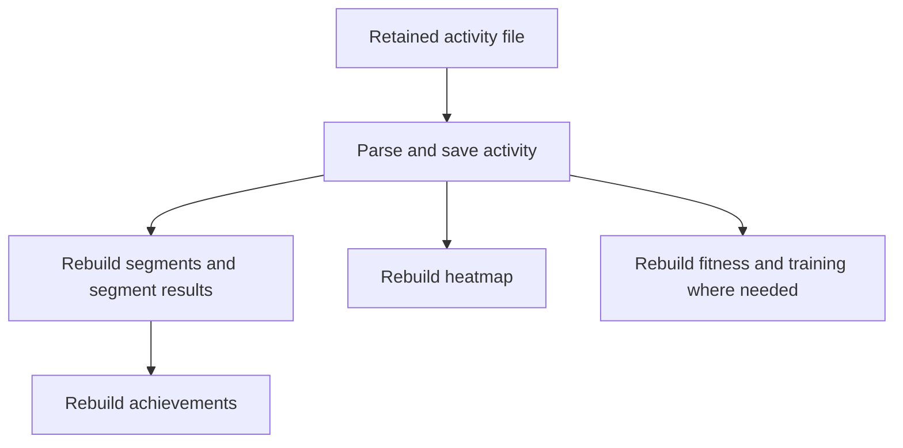

# Background work and Strava integration

- This specification owns background processing, Strava integration, and retained
  activity sources. [The TODO](../TODO.md#worker-conversion) owns outstanding work;
  [the rollout record](../worker-rollout-2026-10-16.md) owns dated evidence.
- **Design decision, 2026-10-17:** treat ingestion as repeatable, low-consequence
  work. Read the activity file, process it, and call the downstream tasks.
  A developer should be able to follow that sequence in one workflow.
- This replaces the earlier execution-accounting, shared-output coordination,
  cancellation-handshake, and exact batch-result requirements. The Bike task
  code implements this sequence. The [2026-10-17 cutover](../worker-rollout-2026-10-16.md#2026-10-17-simple-worker-cutover)
  records production verification.

## Ownership and runtime

| Boundary                       | Strava            | Bike tasks                                   |
| ------------------------------ | ----------------- | -------------------------------------------- |
| Workflow/Activity registration | `strava-temporal` | `bike-temporal`                              |
| Task queue                     | `bike-strava`     | `bike-tasks`                                 |
| Workflow ID prefix             | `strava-`         | `bike-`                                      |
| Object keys                    | `strava/`         | `activity-imports/` and retained `archives/` |

- Keep both pollers in the existing `temporal-worker`, sharing the SDK connection,
  database pool, object store, and metrics. Preserve coordinated process shutdown.
- Run domain Activities on Tokio's blocking pool so parsing and segment matching
  cannot starve Temporal polling, timers, or health requests. The Bike queue uses
  two native Activity slots within the existing worker resource budget.
- Give Bike Activities a 30-minute Start-To-Close timeout for whole-archive and
  segment rematching work. Keep the provider RPC timeout independent.
- Temporal owns running work, retries, child execution, and status. PostgreSQL
  stores activities and other business data. Do not build a second execution
  system in database rows, audit JSON, or storage descriptors.
- Controllers accept requests and return a job reference. Workflow methods show
  the processing steps. Activities call existing services/models; models own
  queries, transactions, uniqueness, and replacement writes.
- Strava owns provider intake, OAuth, fetching, normalization, and connection
  checks. Its workflows call the same neutral domain computations as file imports.
  Share domain operations and a small typed SDK helper without a generic DAG engine.
- Temporal UI shows running/failed work and child steps. Bike retains source
  metadata, downloads, and useful activity-change history. Link recorded namespace
  and workflow IDs through `TEMPORAL_UI_URL`; never invent a job ID from an
  activity ID. Without a recorded job, link the configured namespace list.
- All Bike producers submit to Temporal. The SQL worker, queue, batch tracking,
  stage executor, recovery loops, and task administration API are retired.

## Processing flow

- The Bike task workflow calls these named operations explicitly, through
  Activities or child workflows where a task has its own steps. Reuse the existing
  registered task names; an achievement operation does not require a new queue,
  registry, or scheduler.
- Save the activity before starting derived work. Achievements that depend on
  segment results run after that segment work. Independent children may overlap,
  with bounded concurrency.
- A request-owned parent normally awaits its children and returns or fails.
  While work is in flight, it is simply running. The API already returned after
  acceptance; it does not wait for computations.
- Derived data may become visible at different times. If a later step fails,
  preserve the source and successful effects, show the failed step in Temporal,
  and retry. There is no atomic all-output publication requirement.
- Reprocessing may parse the file again and rebuild already computed outputs.
  That is an accepted cost. Prefer this to recovering an exact previous execution
  result or coordinating every producer through shared output owners.

## Identity and causal context

- Pass the owned import/file reference and activity ID when known. New imports
  resolve the activity during save; reprocessing preserves its activity/import IDs.
- Use a stable native workflow identity for a retry of the same submission.
  Include the target in that identity so different activities cannot attach to
  the same job. An intentional rerun can start a new execution.
- Keep useful owner, actor, workflow/run, and trace IDs in existing inputs/logs.
  No separate command registry, admission ledger, contributor list, or persisted
  command snapshot is required.
- A duplicate submission may return its existing native job. Do not require
  reading and decoding the first history event just to acknowledge every start.
  Authorization remains an ordinary owned-record check.

## Fast durable acceptance

- Bike retains the input file, starts the workflow, and returns HTTP 202 with
  the native job reference after acknowledgment. Parsing and derived work run
  in the worker. Worker downtime does not require synchronous execution in the API.
- A failed or uncertain start returns an error; retain the file for retry.
  Do not acknowledge work held only in API memory.
- Uploading the same retained file again starts processing when it has no saved
  activity yet. Completed imports return their existing activity as duplicates.
- Preserve the existing Strava inbox and its bounded callback acceptance.
  Its current 1.5-second deadline covers lookup, validation, and the durable event
  transaction within the two-second callback budget. Timeouts return non-2xx;
  canonical event deduplication handles another delivery.
- The inbox is an existing provider adapter, not a model to reproduce for every
  Bike task. Keep the registered callback aliases and native relay.

## Idempotent effects and activity history

- Parse retained bytes and save through ordinary owned-model operations.
  Use existing import/provider uniqueness, upserts, replacement writes, and
  transactions so repeating work does not create duplicate activities or efforts.
- Preserve ownership, user-edited fields, deletion, and privacy rules. Keep a
  local version check or lock where an observed domain race needs it; there is
  no universal execution-generation or exactly-once protocol.
- Reprocessing a retained file preserves the saved title and Training/Race
  selection. Initial imports use the file's title; re-reading it must not undo
  a later edit in Bike.
- Rebuild projections from current stored activities/efforts. Replacement either
  commits or rolls back. Keep the existing transaction fix for overlapping segment
  achievement updates and bounded bulk writes; simplicity does not require
  reintroducing the observed duplicate-key bug.
- When rematching removes a segment membership, refresh the removed segment too.
  Use the old/new IDs during the normal operation; when a retry no longer knows
  the old set, a broader rebuild is acceptable. Do not persist a result receipt
  solely to recover the original minimal refresh set.
- Activity-change history remains useful domain history. Preserve its existing
  transactional consistency, but remove execution decisions based on an audit
  entry's `refresh_scope`, exact original outcome, or one-audit-per-attempt count.
  A workflow does not need an audit record to prove its progress.
- Existing Strava source mappings, connection generations, and deletion state
  serve provider ownership/data rules. They are not a generic task ledger.
- No new execution, receipt, result, readiness, publication, or reconciliation
  accounting tables are part of this migration.

## Cancellation, recovery, and completion

- Use native retries and cooperative cancellation. An already executing Activity
  may finish and write data after cancellation is requested. Partial processing
  is acceptable; do not promise rollback or instantaneous interruption.
- Stop starting later work when cancellation is observed at normal step or batch
  boundaries. Preserve the file and completed effects for a later rerun.
- Remove custom commit-boundary/cancellation handshakes and special finalization
  protocols. Native status describes what happened; no separate cancellation
  accounting is required.
- Worker restart resumes native execution. A repeated Activity may reparse or
  recompute; ordinary domain writes make that safe. Exhausted failures remain
  visible for retry from the retained source.
- Completion means the workflow's own steps finished. It does not certify that
  every shared projection across Bike is simultaneously current.
- Strava's provider-specific cancellation behavior is described below. Its
  native cancellation tokens do not change Bike task cancellation or add a
  database handshake, result ledger, or shared-output coordinator.

## Reprocessing implementation

- `POST /admin/activity-imports/reprocess-activity` remains the entry point.
  It checks the owned retained source, submits the native workflow, and returns
  the job. Keep the existing UI command reuse for transport retries where useful.
- Read primary/supplemental files through the shared `ObjectStore`, verify their
  integrity, and reuse the parser and enrichment code.
- Source processing reparses the retained file in
  [source processing](../../bike-rs/bike-core/src/activity_reprocessing.rs) and
  the audit-result coupling in
  [the model operation](../../bike-rs/bike-core/src/entities/activities/reprocessing.rs)
  with straightforward repeated parsing/saving.
- The [workflow](../../bike-rs/bike-temporal/src/workflows/reprocess_activity_import.rs)
  shows source save → segments → achievements → heatmap → fitness.
  [Named derived steps](../../bike-rs/bike-temporal/src/workflows/steps/derived.rs)
  use awaited child workflows and Activities without scheduling RPCs or signals.
- Segment matching also refreshes the user's existing segment-summary scope.
  This broader rebuild covers a removed membership after a repeated matching
  attempt without retaining the earlier execution's result.
- Domain calls write their domain outputs only. No pipeline-output ledger remains.
- This changes the Bike workflow sequence and output inputs. Before deployment,
  stop new Bike submissions and drain open Bike workflows using the old worker.
  Start the new worker only after there are no open Bike task executions.
  Retired coordinator histories cannot be reset/replayed with the new worker.
  The native replay example applies to histories produced by this implementation.
- Preserve canonical source keys, activity/import identity, and valid user data.
  Native Strava sources stay on provider sync/backfill. Legacy files without a
  recorded checksum remain readable; verify their stored size and parse the file.

## Bike workflow composition and bounded batches

- Keep the [task inventory](../TODO.md#converted-tasks).
  Import and reprocess reuse source processing and downstream domain tasks.
  Collection workflows loop over items and call the individual task.
- Use ordinary paging or an archive-entry iterator and bounded child concurrency.
  A compact extracted-file index is fine when needed to find files; preparing an
  immutable command manifest for every user/batch is not required.
- Await children for the current page. A child failure remains visible and fails
  the parent; completed children are not rolled back.
- Use native Continue-As-New for long loops, carrying the selection, retained
  file reference, and next cursor. Repeating a page/entry is acceptable.
  Do not add exact settled-count, per-entry outcome, or cross-run result ledgers.
- Counts may help display progress but are not the recovery authority. Use source
  files, domain records, and native execution history to inspect or rerun work.
- User batches process 16 activities per page, awaiting each child before advancing
  the ID cursor with Continue-As-New. Training backfills calculate each activity
  in the same page loop. Archive workflows retain the ZIP in `archives/{job_id}.zip`,
  extract at most 16 files, await their imports, and continue with the next offset.
- A native schedule runs heatmap reconciliation every 15 seconds with overlap
  skipped. It pages pending projections and calls the ordinary heatmap child.

## Eventual consistency, debounce, and priority

- Accept temporarily stale fitness, segments, achievements, and heatmaps during
  processing. Read existing stored output; show native work status where useful.
- Explicit child calls are the default. Mandatory Signal-With-Start output
  coordinators, merge buffers, revision watermarks, and publication barriers are
  removed from the target design.
- Use existing native task priorities to keep archive/backfill work in the
  background where useful. Running work need not be preempted.
- Measure before introducing debounce or fairness tuning. A concrete performance
  problem may justify a small change later; a general accumulator/coordinator
  framework is not a prerequisite for processing a ride.

## Shared object storage and retention

- Reuse `ObjectStore` and compact `ObjectRef { path, sha256, bytes }` values.
  Keep existing logical keys, namespace ownership, and integrity verification.
  Source bytes belong in the retained store, not Temporal payloads.
- Keep canonical activity/import files available for reprocessing, including
  after failed or canceled work. Deleting native execution history must not
  delete the activity's retained source.
- Keep existing safe temporary-file cleanup. A new reference/pin inventory,
  workflow-history scan, or accounting-based garbage collector is outside this
  conversion. If uncertain whether a file is still needed, retain it.
- Reclaim obsolete scratch separately, using a clear storage rule that does not
  remove canonical files. Do not make storage redesign a dependency of ingestion.

## Large archive durability

- Retain the archive before processing. Stream extraction with bounded memory,
  save each activity file, and call the ordinary import task.
- Carry a compact entry/page cursor through native continuation. A useful native
  heartbeat may report extraction progress, but restarting extraction or repeating
  the current entry after interruption is acceptable.
- Preserve bytes so an expired download URL is not required for a rerun.
  Use normal import identity/upserts to avoid duplicate activities.
- No exact success/duplicate/failure accounting or custom pause/resume protocol
  is required. Verify bounded memory, multiple pages, a failed child, and restart
  from retained input; extend tests when an observed failure warrants it.

## Strava protocol and workflows

- Target intake is Strava → `/api/strava/webhook` → bounded durable acceptance.
  Preserve registered `/webhooks/strava-gateway` and `/oauth/gateway/callback`
  as aliases to native handlers, with existing ingress/TLS; no gateway code returns.
- Activity `create` / `update` / `delete` start dedicated native workflows.
  Athlete `update` with `authorized=false` disconnects without remote revoke.
  Other combinations and unconnected athletes are acknowledged and ignored.
  [Typed intake](../../bike-rs/bike-core/src/strava/events/intake.rs) and
  [client registration](../../bike-rs/strava-temporal/src/client.rs) own mapping;
  there is no generic Strava processor.
- Retain all activity summaries, including manual entries and non-cycling sports,
  with normalized sport, title, distance, duration, reported elevation gain,
  description, and gear ID/name when supplied. Missing gear name preserves its
  ID without another call. Store complete provider responses in object storage.
- Fetch streams only for recorded cycling activities. Manual/non-cycling summaries
  use empty streams; missing manual streams do not fail import. Invent no GPS or
  sensor data. Prefer reported elevation gain over samples. Apply the
  [central sport policy](supported-activities.md#central-activity-vocabulary-and-retention)
  to exclude non-cycling summaries from cycling calculations while keeping them
  visible in the feed; preserve unknown provider sports.

| Workflow                        | Input                      | Source steps and result                                                    |
| ------------------------------- | -------------------------- | -------------------------------------------------------------------------- |
| CreateActivity / UpdateActivity | Strava event               | Await Upsert child; return Bike ID/status                                  |
| UpsertActivity / DeleteActivity | Event + remote activity ID | Await source-keyed ReconcileActivity; return ID/status                     |
| ReconcileActivity              | Event + remote activity ID | Fetch → normalize → persist → refresh, or capture → delete → refresh       |
| SyncActivities                  | Event + saved offset       | List pages → await upsert children → commit offset; counts/new offset      |
| BackfillActivities              | Event + fixed range        | List range → await upsert children; counts without offset change           |
| DisconnectStrava                | Event + revoke flag        | Delete children → optional revoke → remove connection                      |
| ScheduledSync                   | Schedule context           | List connections → await sync children; per-connection results             |

- These are the nine workflows (Create and Update are separate). Review
  [their explicit implementations](../../bike-rs/strava-temporal/src/workflows.rs)
  and [typed Activities](../../bike-rs/strava-temporal/src/activities.rs).
  Call steps as `run(ctx, RevokeConnection, event).await?`; shared helpers adapt
  SDK failures/options and derive display names from registered markers.
- The workflow table describes the existing provider sequence. Keep its explicit
  fetch/normalize/persist/refresh shape when reusing Bike domain tasks. Per-item
  rebuilds are acceptable; shared-output coordination is not a conversion gate.
- Provider single-event parents await request-owned children and preserve the
  child's result: canceled preparation reports cancellation; a started mutation
  reports its actual completion or failure. Collections settle the current child,
  then stop before the next item or cursor update. Parent close requests child
  cancellation and waits for the child to settle.
- Native patch `strava-commit-boundary-v1` preserves retained histories. New
  provider runs check cancellation before preparation and shield a started
  mutation and its downstream steps with independent native cancellation tokens.
  Disconnect shields its initial state write and final revoke/removal separately;
  item boundaries remain cancellable. This does not promise atomic publication.
- SQL import recovery, bulk replay, and historical source repair must exclude
  `strava_sync`, including interrupted native publication. Use native sync/backfill;
  do not call legacy processors or create SQL continuation/checkpoint tasks.
- `strava_events.status` is authoritative mutation status: `pending`, `applied`,
  `unchanged`, `deleted`, `already_absent`, `superseded`. `captured` is transient
  deletion input. Use typed operations/mutation/attempt enums; count children by
  the status column rather than JSON or a status relation.
- Status and retry dependencies commit atomically. Connection/customer validation
  is split into named operations; DB failures remain server errors and missing
  customers are not found. Required remote IDs live on `StravaEvent`; source-state
  lookup/absence/content/supersession predicates live on the owning model.
- Scheduled scans continue starting later customers after a child-start failure,
  await every started child, and carry total failures through continuation.
  Cancellation remains cancellation; a nonzero final failure count fails the scan.
- Use primary-key-aware SeaORM save for import/artifact create/update; separate
  model construction, saving, and provider-artifact linking. Schema retirement and
  status promotion use new migrations; never rewrite migration history.

### Callback security

- `/oauth/gateway/callback` completes **Connect Strava**: verify Bike's signed
  OAuth `state`, exchange the authorization code with Strava, save the connection,
  and request sync. It does not authenticate webhook POSTs.
- Strava returns the OAuth `state` that Bike supplied; this is a Bike signature,
  not a Strava signature. State must also be bound to the initiating browser
  session, consumed once, and verified with the HMAC library's constant-time check.
- The webhook GET `hub.verify_token` check verifies subscription setup only.
  [Strava's published webhook protocol](https://developers.strava.com/docs/webhooks/)
  does not document a signature header for event POSTs.
- Subscription ID, athlete ID, event time, deduplication, and connection-generation
  checks do not authenticate the sender. TLS protects transport, not sender identity.
- Accept unsigned event POSTs on the registered callback routes. The absence of
  sender authentication is an accepted Strava protocol limitation, not a release gate.
  Do not require unavailable signatures or provider confirmation before processing
  supported delete and deauthorization events.
- Keep configured subscription checks, connected-athlete lookup, ownership and
  connection-generation validation, deduplication, and event ordering. These are
  processing checks; they do not prove the sender's identity.
- Track OAuth state hardening separately from webhook delivery. Cover webhook
  validation/deduplication and OAuth state protections with isolated mocked units.
- Connect creates a random, HttpOnly `strava_oauth_session` cookie and a signed
  state for the authenticated Bike user. The cookie is host-only, `SameSite=Lax`,
  has path `/` for both callback aliases, and lasts ten minutes. HTTPS uses the
  Secure `__Host-strava_oauth_session` cookie; sibling domains cannot set it.
- Verify the state signature and browser binding with `Hmac::verify_slice` before
  consuming it from the existing `oauth_states` store under provider `strava`.
  Reject malformed, future, expired, mismatched, or already consumed state before
  exchanging any provider code. Consume valid denied callbacks too; clear the
  cookie on every callback. A failed exchange requires a new Connect request.
- Test handler policy with fixture providers, in-memory object storage, and mocked
  persistence. No unit test opens a database or contacts a running service.

### Source ordering and reconciliation

- Retain raw `owner_id`, `object_id`, `object_type`, `aspect_type`, `event_time`,
  `subscription_id`, and `updates`. Interpret IDs by object type: an athlete
  deauthorization is not an activity. Deduplicate canonical payloads within the
  connection generation; owner/object/time alone can collapse distinct updates.
- Bike assigns event IDs. Event identity spans one operation; source identity
  spans create/update/delete. Persist the remote-to-Bike mapping in the same
  transaction as create, update, unchanged recognition, or deletion. Backfill
  known live mappings through owning connection/generation without inventing history.

| Stored timestamp                                | Meaning                                                      |
| ----------------------------------------------- | ------------------------------------------------------------ |
| State `event_time`                              | Last accepted provider event, epoch seconds                  |
| State `deleted_at`                              | Provider time of current deletion; cleared by a newer upsert |
| State `updated_at` / compatibility `applied_at` | Synchronized local write version, advanced on every write    |
| History `occurred_at`                           | Source event/manual change time                              |
| History `recorded_at`                           | Bike archive time                                            |

- Never compare local sync/backfill request/receive time with a provider watermark,
  or use activity start time as event order. Derive provider time only from the
  retained webhook; zero means unknown. Sync/backfill preserves the watermark,
  and a new connection generation resets it. Repair old mixed values from
  committed provider mutations, never from receipt or sync time.
- Upsert/Delete await a request-owned `ReconcileActivity` child keyed by owner,
  connection generation, athlete, and remote activity. A busy source retries
  after a native timer; distinct events each fetch and apply rather than attaching
  to another request's result. Continue a waiting parent after 128 attempts or
  Temporal's history suggestion, preserving its original event and job identity.
- Capture the source row version before provider I/O. Under the existing
  connection lock, return any committed retry result, then check that version.
  If the source changed, refetch using a response key containing the new version.
  Atomically advance the existing timestamp token on writes; no new table or
  execution ledger is required. A generation change clears an absent Bike mapping.
- The native `strava-source-reconciliation-v1` patch preserves retained inline
  histories. Drain started provider runs before the data repair and worker
  transition; keep callback acceptance available during deployment.
- Reject clearly older events within the same owner/object/generation. Deletion
  wins an equal-time upsert; only a strictly newer upsert restores it. Ignore
  deauthorization older than the connection; delayed old generations cannot write.
- Distinct equal-second provider updates may require another fetch. Keep the
  existing canonical deduplication and owned writes; do not introduce a universal
  source-serialization workflow as a condition of converting file ingestion.
- Preserve atomic deletion and provider state updates. Repeated processing or a
  broader derived rebuild is acceptable; exact recovery of the first mutation
  outcome is not a migration requirement.

## Temporal execution policy

- Immutable retained-input integrity and JSON decoding failures use the existing
  typed domain error (`422 Unprocessable Entity`); pure file parser failures are
  also terminal client errors. Missing immutable input is terminal. Native
  Activity error adaptation classifies these without matching message text.
  Backend I/O/timeouts remain server errors and retryable. Repair or recover the
  retained source before intentionally submitting new work; retries cannot fix
  the same checksum, size, or malformed bytes. Primary and supplemental sources
  obey the same rule before any mutation.
- [Shared platform policy](../../bike-rs/bike-core/src/platform/temporal.rs) owns
  named timeout constants and native retry-policy factories. Bike and Strava
  workflow options use these factories; workflow steps do not build policies.
- Keep retry settings explicit: initial interval, backoff coefficient, maximum
  interval, and maximum attempts. Attempts include the initial execution.
- Preserve current execution budgets:

| Activity role        | Execution timeout     | Heartbeat timeout | Retry factory             | Total attempts | Initial interval | Backoff | Maximum interval |
| -------------------- | --------------------- | ----------------- | ------------------------- | -------------- | ---------------- | ------- | ---------------- |
| Bike domain effect   | 2 minutes per attempt | None by default   | `activity_retry_policy()` | 12             | 1 second         | 2×      | 1 minute         |
| Strava domain effect | 2 minutes per attempt | 30 seconds        | `activity_retry_policy()` | 12             | 1 second         | 2×      | 1 minute         |

- These are current finite attempt budgets, not a guarantee of eventual success
  after every outage. Adapters distinguish permanent invalid input from transient
  failure. Policy factories do not implement private retry loops.
- Workflow/child executions have no automatic execution retry policy. Activities
  own effect retries; Workflow Task retry/replay stays native. A deliberate whole
  workflow retry creates another run and still needs domain idempotency.
- Provider `next_retry_delay` overrides computed backoff. Clamp expired waits to
  the shared initial interval. Heartbeat every **5 seconds**, below the shared
  **30-second** heartbeat timeout.
- Native SDK patch/version markers protect changed Strava decisions, including
  continuation inside a populated page, failed customer starts, input budgets,
  and future output handoffs. Old histories retain their previous decisions;
  verify replay rather than modifying deployed Activity sequences blindly.
- Verify emitted Activity options against the shared factories. Retry builders
  and named budgets stay out of steps.

## Payload and history budgets

- Retain raw activity responses, stream responses, normalized sources, and parsed
  activities in Bike's existing persistent upload-volume object store. Temporal
  carries their path, SHA-256, and byte count; source size does not affect input size.
- Limit each Strava value crossing a Temporal boundary to **256 KiB of serialized
  UTF-8 JSON**, including the complete event, nested values, and dependency IDs.
  This leaves room for SDK metadata below the server's warning threshold.
- Validate before durable webhook acceptance, workflow handoff, activity/child
  scheduling, continue-as-new, and returning activity results. Oversized callbacks
  return HTTP 413. Oversized worker values produce non-retryable application
  failures, with size and limit in the error and no provider body in the message.
- Temporal Server 1.32.1 defaults: payload warning **512 KiB**, payload rejection
  **2 MiB**, event-history transaction maximum **4 MiB**, history warning **10 MiB**
  or **10,240 events**, history rejection **50 MiB** or **51,200 events**. The deployed
  dynamic configuration does not override these limits. Source:
  [versioned server defaults](https://github.com/temporalio/temporal/blob/v1.32.1/common/dynamicconfig/constants.go)
  and [Temporal service limits](https://docs.temporal.io/self-hosted-guide/defaults).
- Sync and backfill list 100 activities per provider page. Continue as new after
  25 pages or the server's history suggestion. Check the suggestion after every
  completed child, preserving the remaining page IDs in continuation input.
  Carry the original fixed window, next page, counts, latest start,
  event/correlation IDs, request ID, and trace carrier. Advance the sync cursor
  only after the workflow's children finish. Backfill never advances it.
  Existing provider counts may remain; no extra result accounting is required.
- Scheduled scans continue as new after each 20-connection page. Await every
  started customer, carry failures and correlation ID into the next run, and fail
  the final run with the cumulative count when any customer failed.

| Temporal activity                                                                                                                    | Input → output                                                               |
| ------------------------------------------------------------------------------------------------------------------------------------ | ---------------------------------------------------------------------------- |
| `strava_fetch_activity`                                                                                                              | StravaEvent → ActivitySource (activity object reference)                     |
| `strava_fetch_streams`                                                                                                               | ActivitySource → ActivitySources (activity + streams references)             |
| `strava_normalize_activity`                                                                                                          | ActivitySources → NormalizedActivity (source + optional parsed reference)    |
| `strava_persist_activity`                                                                                                            | NormalizedActivity → ActivityChange (Bike ID, status, affected dependencies) |
| `strava_capture_deletion`                                                                                                            | StravaEvent → ActivityChange                                                 |
| `strava_delete_activity`                                                                                                             | ActivityChange → ActivityChange                                              |
| `strava_delete_source`                                                                                                               | ActivityChange → ActivityChange                                              |
| `strava_rebuild_activity`, `strava_rebuild_segments`, `strava_rebuild_fitness`, `strava_publish_heatmap`, `strava_complete_activity` | ActivityChange → ActivityChange; each method performs its named step         |
| `strava_resolve_collection_window`                                                                                                   | StravaEvent → CollectionInput (fixed date range)                             |
| `strava_list_activity_page`                                                                                                          | PageInput → ActivityPage (IDs, next page, latest start)                      |
| `strava_accept_child_event`                                                                                                          | ChildEvent → canonical StravaEvent                                           |
| `strava_complete_sync`, `strava_complete_backfill`                                                                                   | CollectionResult → CollectionResult; only sync advances the offset           |
| `strava_begin_disconnect`                                                                                                            | StravaEvent → up to 50 owned remote IDs; blocks new writes                   |
| `strava_revoke_connection`, `strava_remove_connection`                                                                               | StravaEvent → StravaEvent                                                    |
| `strava_scan_connections`                                                                                                            | ScanRequest → ScanPage (up to 20 customer sync events)                       |

- Typed domain values live in
  [`strava/native/types.rs`](../../bike-rs/bike-core/src/strava/native/types.rs).
  The table describes the existing provider Activity sequence. Changes must
  preserve retained-history compatibility; reuse domain operations without
  introducing a second execution accounting system.

## Logs, job visibility, and alerts

- Use **Strava event**, never receipt. `correlation_id` is the root Bike-assigned
  Strava event ID, unchanged through children; scheduled scans use their first
  native run UUID. Preserve `strava_event_id`, `bike_customer_id` (public UUID),
  `bike_user_id`, optional `bike_activity_id`, `strava_athlete_id`, and
  `strava_activity_id` separately.
- Add namespace/workflow/run/Activity/attempt IDs at their corresponding boundary.
  Provider exchanges add exchange ID, method/path, status, and provider request ID.
  Never log credentials or provider bodies. Typed inputs retain event/customer/
  activity context for acceptance, attempts, exchanges, and terminal results.
- Parent/child logs link both native workflow/run pairs and preserve root request/
  trace context. Lifecycle logs distinguish success, failure, cancellation, and
  continuation. Suppress replay logs without making workflow decisions depend
  on tracing state. Sort serialized carrier keys for byte-stable reconstruction.
- Use the [operation tracing contract](observability.md) for shared INFO stage
  names, selected IDs/counts, DB ancestry, and hotspot interpretation. Export
  existing Activity attempt spans under their registered step names; do not add
  redundant spans or instrument every helper/poll. Handoff success and failure
  use the same correlation span.
- Open the admin integration feed, select a user, and use **View job in Temporal**.
  Local UI: `http://localhost:8080/namespaces/bike/workflows`. Search
  `BikeCustomerId = 'customer-uuid'` or `StravaActivityId = 'remote-id'`; logs use
  the same IDs. Temporal owns execution status; accepted-event history records
  requests. Account sync status reflects connection state. Do not reconstruct
  retired SQL stages or fabricate completion events.
- While the inbox adapter is active, sample all `submitted_at IS NULL` events
  every **30 seconds**, including delayed retries. Export pending count, oldest
  acceptance time (zero when empty), and last successful sample time on the
  provider endpoint. Failed samples retain old values/time; IDs belong in logs
  and search attributes, not backlog labels. Monitor provider and SDK scrapes.

| Alert                             | Condition / response                                                                                                                                                                                                                                     |
| --------------------------------- | -------------------------------------------------------------------------------------------------------------------------------------------------------------------------------------------------------------------------------------------------------- |
| `BikeStravaWorkflowFailed`        | Terminal workflow failure in last six hours for one minute, including first series/reset. Warn through Alertmanager/ntfy; Activity retries do not page. Root/child can both alert. Inspect the failed step and partial effects before native retry.      |
| `BikeStravaHandoffStalled`        | Oldest accepted event over five minutes for five more minutes, with samples newer than 90 seconds. Check `strava.handoff`, `handoff_error`, Temporal/search attributes/DB; relay retries automatically. Never delete pending events or create SQL tasks. |
| `BikeStravaHandoffTelemetryStale` | Samples absent/older than 90 seconds for two minutes. Backlog health is unknown and backlog alert is suppressed. Check worker startup, provider endpoint, DB, and `Strava handoff backlog sample failed` logs.                                           |

## Verification and acceptance scenarios

- Use existing shared fixtures, PostgreSQL SeaORM mocks, object-store fakes, and
  the native SDK harness. Unit tests cover happy paths and concrete regressions.
  No SQLite substitute, separate E2E framework, or real provider calls in units.
- Test the actual readable workflow: parse/save before derived children, segments
  before dependent achievements, and a failed child visible as failure.
- Reprocess the same retained file twice: keep activity/import identity and
  correct outputs. Test a transient Activity failure, corrupt input, deletion/
  privacy checks, and rerun after partial completion. Repeated computation passes.
- Exercise a multi-page batch, a failed child, and continuation/restart from
  retained input. Do not require exact once-only counts or receipt reconstruction.
- Keep Strava's protocol, OAuth, ownership, payload-limit, and paging regressions.
  Their detailed fixtures remain in the existing suites; the superseded U/P
  accounting matrix does not govern the simplified migration.
- Use the owning Docker/mise unit tasks with fixture-backed workflow children,
  object storage, and PostgreSQL mocks. Local checks must establish the converted
  paths work without waiting for CI. Warnings, lint, and required hooks remain blocking.
- Before deploying changed workflow sequences, verify retained native histories
  still replay or drain the old runs. Use existing replay tools. For the actual
  converted path, verify one real file's downstream results and a worker restart.
  Mock success alone is not deployed evidence.

## Conversion and retirement gates

- The conversion includes every task in [the TODO](../TODO.md#converted-tasks),
  their producers, and removal of SQL queue/batch/stage/recovery/UI/build code.
- Preserve historical migrations. The new forward-only retirement drops execution
  and lock tables while preserving activities, imports, source files, and activity
  event history. Stop submissions and drain the old workers before applying it.
- Keep the combined `temporal-worker`. Prepare and validate the conversion locally;
  remote publication and deployment require the user's instruction.
- Record the focused checks, CI, and actual user-visible results for a deployment
  in the rollout record. Keep those evidence scopes distinct.

## References

- [Temporal Activity idempotency](https://docs.temporal.io/activity-definition#idempotency)
- [Workflow/run identity](https://docs.temporal.io/workflow-execution/workflowid-runid)
- [Rust SDK history patching](https://github.com/temporalio/sdk-rust/blob/main/crates/sdk/README.md#patching)
- [Retry policies](https://docs.temporal.io/encyclopedia/retry-policies)
- [Cancellation](https://docs.temporal.io/encyclopedia/workflow/cancellation-and-termination)
- [Activity heartbeats](https://docs.temporal.io/encyclopedia/detecting-activity-failures#activity-heartbeat)
- [Strava webhook contract](https://developers.strava.com/docs/webhooks/)
