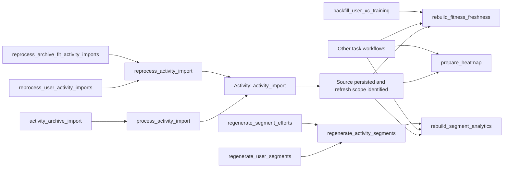

# Bike task workflows

- The [durable work contract](durable-work-contract.md) owns shared identity,
  idempotent effects, minimal persistence, cancellation, and provider boundaries.
  Its [unit scenarios](durable-work-contract.md#unit-acceptance-scenarios) and
  [findings](durable-work-contract.md#findings-requiring-closure) are acceptance
  criteria for implementation, not claims that the current proof of concept
  satisfies them.
- Finish `reprocess_activity_import` and its real domain/API/worker/derived-output
  path before broader rollout. Follow the
  [first-milestone gate](durable-work-contract.md#delivery-order-and-completion-gate)
  and stop for user review before the remaining conversions.
- All downstream activity projections are eventually consistent. Prioritize
  prompt fitness/segment/achievement refresh after a new ride; bulk imports and
  deletes may settle slowly. Follow the shared
  [responsiveness policy](durable-work-contract.md#responsiveness-and-eventual-consistency).

- Keep the task names in [the conversion plan](../worker-conversion-plan.md#task-inventory-and-conversion-order).
  Renaming any task requires the user's approval and an explanation. Rust type
  names may follow Rust casing; registered Temporal names match the plan exactly.
- The current implementation establishes typed workflow composition and handoffs.
  Production domain adapters, write fences, producer cutover, worker deployment,
  and retained-history recovery remain conversion gates.

## Workflows and Activities

| Task | Temporal Workflow name                   | Responsibility                                                                         |
| ---- | ---------------------------------------- | -------------------------------------------------------------------------------------- |
| 1    | `reprocess_activity_import`              | Replay retained input into an existing activity, then hand off derived requests.       |
| 2    | `rebuild_fitness_freshness`              | Debounce and refresh one user's fitness output.                                        |
| 3    | `rebuild_segment_analytics`              | Debounce and refresh one segment's analytics output.                                   |
| 4    | `prepare_heatmap`                        | Debounce and prepare the current generation of one activity.                           |
| 5    | `regenerate_activity_segments`           | Rematch an activity and hand off affected segment analytics.                           |
| 6    | `regenerate_segment_efforts`             | Page affected activities and call #5 for one segment generation.                       |
| 7    | `backfill_user_xc_training`              | Page activity training analysis, hand off fitness changes, then finalize the backfill. |
| 8    | `process_activity_import`                | Import retained input as a new activity, then hand off derived requests.               |
| 9    | `reprocess_user_activity_imports`        | Page retained user imports and call #1.                                                |
| 10   | `reprocess_archive_fit_activity_imports` | Select only archive FIT imports and reuse #1 through the same page mechanism.          |
| 11   | `regenerate_user_segments`               | Page a user's cycling activities and reuse #5.                                         |
| 12   | `activity_archive_import`                | Retain archive and manifest references, then page entries through #8.                  |

- Task 0, `email_notification`, remains a retirement item with no replacement
  workflow. All production conversion statuses remain separate from these
  proof-of-concept definitions.
- `activity_import` is an explicit reusable **Activity**, not another task name.
  Both import workflows invoke it. Its typed target distinguishes new activity
  creation from reprocessing an existing activity at an expected revision.
- The Activity owns parsing and conditional domain persistence. It receives a
  retry-stable command ID, owner/import identity, and a shared-storage reference.
  It does not schedule derived work or submit SQL tasks.
- A successful Activity returns the committed activity/import identity and typed
  fitness, affected-segment, and optional heatmap requests. Reuse existing output
  freshness/version fields where needed; an activity version does not describe a
  whole user's fitness or a shared segment. Do not add a ledger per output.
- A retry after commit must preserve one business effect and enough refresh scope
  for eventual convergence. Use model keys/versions, a retained plan, or an existing
  result as appropriate; persisting every complete Activity result is not required.
- Each workflow declares its steps explicitly. Any later workflow may call the
  same Activity or request these derived workflows in its own order.
- Activity options use named constants and factories from the shared
  [Temporal execution policy](temporal-execution-policy.md), including the
  domain effects and handoffs. Keep SDK policy construction out
  of orchestration steps.

## Review from the workflows

- Start at [the workflow index](../../bike-rs/bike-temporal/src/workflows.rs).
  Each task has its own file and registered name. Review its `run` method first.
- Named [application steps](../../bike-rs/bike-temporal/src/workflows/steps.rs)
  compose typed effects and derived-output handoffs. Both imports use one
  `refresh_import_outputs` sequence, whose fitness/segment/heatmap steps remain
  individually reusable by other workflows.
- [Batch paging](../../bike-rs/bike-temporal/src/workflows/batches.rs) and
  [typed child calls](../../bike-rs/bike-temporal/src/workflows/children.rs)
  own shared SDK options, stable child IDs, cancellation, result awaiting, counts,
  and continuation. Workflow call sites name the page Activity and child Workflow;
  they do not repeat SDK builders or implement private task queues.
- [Activity adapters](../../bike-rs/bike-temporal/src/activities.rs) are separated
  into imports, derived data, segments, training, and archives. Each adapter calls
  a typed domain operation. Concrete implementations must enforce idempotency and
  write fences; they must not call legacy queue/lock/barrier orchestration.

## Shared bounded batches

- Prepare a retained immutable manifest once per command. It fixes eligible
  inputs, stable entry command IDs, resource revisions, selection, and ordering.
  Page readers return references and small typed commands, never archive bytes
  or route payloads in workflow history.
- Bind each manifest to the parent command and selection. A continued archive-FIT
  workflow must reject a general user-import manifest. User, training, segment,
  and archive selections cannot substitute for one another.
- Read at most 16 entries per page. The reader must return exactly the expected
  number of entries through the manifest boundary; truncated/oversized pages
  fail instead of silently skipping inputs or reporting success.
- Validate the whole page before starting work: entry command IDs belong to the
  parent, IDs within the page are unique, and entries match the manifest's scope.
  Preparation must enforce global entry uniqueness across the retained manifest.
- Reprocessing and archive parents await existing import child workflows.
  User and global-segment regeneration parents await the same per-activity
  segment workflow, with `All` or one specific segment generation respectively.
- A global segment manifest may include activities from multiple users, including
  previous effort holders that no longer match. A user segment manifest includes
  only that user's selected cycling activities. The per-activity domain operation
  commits matching and per-activity analytics together, then hands off global
  segment analytics through its existing debounce workflow.
- Training backfill uses the same page loop with per-activity training Activities
  and optional fitness handoffs. Only after every page settles may it record
  successful goal/backfill completion. Errors and cancellation prevent that
  completion effect; native workflow status remains the execution authority.
- Await one child/Activity at a time in this proof of concept. Advance the cursor
  and counts only after the page settles. Child-start and execution failures
  fail the parent; starting a duplicate child is not proof of successful work.
- Accepted cancellation stops new source work/handoffs and propagates to owned
  children. A batch accepts it at a safe boundary between items; the current
  apply/handoff step must settle before that boundary. Preserve completed items.
  Follow the [cancellation contract](durable-work-contract.md#cancellation-recovery-and-completion).
  Test both cancellation before apply and a request racing the cutoff (F4, U12–U14).
- Continue-As-New only after a settled page, after 16 pages (at most 256 entries
  per run), or when the SDK suggests continuation. Carry the retained manifest
  and settled count; no live children cross the boundary.
- Archive manifest preparation uses the shared manifest execution timeout and
  heartbeat timeout. Its domain implementation must stream through
  shared storage and resume safely from older heartbeat details. References
  remain retained across worker loss and continuation; do not delete source bytes
  at parent completion. The shared storage lifetime/reference policy owns cleanup.
- Batch counts describe settled source/matching/training operations and accepted
  handoffs. They do not wait for aggregate publication. Conditional domain writes
  and real archive crash drills remain checks for their owning conversions.

## Handoff and completion

- Apply the shared [identity contract](durable-work-contract.md#identity-contract)
  and [fast durable acceptance](durable-work-contract.md#fast-durable-acceptance)
  rules. Correlation and source identity exist before a Bike activity ID; no
  import-attempt lifecycle is needed to create that link.
- API submission uses the native client directly. Return a typed
  `JobReference` after Temporal acknowledges acceptance; recording is owned by
  the workflow's Activities, not the API request transaction.
- [`TaskSubmissionService`](../../bike-rs/bike-temporal/src/submission.rs) exposes
  named `process_activity_import` and `reprocess_activity_import` operations.
  Callers pass the domain command and one captured `TaskCause`. The service has
  no database dependency, receipt table, admission gate, or cancellation
  compensation for failed recording.
- Public job identity is Temporal's client-selected **Workflow ID**. Retain
  namespace and the acknowledged **Run ID** for observability; a later reset or
  Continue-As-New can change the run without changing the business command.
- Root starts and shared child helpers derive IDs from task name, affected user,
  and retry-stable command ID. A command ID identifies one immutable operation;
  every legitimate update, delete, or new reprocessing request needs its own ID.
- Root submission uses native `UseExisting` conflict and `RejectDuplicate` reuse
  policies. A running duplicate returns the existing run; an already-started
  response for retained closed history returns its native reference. Retrying
  HTTP submission does not automatically restart a failed command. Recovery uses
  Temporal's existing execution or an explicitly new domain command.
- The original accepted workflow input wins on duplicate submission. Temporal
  does not compare payloads or replace the original actor/context. Producers must
  not reuse a command ID for changed work. Domain uniqueness and safe replacement
  protect repeated effects even after workflow-history retention expires.
- Both import workflows call the same `activity_import` Activity. The target
  operation uses existing source keys, model versions, and transactions for safe
  repeated writes. Preserve sufficient refresh scope using a plan, version,
  existing result, or broader rebuild. Follow
  [minimal persistence](durable-work-contract.md#idempotent-effects-and-minimal-persistence);
  no general outcome table or per-request derived-readiness record is required.
- At reviewed head `93b93db9`, the wrapper instead records a `started` native
  `activity_import_attempts` row, calls an unimplemented domain adapter, and marks
  the row completed. That does not implement domain idempotency (F5).
  Simplify native use to model-owned effects in the first conversion; do not
  copy SQL stages/claims/checkpoints into the new worker. Preserve legacy history
  and fields required by unconverted tasks until their consumers retire.
- Concrete import operations also append the typed import/reprocess event to
  [shared activity history](activity-event-history.md) in their domain-write
  transaction. Include the command's native execution and causal context.
- Transaction/recording failures use native Activity retries. Exhausted retries
  remain visible for operator retry or existing reconciliation. Reuse domain
  freshness fields where useful; no new recovery service is a prerequisite.
  Temporal owns execution status; PostgreSQL owns business data/history.
- Temporal workflow-ID deduplication is bounded by retained history. Domain
  idempotency must remain correct after that history expires. See
  [Temporal workflow identity](https://docs.temporal.io/workflow-execution/workflowid-runid)
  and the [money-transfer example](https://learn.temporal.io/getting_started/go/first_program_in_go/).
- Derived Signal-With-Start handoffs retain their shared resource identities and
  debounce behavior. Submission of other task types and propagation through
  children/derived workflows remain producer-cutover work.
- Unit tests use shared DTO fixtures, mocked repository outcomes, native SDK
  Activity environments, workflow replay, and fake RPC transport. They do not open
  SQLite or emulate PostgreSQL commit failures.
- Review boundary: the API still constructs the SQL-backed `JobQueue` in
  `api/src/storage.rs`; for example, its reprocess endpoint calls
  `state.tasks.reprocess_activity_import`. The Temporal functions in
  `bike-temporal/src/client.rs` have no API callers or deployed Bike worker yet.
  Workflow definitions and fake-adapter checks do not establish API cutover.
- Preserve a small typed task submission interface at application call sites.
  Capture causal context once at its boundary; controllers should not construct
  Temporal SDK options, transport headers, or repeated logging metadata.
- Before activation, define shared durable causal metadata for API and non-HTTP
  producers: command/correlation identity, receive time, optional request ID,
  initiating actor, affected user, and W3C trace context. Keep authenticated actor
  identity distinct from the owner affected by an administrator's command.
- Carry that context through workflow starts, Activities, child starts, derived
  Signal-With-Start handoffs, retries, replay, and Continue-As-New. Include native
  namespace/workflow/run/Activity/attempt identities in the corresponding logs
  and spans, and expose useful correlation fields through Temporal visibility.
- Debounce combines multiple causes. Keep useful bounded log/trace links without
  attributing shared work exclusively to the last caller. A durable contributor
  ledger is not required for eventual refreshes.
- Current import submission carries this causal context into the root workflow
  and transitional import-attempt record. Other command types and derived/child
  handoffs still need shared propagation. Existing SQL `PipelineContext` and Strava's
  event/trace handling provide reference behavior, not proof that the Bike native
  handoff already retains it. Require focused propagation/fan-in tests and live
  API-to-workflow trace evidence before a task's producer cutover is verified.

- Import workflows finish after derived requests are durably accepted. They do
  not await derived publication; source batches follow the same rule. Existing
  freshness information can show refreshing data without per-request receipts.
- Use one stable Workflow ID per user for fitness, per segment for analytics,
  and per activity for heatmap. Shared segments must converge even when changes
  come from different users or parent workflows.
- Producers use native Signal-With-Start with `UseExisting`. Repeated parent
  calls reach the same named output workflow, including after the parent closes.
- Signal-With-Start is a client RPC in the pinned Rust SDK. The small typed
  scheduling Activities perform that atomic RPC and return after acceptance.
  They do not execute the derived operation, wait for its publication, use a SQL
  bridge, or create a private queue.
- Retrying a partially completed segment fanout resubmits the same output
  revisions. The receiving workflows deduplicate those requests.

## Debounce and priority

- Priority is Temporal's native Workflow/Activity priority option. New activity
  fitness/segment/achievement refreshes have high priority (1); archive, historical
  import, deletion, and background refreshes have lower priority (5) and may wait.
  Existing domain privacy/access rules remain independent of computation priority.
- An archive entry is not an urgent new ride merely because it is newly inserted.
  Propagate its bulk/background priority through derived handoffs. Interactive
  single-activity reprocessing retains its requested refresh priority.
- Debounce is Temporal's [signal and resettable timer pattern](https://docs.temporal.io/design-patterns/updatable-timer),
  not a server debounce setting. Each named derived workflow owns its pending
  typed request, durable timer, and published revision. There is no generic
  task-type coordinator or independent running-task state machine in Bike core.
- Initial configurable windows remain 2s quiet / 10s cap for new activity and
  60s quiet / 5m cap for deletion/background. Tune these after the working proof
  of concept; backlog aging and performance policy are follow-up work.
- Merge revisions and urgency; fitness also keeps the earliest dirty date.
  Requests for the same revision do not extend the deadline. High-priority
  arrivals advance a pending low-priority flush; low-priority requests do not
  postpone a high-priority flush.
- Five quick requests for one output produce one rebuild. Requests arriving
  during a rebuild merge into one follow-up. Published revisions do no more work.
- Temporal records signals, timers, Activities, retries, and cancellation.
  Continue-As-New carries pending requests, deadlines, and publication state
  only after active work settles. Changes that supersede a rebuild must be covered
  by its follow-up or the existing reconciliation path, not silently lost.
- Give each processing Activity its current batch priority/fairness and disable
  eager dispatch so native matching applies. Priority does not preempt running
  Activities. Broader starvation/aging policy and deployed measurements remain
  explicit follow-ups; do not implement a parallel priority scheduler.

## Validation and remaining work

- The acceptance matrix is [U01–U26 and P01–P04](durable-work-contract.md#unit-acceptance-scenarios).
  Link concrete tests/evidence to those IDs and the first-milestone gate. Existing
  mocks cannot establish atomic domain writes, unique source identity, or live
  crash recovery. Implementation simplicity is a review criterion as well as
  behavioral correctness.
- Unit proof uses the pinned SDK workflow runner, shared fixtures, and fake
  domain/RPC adapters. Assert actual Activity and timer commands, the exact task
  names, handoff ordering, duplicate bursts, priority changes, replay, continuation,
  cancellation, and requests arriving during execution.
- Cover each named workflow's happy path and shared-batch recovery: more than one
  page, restart during a child, continuation with the same manifest, failed child
  start/execution, empty snapshots, invalid pages, selection substitution, and
  global-segment work across users. Large-manifest fixtures are synthetic;
  they do not establish real archive streaming, disk usage, or crash durability.
- Real idempotent domain writes, worker registration/deployment, producer migration,
  safe cancellation, and eventual output convergence remain required before a
  production conversion. Prove only the persistence mechanism actually chosen;
  an outcome ledger and derived-readiness wait contract are not prerequisites.
- Shared storage/TTL behavior remains in the shared storage service. Complete
  the [Strava follow-up](../TODO.md#worker-conversion) after the Bike conversions.
  Correctness fixes F1–F4 and affected shared-output routing must not be deferred
  to that later storage cleanup.
