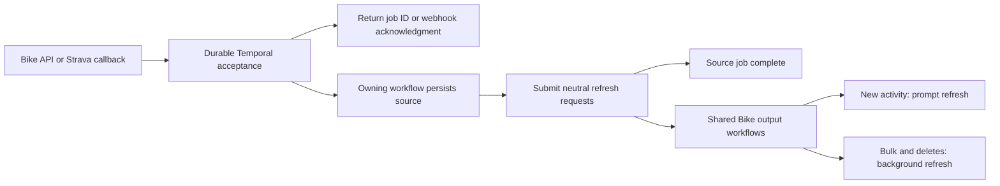

# Durable Bike work and provider integration contract

## Scope and implementation status

- Shared contract for [Bike tasks](bike-task-workflows.md) and
  [Strava](strava-temporal.md). Provider workflows remain separately owned.
- Finish `reprocess_activity_import` end to end before broader Bike rollout.
  The [conversion plan](../worker-conversion-plan.md) owns task status.
- Review baseline: [PR #64 at `93b93db9`](https://github.com/ericbutera/bike/pull/64).
  Bike has workflow/submission groundwork but no production import adapter,
  API cutover, or registered/deployed Bike Temporal worker. Strava is already native.
- Requirements and test scenarios below are targets, not implemented fixes or
  passing new tests. Preserve migration history, retained inputs, and deployed
  Strava histories when implementing them.

## Responsiveness and eventual consistency

- Analytics, fitness, segments, achievements, heatmaps, and other downstream
  activity projections may be temporarily stale and finish independently.
  Do not require an atomic switch of all outputs or a readiness receipt per request.
- Newly finished activities should refresh fitness, segments, and achievements
  promptly so the rider can review the result. Give these refreshes high priority
  and short coalescing windows; heatmaps use the same activity-change handoff.
- Archive imports, historical backfills, maintenance, and deletes use background
  priority and longer coalescing windows. They may take a long time. A new ride
  can promote pending work for the same user or output.
- Start with the existing configurable windows: new activity **2s quiet / 10s cap**,
  priority **1**; background/bulk/delete **60s quiet / 5m cap**, priority **5**.
  These are batching defaults, not publication deadlines. Tune from observed
  rider latency and redundant rebuild counts, without building another scheduler.
- API acceptance waits only for durable submission. Import completion means
  source persistence and accepted refresh requests. Batch/sync completion and
  offset advancement wait for source children and their handoffs, not aggregate
  publication. Show refreshing/stale state where useful; use existing freshness
  information rather than building per-caller publication tracking.
- Rebuild from authoritative current state. Repeated computation is acceptable;
  duplicate business records or permanently lost changes are not. Normal retries
  must converge, and exhausted failures must remain visible and retryable.

## Simplicity and ownership

- Temporal owns execution status, scheduling, retries, timers, child execution,
  continuation, and cancellation. A simple task can be one workflow and one
  Activity. Add shared resource workflows only where they coalesce useful work.
- Keep controllers thin: authenticate, validate, capture context, submit, return.
  Keep queries, uniqueness checks, and atomic writes on the owning domain model.
- Strava owns callbacks, OAuth, quotas, fetching, normalization, sync/backfill,
  and provider deletion/reconnection rules. Bike owns domain and derived computations.
- Use a small neutral change request: affected Bike user/activity/segments,
  priority, and existing freshness/version information where needed. Share output
  coordinators across producers; do not pass `StravaEvent` into Bike computations.
- Keep `bike-strava` and `bike-tasks` code, worker registration, and queues separate.
  Share domain operations, storage, fixtures, and SDK helpers.
- Reuse natural keys, versioned records, upserts/replacements, and transactions
  before adding persistence. No generic admission, receipt, attempt-stage, lease,
  completion-ledger, or per-request recovery framework is required.
- Keep large bytes in shared durable storage and pass references. Reuse bounded
  manifest paging for batches; do not create another batch engine.

## Identity contract

| Identity                      | Meaning                                                                        | Required behavior                                                                                                                    |
| ----------------------------- | ------------------------------------------------------------------------------ | ------------------------------------------------------------------------------------------------------------------------------------ |
| Source                        | Provider, remote owner, object type, object ID; scoped to the owning Bike user | Exists before a Bike activity. Enforce a unique owned mapping with existing source records.                                          |
| Connection generation         | Authorization lifecycle                                                        | Reject delayed work from an earlier connection. Reuse the existing provider fence.                                                   |
| Bike activity ID              | Local domain record                                                            | Optional at intake; stable across updates/reprocessing. Resolve/link it when persisting.                                             |
| Command/event key             | One logical operation                                                          | Reuse across delivery/Activity retries; intentional new work gets a new key. Strava has no supplied unique event ID.                 |
| Workflow/job ID               | Accepted command or shared output resource                                     | Derive command IDs from task/user/command; key shared refreshes by user/segment/activity.                                            |
| Correlation ID                | Diagnostic causal link                                                         | May equal the root command ID; propagate as small context. It is not an idempotency or authorization key.                            |
| Request/trace/run/attempt IDs | Delivery/execution diagnostics                                                 | They can change on retries without creating a new business operation. Keep actor distinct from affected user.                        |
| Domain version                | Version of the data being replaced or computed                                 | Use existing model versions or add one where a real stale-write race requires it; do not prescribe a new revision ledger per output. |

- No local activity ID or import-attempt lifecycle is needed to acknowledge work.
- Capture the retained source/target identity and relevant parser version in the
  command. A checksum alone does not identify an intentional reprocess request.
- Native duplicate starts retain original input; they do not compare payloads.
  Return the canonical job and never imply that changed input replaced it.
  Enforce any domain conflict in the owning operation, without SQL admission plumbing.
- Retain useful root context through children/replay/continuation. Shared refresh
  logs can link contributing requests; a durable contributor ledger is not required.

## Fast durable acceptance

- Bike API: retain required input bytes, start Temporal with a stable command key,
  await acceptance, return `202` and a `JobReference`. Do not wait for processing.
  A failed/uncertain start may fail the API call; retry with the same key/input.
- Strava callback: keep the endpoint highly available and the request path small.
  Validate the supported event and do a bounded Temporal start. Return HTTP 200
  on durable acceptance within Strava's **two-second** response requirement.
  Reserve response time by setting the start timeout below that total budget.
- No provider fetch, parsing, analytics, or wait for a worker belongs in the
  callback. Worker downtime alone must not prevent an accepted start.
- If Temporal cannot acknowledge in time, fail promptly with non-2xx and let
  Strava retry the same identity. Do not send success for an event held only in
  memory. Strava retries up to **three total deliveries**; direct submission does
  not buffer an outage spanning those attempts. Existing sync/backfill can help
  recover live activities but is not guaranteed to reconstruct missed deletions.
- Direct submission is the baseline. The existing Strava inbox is an optional
  adapter if independent buffering is worth its cost, not a required pattern for
  Bike tasks or a rollout gate. If retained, its successful durable write is the
  acknowledgment boundary and its relay only retries Temporal handoff.
- A duplicate retained closed workflow returns its reference/status, not an
  automatic restart of failed work. Native history retention bounds start dedupe;
  domain uniqueness/idempotency still protects repeated effects afterward.

## Idempotent effects and minimal persistence

- Temporal can retry after a database commit whose completion reply was lost.
  Protect the effect with a natural unique key, an idempotent replacement/upsert,
  or an operation key on the existing domain/version record. A separate operations
  record is justified only when the model cannot otherwise represent the guarantee.
- Idempotency concerns business effects. Recomputing a projection, or advancing an
  internal version without changing visible data, can be harmless. A retry must
  not invent a fresh version that lets older content overwrite newer state.
- Apply related authoritative changes atomically. Check expected versions in the
  same transaction as publication where overlapping work can overwrite new data.
  Use model-owned constraints/conditional updates, not a task execution lock table.
- For versioned replacement, publish a complete selected version, then reclaim
  superseded data safely. Readers must select the published data. This is an
  available model technique, not a requirement to version every projection together.
- If using an existing stored result for idempotency, recheck it after acquiring
  the lock and before unchanged/superseded branches; never overwrite that result
  with a different retry outcome.
- Preserve enough information for required refreshes. A rematch from `{A,B}` to
  `{B,C}` must eventually refresh A too. Choose the simplest valid method: retain
  the old version, capture a small plan in Temporal before mutation and validate
  its source version when applying, record the affected scope with the mutation,
  or rebuild a broader authoritative scope. A full serialized outcome is not
  universally required, and current rows alone cannot recover discarded membership.
- Reuse existing source mappings/tombstones and freshness/dirty fields. Domain
  audit follows the existing history contract; it is not a second execution log.
  Remove redundant native dependence on SQL attempt stages as consumers migrate.
- Finite retry exhaustion is visible failed work. Use the native retry/operator
  recovery path or an existing reconciliation loop. Do not mandate a new SQL
  ledger or autonomous repair service for every command/termination scenario.

## Cancellation, recovery, and completion

- Accepted cancellation stops new request work and propagates to request-owned
  children/Activities. Do not start new refresh handoffs after accepting it.
- For a single source mutation, allow cancellation while queued or in separate
  preparatory work. Close that window before invoking the mutating Activity and
  its small refresh requests. A racing later request is too late, not successful
  cancellation. The workflow owns that decision; a stale UI button cannot decide it.
- A native cancellation RPC acknowledges a request, not completed cancellation.
  Report the workflow's decision/status; do not present a pending or too-late
  request as canceled. Keep this decision in Temporal, without a SQL cancel ledger.
- Keep a combined parse/write Activity if that is simpler; its cancellation
  window closes before it starts. Split preparation only when useful for the task.
- Cancellation is cooperative: request stop, await acknowledgment/settlement,
  then report canceled. Use native cancellation policies and heartbeats for long
  Activities. Do not promise immediate interruption of an in-flight database call.
- Batches can cancel at safe boundaries between items, preserving completed
  imports. A request during an item's apply/handoff boundary waits for the next
  safe boundary before cancellation is acknowledged. Stop starting new items.
- Source completion waits for accepted handoffs, not downstream calculations.
  Shared output workflows may serve several requests; they are not cancellable
  children of one import. Once handed off, they own their background refresh.
- Ordinary worker loss resumes through Temporal history and idempotent Activities.
  Failed source/handoff work remains visible for retry. Existing scheduled refresh
  may repair stale projections, without being a continuation of a canceled request.
- No general post-cancellation finalization rule, rollback of completed imports,
  all-output transaction, or per-request derived-readiness barrier is required.

## Strava ordering and reconciliation

- Keep raw `owner_id`, `object_id`, `object_type`, `aspect_type`, `event_time`,
  `subscription_id`, and `updates`. Reuse the existing canonical payload key within
  a connection generation; owner/object/time alone can collapse distinct updates.
- Provider timestamps can reject clearly older events. Do not compare local
  sync/request time with a provider event watermark. Local arrival order does
  not establish provider order, and one Strava save can emit several events.
- Reconcile current provider state for updates. Coalesce/serialize one source
  where needed and use existing domain version checks to prevent a late fetch
  from becoming the final stale state. Avoid a generic ordering protocol.
- Preserve existing deletion/reconnection fences. Derived cleanup can run in the
  background; a stale retry must not recreate the deleted source. Existing privacy
  and access rules continue to belong to the provider/domain boundary.
- Route maintenance through neutral Bike requests. If changing deployed Strava
  Activity sequences, use supported version/patch mechanisms and replay histories.

## Findings requiring closure

- Reviewed on 2026-10-16 at `93b93db9`; not all findings originate in PR #64.
  The earlier 68 Bike workflow and 168 focused Strava test passes were mocked/unit
  evidence, not live database race proof. Findings specify behavior, not new tables.

| ID  | Reviewed behavior and consequence                                                                                                                                                                                                      | Required correction / acceptance scenarios                                                                                                                      |
| --- | -------------------------------------------------------------------------------------------------------------------------------------------------------------------------------------------------------------------------------------- | --------------------------------------------------------------------------------------------------------------------------------------------------------------- |
| F1  | [Strava persistence](../../bike-rs/bike-core/src/strava/native/persistence.rs) checks the stored outcome after supersession/content branches under the lock; an overlapping retry can replace `Applied` with `Unchanged`/`Superseded`. | Recheck the existing idempotency result first; U07, U08, P01. No new ledger is required.                                                                        |
| F2  | [Rematching](../../bike-rs/bike-core/src/activity_lifecycle.rs) derives old/new segment union from current rows; retry after commit can forget a removed segment.                                                                      | Preserve or reconstruct sufficient refresh scope; U09, P02. Choose a plan/version/domain record or broader rebuild.                                             |
| F3  | [Event construction](../../bike-rs/bike-core/src/strava/events.rs) uses Bike time for sync children; [state comparison](../../bike-rs/bike-core/src/entities/strava_activity_states.rs) treats it like provider time.                  | Separate clocks and make equal-second/overlapping work converge; U18–U21, P03.                                                                                  |
| F4  | [Cancellation test](../../bike-rs/bike-temporal/src/tests/imports.rs) suppresses handoffs after a late successful import, without a safe cancellation boundary.                                                                        | Test accepted cancellation before apply and too-late/deferred cancellation during apply/handoff; U12–U14, P04. Do not require work after accepted cancellation. |
| F5  | [Native attempt wrapper](../../bike-rs/bike-core/src/entities/activity_import_attempts/temporal.rs) records stages, while real import adapters and producer/worker wiring are absent.                                                  | Complete reprocessing with ordinary domain idempotency and a real runtime; U01–U08, P01, P04. Full outcome persistence is optional.                             |
| F6  | [Strava upsert](../../bike-rs/strava-temporal/src/workflows/activity_upsert.rs) performs per-item rebuilds instead of shared coalescing.                                                                                               | Neutral asynchronous refresh with priority and compatible history evolution; U15–U17, U22, P03.                                                                 |

## Unit acceptance scenarios

- Use existing `bike-core::test_support` factories, in-memory provider/storage
  fakes, mocked repositories, and the pinned Temporal harness. Execute production
  decisions with controlled clocks/completion order; no sleeps or provider calls.
- IDs describe behaviors to demonstrate, not mandatory infrastructure or existing
  passing tests. Map the scenarios applicable to each conversion to real test paths.
  Mock success alone does not prove persistence isolation or crash durability.

| ID / suggested test                              | Given / action                                                                                  | Required assertion                                                                                                                                                                                     |
| ------------------------------------------------ | ----------------------------------------------------------------------------------------------- | ------------------------------------------------------------------------------------------------------------------------------------------------------------------------------------------------------ |
| U01 `accepts_without_activity_id_or_worker`      | No Bike activity ID; fake Temporal accepts while worker is stopped.                             | Return job reference without parsing, fetches, rebuilds, or pre-start business mutation.                                                                                                               |
| U02 `lost_start_reply_reuses_job`                | Accepted start loses its reply; retry same command, including a retained closed job.            | Same logical job/original input; no automatic restart of a closed failure.                                                                                                                             |
| U03 `command_identity_is_not_correlation`        | Different commands share correlation; retry changes trace/run IDs.                              | Commands remain distinct; retries preserve business identity; owners never collide.                                                                                                                    |
| U04 `changed_input_cannot_replace_command`       | Same key with different source/target.                                                          | Duplicate start retains canonical input; no claim that changed input replaced it.                                                                                                                      |
| U05 `reprocess_preserves_domain_identity`        | Valid owned retained source and existing activity.                                              | Same activity/import IDs, correct parsed data, existing audit behavior, correct refresh scope and priority.                                                                                            |
| U06 `invalid_source_has_no_effect`               | Foreign/missing/corrupt source or invalid/stale command.                                        | Explicit failure/supersession, no business mutation or refresh; permanent input errors are not transient retries.                                                                                      |
| U07 `lost_commit_reply_is_safe`                  | Effect commits, reply is lost, retry runs again.                                                | One visible source/effect; valid refresh scope survives. Prove the chosen model's idempotency, without requiring a generic result table.                                                               |
| U08 `idempotency_is_checked_atomically`          | First lookup misses; another attempt commits before the lock is acquired.                       | Constraint/locked lookup prevents duplicate effects; an existing stored result is not overwritten by retry classification.                                                                             |
| U09 `rematch_retry_keeps_removed_segments`       | `{A,B}` becomes `{B,C}`; completion is lost.                                                    | Eventual refresh covers `{A,B,C}` using the chosen plan/version/scope, including A.                                                                                                                    |
| U10 `late_result_cannot_become_final_state`      | Older work finishes after a newer update or deletion.                                           | Conditional writes or reconciliation preserve current source/output state; no source resurrection.                                                                                                     |
| U11 `partial_handoff_retries_without_reimport`   | Some output requests accept; another fails.                                                     | Retry safely resubmits missing/duplicate refreshes; source effect is not duplicated; source job completes after acceptance.                                                                            |
| U12 `accepted_cancel_stops_owned_work`           | Cancel during preparation or between batch items.                                               | No new source work/handoffs; owned children stop; completed earlier items remain; parent is canceled.                                                                                                  |
| U13 `cancel_racing_apply_has_one_outcome`        | Cancel races with entry into apply/handoff.                                                     | Either cancellation wins before mutation, or it is too late/deferred to a safe batch boundary; never claim accepted cancellation while continuing request work.                                        |
| U14 `failed_work_can_converge_on_retry`          | Source/handoff/output retries exhaust, then operator retry or existing reconciliation runs.     | Failure stays visible; eventual output is correct without duplicate source effects; no new recovery ledger is needed.                                                                                  |
| U15 `mixed_producers_coalesce_refreshes`         | Upload, reprocess, and Strava burst for one user/shared segment.                                | Shared output owner reduces rebuild count, merges affected scope, and preserves the highest pending urgency.                                                                                           |
| U16 `inflight_changes_get_a_followup`            | Changes arrive during rebuild/replay/continuation.                                              | One merged follow-up covers new state; duplicate signals do not postpone it indefinitely.                                                                                                              |
| U17 `ingestion_does_not_wait_for_projections`    | Refresh requests accept while fitness/segments/heatmaps remain pending.                         | Import and source batch/sync can finish; offset can advance after successful source children; projections converge later without readiness receipts.                                                   |
| U18 `webhook_dedupe_keeps_distinct_updates`      | Repeat canonical payload with different JSON order; distinct same-second updates/create/delete. | Exact duplicates share identity; distinct changes still reconcile.                                                                                                                                     |
| U19 `sync_clock_is_not_provider_order`           | Bike clock ahead/behind during overlapping sync/webhook.                                        | Local request time cannot advance provider watermark or suppress valid source events.                                                                                                                  |
| U20 `same_second_updates_converge`               | Updates/sync overlap and old fetched content completes last.                                    | Latest authorized provider state eventually wins through the chosen serialization/version strategy.                                                                                                    |
| U21 `delete_and_reconnect_fence_stale_work`      | Delayed update after delete; reconnect with old work outstanding.                               | Deleted source is not recreated by stale work; previous connection cannot mutate; delayed derived cleanup eventually converges.                                                                        |
| U22 `provider_handoff_is_neutral_and_compatible` | Strava change and retained old workflow history.                                                | Domain refresh inputs contain no provider types; new flow coalesces; old history replays compatibly.                                                                                                   |
| U23 `context_survives_workflow_boundaries`       | Admin acts on another user; children/retries/continuation follow.                               | Actor/owner remain distinct and root context survives; shared refresh does not invent one exclusive caller.                                                                                            |
| U24 `batch_resume_keeps_manifest_and_counts`     | Multiple pages, failures, replay, older heartbeat, continuation.                                | Stable entries/counts, no skips, visible failures, retained bytes; completion does not wait for all projections.                                                                                       |
| U25 `intake_is_fast_and_failure_is_honest`       | Temporal accepts, times out, or loses a start reply during callback/user submission.            | Success only after durable acceptance; callback deadline stays below two seconds; failure returns promptly and retry reuses identity. Optional inbox variant must prove durable acceptance before 200. |
| U26 `priority_matches_rider_expectations`        | Background archive/delete burst followed by a new ride.                                         | Fitness/segment/achievement refresh gets short wait/high priority; pending work promotes; background work still progresses; no publication SLA is asserted.                                            |

## Persistence and runtime evidence

- Keep focused unit tests as the baseline. Use existing owning engine/runtime
  checks for the changed persistence and execution boundaries; no new universal
  test framework. Mocks alone cannot establish database or server guarantees.

| ID  | Required evidence when applicable                                                                                                                                                                                                                                                                                         |
| --- | ------------------------------------------------------------------------------------------------------------------------------------------------------------------------------------------------------------------------------------------------------------------------------------------------------------------------- |
| P01 | PostgreSQL: duplicate/concurrent source writes, rollback, and commit-before-lost-reply satisfy the chosen natural-key/version/transaction contract.                                                                                                                                                                       |
| P02 | PostgreSQL: replacement/deletion refreshes removed dependencies; delayed/repeated rebuilds eventually match current authoritative data without duplicate contributions.                                                                                                                                                   |
| P03 | Native Temporal with fake Strava: fast callback acceptance/failure, equal-second and sync ordering, mixed-producer priority/coalescing, and replay when provider workflow history changes.                                                                                                                                |
| P04 | Reprocess runtime: API acknowledges while worker is stopped; restart/kill after source commit or partial handoff and retry safely. Verify cancellation boundary, eventual rider-visible outputs, deployed image/migrations, and job status. Measure prompt new-activity refresh separately from relaxed bulk/delete work. |

## Delivery order and completion gate

- First implement the real reprocess adapter, API submission, worker registration,
  and shared derived dependencies. Complete the source/handoff job and demonstrate
  eventual outputs; do not introduce a per-request publication wait contract.
- Each converted task/output has one execution owner. Update its producers and
  drain/fence old execution before activation. Unrelated task conversions remain
  separate; provider storage/inbox cleanup does not block this slice.
- Address F1–F6 at the paths changed by each conversion, with their regression
  scenarios. Track untouched findings explicitly rather than claiming they passed
  or requiring the first slice to become a whole-system rewrite.
- Record applicable U/P IDs, test paths, commands, commit, results, and whether
  evidence is mock, engine, or deployed. Archive streaming/retention crash drills
  remain task-12 gates. Use owning Docker/mise checks; warnings/notices fail.
- Simplicity review: every added table/field must have a concrete domain purpose
  that existing keys, versions, transactions, or Temporal state cannot satisfy.
  No mandatory inbox, generic result ledger, contributor ledger, synchronous
  projection barrier, or new repair service.
- Complete reprocessing and stop for user review before broader rollout. Keep the
  PR open; this specification does not authorize deployment or integration.

## References

- [Temporal Activity idempotency](https://docs.temporal.io/activity-definition#idempotency)
  and [bank-charge/idempotency example](https://temporal.io/blog/idempotency-and-durable-execution):
  effect safety belongs in the called service/model; a separate operation record
  is an option when existing domain keys are insufficient.
- [Temporal workflow/run identity](https://docs.temporal.io/workflow-execution/workflowid-runid),
  [message passing](https://docs.temporal.io/encyclopedia/workflow-message-passing),
  and [resettable timers](https://docs.temporal.io/design-patterns/updatable-timer).
- [Temporal cancellation](https://docs.temporal.io/encyclopedia/workflow/cancellation-and-termination):
  cooperative cancellation, heartbeats, and child policy.
- [Strava webhook contract](https://developers.strava.com/docs/webhooks/):
  two-second acknowledgment, three attempts, payload fields, and multiple events per save.
