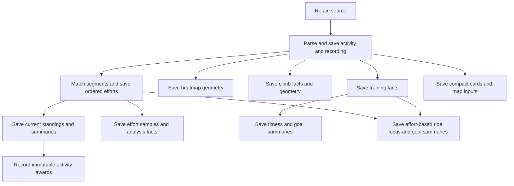

# Activity processing DAG

PR 100 is the implementation plan for a simple activity-ingestion DAG and fast,
schema-backed reads. The application and behavior before PR 100 are the baseline;
do not build a new baseline, orchestration framework, or replacement UI.

The remaining work is **save the missing outputs in named DAG steps, switch
backend reads to those outputs, then simplify the existing UI**.
[Implementation slices](../TODO.md#performance) own the remaining work.
[Loading findings](../TODO-fix-data-loading.md) own LOAD status.
[Background work](background-work.md) owns Temporal mechanics.

## Implemented foundation

Source review reconciled with main at `02b6c6483` on 2026-10-24. “Merged”
describes implementation, not a claim that production backfills have run.

| Merged work                                                                                     | Evidence                                                                                                                                                    |
| ----------------------------------------------------------------------------------------------- | ----------------------------------------------------------------------------------------------------------------------------------------------------------- |
| Retained source objects, parsers, Temporal processing, heatmap, training and fitness operations | Existing application baseline; extend these operations.                                                                                                     |
| Saved climb output, typed artifact references and report facts                                  | [110](https://github.com/ericbutera/bike/pull/110), [133](https://github.com/ericbutera/bike/pull/133) (P9). B3 still owns report reads.                    |
| Shared overall results, private personal reads and shared segment browsing                      | [120](https://github.com/ericbutera/bike/pull/120), [121](https://github.com/ericbutera/bike/pull/121), [122](https://github.com/ericbutera/bike/pull/122). |
| Typed immutable activity awards, explicit no-award output, saved chip order                     | [123](https://github.com/ericbutera/bike/pull/123); conversion storage still needs retirement.                                                              |
| Bounded rank and segment/rider summary writes                                                   | [125](https://github.com/ericbutera/bike/pull/125), LOAD01–02.                                                                                              |
| Activity-detail reads of saved ranks and personal bests                                         | [126](https://github.com/ericbutera/bike/pull/126), LOAD09. Missing saved values remain null.                                                               |
| Fixed segment geometry and creator-only metadata rename                                         | [127](https://github.com/ericbutera/bike/pull/127); renaming does not rebuild results.                                                                      |
| One effort input and atomic publication for segment analytics, personal and overall results     | [129](https://github.com/ericbutera/bike/pull/129), LOAD03. P6 #136 supplies changed-input retry before awards.                                             |
| Compact saved activity cards and previews                                                       | [130](https://github.com/ericbutera/bike/pull/130), LOAD14. Map-image requests are separate.                                                                |
| Stable effort identity and no writes for unchanged activity matches                             | [131](https://github.com/ericbutera/bike/pull/131), part of LOAD05. Historical pair writes and invalidation remain.                                         |
| Every valid traversal across matching profiles, returned in recording order                     | [134](https://github.com/ericbutera/bike/pull/134) (P3).                                                                                                    |
| Normalized recordings with typed references, import producers and focused backfill              | [135](https://github.com/ericbutera/bike/pull/135) (P1).                                                                                                    |
| Shared City/Commons matching fixtures, fixed segment GPXs and ordered traversal expectations    | [139](https://github.com/ericbutera/bike/pull/139). Ordinary matching unit coverage includes positive and negative pairs.                                   |

Producer implementations and remaining cutovers:

| Slice               | Implementation                                                                                                                              | Remaining cutover                                  |
| ------------------- | ------------------------------------------------------------------------------------------------------------------------------------------- | -------------------------------------------------- |
| P6 current results  | [136](https://github.com/ericbutera/bike/pull/136) (merged): changed-input retry, bounded segment batches and one affected-activity refresh | P13 outer upload caller and P14 historical caller  |
| P2 metadata/laps    | [137](https://github.com/ericbutera/bike/pull/137) (merged): typed metadata, ordered lap rows, import/edit producers and focused backfill   | B2 reads, U2 presentation and C1 legacy retirement |
| P5 candidate bounds | [138](https://github.com/ericbutera/bike/pull/138): indexed route bounds, conservative candidate queries and focused backfills              | P4 pair writes and P14 historical orchestration    |

P6 #136, P2 #137 and P5 #138 are merged into main. P4 #140 is in review.
Producer implementation does not establish production backfill
completion; the remaining consumer cutovers above keep their prerequisites.

[124](https://github.com/ericbutera/bike/pull/124) was closed without merging.
Its full-history scan and segment-wide replacement are not the target.
[128](https://github.com/ericbutera/bike/pull/128) added review guidance, not a DAG stage.

## Proposed flow

| Named operation                | Saved input                                                                     | Saved output                                                                                    |
| ------------------------------ | ------------------------------------------------------------------------------- | ----------------------------------------------------------------------------------------------- |
| Retain and parse               | Existing immutable source object                                                | Activity identity/metadata, ordered laps and normalized recording with typed artifact reference |
| Match segments                 | Saved recording and nearby fixed shared segment definitions                     | Every effort with stable ID, recording bounds, attempt number and metrics                       |
| Calculate current results      | Saved efforts for affected segments                                             | Current ranks, personal podiums, one overall place per athlete, period results and counts       |
| Record awards                  | This activity's ordered effort IDs and successfully published current standings | Existing typed award output and award rows, including no award and chip display order           |
| Prepare effort samples         | Saved efforts and recording                                                     | Prepared samples and scalar comparison/analysis facts keyed by effort                           |
| Prepare heatmap                | Saved recording                                                                 | Existing heatmap output                                                                         |
| Detect climbs                  | Saved recording                                                                 | Existing climb rows extended with missing report facts and typed artifact reference             |
| Calculate training and fitness | Saved activity/recording, rider settings and saved training facts               | Typed training facts, daily fitness values and compact goal summaries                           |
| Prepare cards and map inputs   | Saved activity/recording                                                        | Existing card/preview rows plus prepared map geometry and image identity                        |

### Stage boundaries

- Use existing named domain operations, Temporal retries and ordinary database
  transactions. Each operation reads saved inputs and commits its own result.
  Do not add a generic stage ledger, freshness scheduler or coordinator.
- Dependency order matters: awards follow successful standings publication.
  Changed source during calculation must retry; it must not look like successful
  empty work and allow a permanent no-award decision.
- Heatmap, climbs, cards and recording-only training calculations depend on the
  saved activity/recording, not successful matching. DH ride classification
  consumes saved efforts and must keep that dependency; goal summaries consume
  their saved training/results inputs. A ride with no matches still gets the
  independent outputs. Fitness depends on the training facts it consumes.
- Keep the existing replay-safe workflow evolution pattern when changing edges.
  Adding a stage does not require rewriting the workflow engine.
- Empty mutable outputs are successful results and clear obsolete rows. Repeating
  a stage preserves effort identity, saved award decisions and unrelated outputs.
- Source changes, deletion and retries must not publish stale computations.
  Use the owning model's transaction and a consistent lock order.

### Stage rollout and backfill

A producer slice includes its focused conversion/backfill using the same operation
as ingestion. Use existing bounded ID pages and Continue-As-New; advance only
after the page's writes and necessary downstream refresh finish. Do not reparse,
rematch or rebuild unrelated stages to add one saved output.

Historical segment matching finds nearby eligible activities across riders,
reconciles only processed activity/segment pairs, and refreshes affected current
results. It does not run award recording or change existing award decisions.

## Shared segment, activity and effort

- Shared segments have fixed geometry. Existing creator-only rename and metadata
  controls remain; independent per-rider favorites are a separate feature.
- A segment is a route definition; an effort is one traversal in one activity.
  Reuse existing effort relationships instead of adding duplicate membership tables.
- Overall standings are public to authenticated athletes. Personal results,
  recordings, comparison samples and private activity fields remain owner-scoped,
  as specified in [segment ownership](segment-processing.md#segment-ownership-and-visibility).
  Shared segments do not authorize cross-rider playback.
- Geographic filtering must be conservative and indexed before recording loads.
  Missing bounds do not mean no match. The
  [matching contract](segment-processing.md#incremental-matching-and-historical-activities)
  owns candidate paging, pair persistence and deletion behavior.

### Recording order and attempt numbers

Save every traversal in recording order, including mixed strict/drift-tolerant
laps, slow warm-ups and overlapping segments. A strict match must not suppress
another valid traversal needing a different existing match profile.

For `A → B → A → C → A`, retain `A #1 → B #1 → A #2 → C #1 → A #3`.
Ranking never renumbers attempts. Use the existing segment and recording bounds
to preserve unchanged traversal identity; removing an earlier attempt must not
transfer its ID to a later one.

## Historical achievements and current results

[Achievements](achievements.md#earned-awards) is the canonical award contract.
PR 123 already records decisions from current saved standings for the activity's
exact effort IDs. Do not replace it with historical as-of-date reconstruction
or reevaluate each lap against an invented earlier standings snapshot.

- Overall results contain one best effort per athlete. Personal efforts retain
  all attempts and the saved all-time podium.
- Record award/no-award decisions once; later faster rides change current results
  without changing those decisions. First evaluation of an old upload uses the
  results present when processed, not the place it might have held years ago.
- Day/week/month/year/all standings use recorded ride dates and existing date
  semantics. Period leadership does not itself confer an all-time PR/top-10/KOM.
- Deletion refreshes affected current results and clears the deleted activity's
  outputs. Surviving activities retain their earned awards.

## Saved ranks and display order

The DAG saves ranks and chip display positions. APIs order by those saved
positions; the UI formats and renders that sequence. Traversal order and award
display order are separate.

Activity detail already reads saved ranks and personal-best values (LOAD09);
award chips already follow saved order (LOAD22). Preserve these cutovers.
Missing saved values remain missing; timestamps, versions and checksums do not
hide currently saved results or trigger repair from GET/UI.

## Schema-backed storage

First-party metadata and calculated facts used by APIs/UI belong in typed columns
or related rows with ordinary keys and constraints. A typed Rust wrapper around
an unstructured JSON column does not establish a database schema.

Reuse existing object storage for immutable source/recording/sample artifacts.
Save references as typed path, checksum and byte-count columns or a typed artifact
relation. Ordered geometry/sample encodings can stay in artifacts; editable
metadata, laps, zones and calculated scalar results cannot hide inside them.

| Remaining storage cutover                                                     | Owning slice                                    |
| ----------------------------------------------------------------------------- | ----------------------------------------------- |
| Normalized recording reference and retained-source handoff                    | P1 merged in #135                               |
| Metadata and ordered laps currently mixed into `activities.derived_data_json` | P2 implemented in #137; B2 read cutover remains |
| Typed climb references and report facts                                       | P9 merged in #133; B3 read cutover remains      |
| Activity heart-rate zone rows and four preference zone ceilings               | P10                                             |
| Training/fitness/goal results used by reads                                   | P10–P11                                         |
| Prepared effort samples/analysis facts and typed artifact reference           | P8                                              |
| Legacy `activity_analytics.achievement_highlights_json` conversion storage    | C1                                              |
| Bike mutation facts in `strava_events.mutation`                               | P12                                             |

Provider payloads and Temporal wire representations may remain JSON.
API-client scopes, archive error samples and general integration diagnostics are
adjacent storage cleanup, not blockers for finishing the activity DAG. Keep them
in the [separate backlog](../TODO.md#other-backlog), not inside these slices.

### Migrating existing derived JSON

Each owning producer converts available saved data before its consumer cutover.
Preserve saved award decisions, editable metadata and recording order; do not
guess missing facts or silently replace malformed input with an empty success.
Use retained source only when the owning producer needs to regenerate a fact.
No conversion or repair occurs on GET/UI paths.

### Legacy JSON retirement and completion

PR 100's goal is complete when these producer outputs exist for existing
activities, API/UI paths use them, and the corresponding first-party legacy
readers, writers and conversion-only storage are removed. A producer or merged
PR alone does not establish that a production backfill finished.

Retire each old field after its owning cutover. C1 is the final removal of any
remaining conversion path, not a new framework or repository-wide JSON audit.

## Saved climb read contract

The existing climb detector and `activity_climbs` rows are the starting point.
Save the bounds, duration, distance, gain/loss, grade/category, geometry and
additional facts needed by existing climbing reports, including vertical rate
and recovery metrics. Preserve original climb numbers and existing units.

Activity detail and report reads use those saved rows/geometry. They do not
redetect climbs or expand a whole recording to calculate missing report facts.
No climbs is a valid saved output. [PR 133](https://github.com/ericbutera/bike/pull/133)
completed the P9 producer and focused backfill; B3 still owns the report read cutover.

## Queries each screen needs

| Consumer                   | Saved query                                                                      |
| -------------------------- | -------------------------------------------------------------------------------- |
| Activity list              | Existing paged cards, preview rows and awards                                    |
| Activity detail            | Compact metadata/laps, recording artifact, saved efforts/ranks/awards and climbs |
| Segment list/detail        | Shared definitions, saved overall standings and owner-scoped personal summaries  |
| Segment effort table       | Server-paged owner-scoped effort facts with original attempt numbers             |
| Comparison and Race Viewer | Only selected authorized effort IDs and their prepared samples                   |
| Segment Progress           | Saved period/year results                                                        |
| Segment Analysis           | Bounded saved analysis facts and selected prepared samples                       |
| Training reports and goals | Saved training/climb facts and compact aggregates; SQL filters precede loading   |
| Fitness                    | Saved daily values; no cache-miss rebuild or request-time decay tail             |
| Map images                 | Compact ownership check, prepared geometry and saved image identity              |

Keep existing destinations and interactions. Display current saved results while
background work catches up. GET/UI must not parse uploads, scan recordings to
rebuild facts, rank history, enqueue repairs, or calculate replacement outputs.
Formatting, map drawing and playback interpolation from prepared samples remain UI work.

## Activity 1671 regression acceptance

Use [activity 1671](https://bike.nibelheim.dev/activities/1671) as the real-data
comparison case for the DAG refactor. Protect matching now with ordinary unit
fixtures: reuse the existing City and Commons recordings and include the missing
segment GPXs. Preserve saved expectations independently of each implementation.
Use the full frozen reference for the persistence and wired-workflow gates below.

- Read-only capture completed on 2026-10-24 at 17:45:34 UTC from deployed revision
  `47148573658c85b6eaca34b7da333d486462a2b1`, in one repeatable-read database
  transaction. Retained objects passed their saved checksum and byte-count checks.
- The private bundle is `/cache/references/bike/activity-1671/2026-10-24/` on the
  shared Docker disk. It freezes 13,114 activity route points, 33 segment definitions,
  17 saved efforts across 16 segments, current result context, award decisions and
  rider settings. Both Coward Log Connector attempts remain distinct.
- `matching.json` SHA-256 is
  `66115fff2f5042fc4b6f02d143f13779bdb13a72750f7db0c4f4acc410191401`.
  Preserve this reference for later isolated persistence/workflow acceptance.
  It is not a prerequisite for running the ordinary matching unit suite.
- The checked-in City FIT recordings and segment GPXs cover repeated traversals;
  the existing Commons recording covers FMR and FMR Full. Together they cover
  every segment matched on activity 1671. `city_efforts.json` freezes the City
  rides' established fixture membership, ordered recording/time bounds and durations,
  including negative cases. The normal unit suite parses these files without production
  access, private snapshots, environment variables or ignored tests. See the
  [shared matching regressions](segment-processing.md#shared-real-ride-regressions).
- P5 runs the same City/Commons fixtures through production candidate queries and
  matching in the migrated E2E PostgreSQL database. Compare persisted ordered
  City efforts with the fixed fixture expectations and retain the required
  Commons matches. The default connected gate covers both query directions,
  paging, bounds fallback, eligibility, unmatchable routes and corridor edges.
- The saved P1 `activity_recordings` row is absent for this activity. The baseline
  retains its existing v2 recording and original provider payload. Isolated
  ingestion replay must create and consume the supported P1 output; this is not
  permission for a legacy fallback in a new saved-output consumer.
- Persistence, retry, immutable-award and actual wired-workflow acceptance remain
  pending for P4/P8. A passing matcher/corridor check does not pass those gates.
  PR 140 implements P4 pair reconciliation; its focused mocked tests and the
  inherited matching corpus do not establish exact-1671 workflow acceptance.

- Capture a read-only, consistent reference: retained import/source and provider
  payload when used, normalized recording, activity metadata/laps, fixed segment
  definitions, existing ordered efforts and IDs, current results, immutable
  award/no-award decisions, and rider settings affecting calculations. Record
  capture time, deployed revision/image, schema version and source/artifact hashes.
  Freeze the other riders' compact effort/result inputs needed to reproduce ranks;
  do not compare recalculated ranks against changing production standings.
- Keep the private validation bundle on the shared Docker disk. Keep credentials,
  private notes, provider payloads and unrelated recordings out of the public
  repo. The existing City/Commons recordings and the authorized segment GPX
  fixtures remain checked in for unit tests. Reuse existing connected fixture,
  PostgreSQL and Temporal runners; no new validation framework is required.
- Replay the same saved inputs in an isolated Docker environment. Preserve the
  captured expected results independently of the candidate's writes. For old
  request-time facts that are not saved, run the existing owning calculation on
  those frozen inputs and retain its result before invoking the new producer.
  Do not run a mutating reprocess against the live activity to create the reference.
- The immediate matching gate is the checked-in real-ride unit corpus and the
  specialized geographic candidate tests. Keep expected values fixed across
  implementation changes. Do not defer these unit regressions to a later DAG
  producer. They do not establish persistence, retry or wired-workflow acceptance.
- P4 compares segment membership, every traversal in recording order, attempt
  numbers, recording bounds, durations/distances, owner and stable effort IDs.
  Repeat unchanged processing and verify stable identity/results and unchanged
  immutable awards. Extend existing focused fixtures for removed last matches,
  stale inputs, interrupted refresh and concurrent import/deletion; one ride
  does not replace those cases.
- P8 compares each effort's prepared samples and scalar comparison/split/analysis
  facts with the existing values, preserving recording bounds, sample order,
  nulls and units. Read the candidate values back from typed rows/artifacts,
  verify artifact integrity and owner-scoped selected-effort reads, and repeat
  the producer to check that it preserves unchanged outputs.
- Compare logical values across the old and new storage formats. Counts,
  order, missing values and award decisions match exactly. Restored-snapshot
  reprocessing must preserve captured effort IDs. Fresh isolated ingestion may allocate new IDs;
  compare the same segment/traversal mapping and verify unchanged retries retain
  those IDs. Keep this fresh-import case separate from saved-award preservation.
  Numeric tolerances must be justified per field by the existing encoding or calculation precision;
  do not use a broad tolerance or regenerate expected values to hide a mismatch.
  Explain intentional behavior corrections against the owning domain contract.
- P4/P8 integration includes replay through the actual ingestion workflow with
  their named operations connected to the saved inputs/outputs. Verify declared
  dependencies, failure/retry behavior and the final saved results. Include the
  focused stage connection needed for this case using existing replay-safe
  workflow evolution. P13 retains remaining outer batching and broader DAG
  composition. Direct-helper or stage-only parity does not pass this integration
  gate, and this case alone does not complete the remaining PR 100 DAG.

### Checkpoint after PRs 138 and 140

After both PRs merge, pause new producer work and review PR 100 against this
same activity before starting P8. The checked-in City rides are activities 1655
and 1660; Commons supplies additional segment coverage. PR 139 does not contain
the exact activity 1671 recording or prove that ride's other DAG outputs.
Use the immutable private 1671 reference for every applicable stage comparison,
and keep the City/Commons corpus as ordinary reusable unit coverage.

The reference bundle and all entries in `SHA256SUMS` were checked again on
2026-10-24. This establishes reference integrity only. The following comparisons
are still pending; merged producer code, passing helper tests and fixture counts
are not evidence that a stage passed this checkpoint.

| Stage and owning slice                | Comparison using the same activity 1671 inputs                                                                                                                                                                                                                                                                                                                                                              |
| ------------------------------------- | ----------------------------------------------------------------------------------------------------------------------------------------------------------------------------------------------------------------------------------------------------------------------------------------------------------------------------------------------------------------------------------------------------------- |
| Retain/parse/recording (P1, P12)      | Replay the captured supported provider input through the existing import path with a fake provider. Read back the P1 artifact; compare ordered recording/chart samples, elapsed time, distance, elevation and every present sensor value, preserving nulls and units. Verify artifact hash/bytes and unchanged import retry. The captured legacy recording is the reference, not a fallback for consumers.  |
| Metadata/laps (P2)                    | Compare saved editable/source metadata, sport, start/end times, metrics and every ordered lap against the frozen activity. Preserve missing fields, manual overrides and recording identity through a metadata-only edit.                                                                                                                                                                                   |
| Candidate bounds (P5)                 | Both candidate directions must retain every matching fixed definition/activity pair. Load only eligible candidate pages before geometry; retain nonmatching definitions as negatives. Keep the existing geographic edge fixtures too.                                                                                                                                                                       |
| Traversals and pair writes (P3/P4)    | Compare all segment memberships, recording/time bounds, metrics, original attempt order and stable saved IDs, including both Coward Log Connector attempts. Retry unchanged work and reload saved rows. Investigate every difference from the captured 17 efforts; do not force that count if an existing documented matcher correction explains a valid additional traversal.                              |
| Current results and periods (P6/P7)   | Use the frozen competing efforts/results, original ride dates and a fixed clock. Compare personal podiums, one overall place per athlete, stored ranks, counts and available period results. A single ride alone cannot establish standings. Preserve surrounding competition fixtures for ties, other riders and period boundaries.                                                                        |
| Immutable awards                      | Reload the exact earned/no-award decision and chip order; reprocessing and historical matching must preserve them even when current results change. Exercise first evaluation separately against frozen published standings, and verify a failed results stage cannot record a permanent no-award decision.                                                                                                 |
| Prepared effort samples (P8)          | For each exact effort ID, compare samples, bounds, split/comparison/analysis facts, nulls and units with the old calculation on frozen inputs. Reload typed rows/artifacts and repeat the producer; the two traversals must retain distinct samples. This is blocked until P8 exists.                                                                                                                       |
| Heatmap                               | Compare the existing owning projection's ordered eligible geometry/chunks from this recording, with unchanged retry and owner scope. Matching failure must not prevent this recording-only branch.                                                                                                                                                                                                          |
| Climbs (P9)                           | Compare the captured climb rows and artifact, original climb numbers, geometry, bounds, gain/loss, grade, category, vertical rate and recovery facts where available. Capture the old owning calculation's missing report facts independently before running a candidate producer.                                                                                                                          |
| Training/ride focus (P10)             | Compare the captured training facts and the existing calculation on this recording with frozen rider zones/settings. Derive effort-based DH classification from the same saved matched efforts; recording-only facts must still run if matching fails. Missing sensors remain missing.                                                                                                                      |
| Fitness/goals (P11a/P11b)             | Compare this ride's contribution within a frozen rider history/date range, daily decay and saved goal/session facts. The current bundle has no daily fitness rows, goal snapshot or surrounding training history; obtain those inputs read-only before claiming parity. A single activity cannot prove these results.                                                                                       |
| Cards/map inputs (existing cards, B4) | Compare captured card metrics, location and ordered preview points. Compare prepared geometry/image identity from the same recording; metadata edits and unchanged retries must preserve the appropriate recording reference. Keep warm-cache ownership checks.                                                                                                                                             |
| Workflow/recovery/backfills (P12–P14) | Run the real named import/reprocess operations in isolated PostgreSQL/Temporal with these saved inputs. Verify stage dependencies, independent branches, failed-stage retry and unchanged retry. Focused backfills must produce the same stage output without rerunning unrelated stages; historical matching never reevaluates awards. Record unimplemented connections as blocked rather than successful. |

Use existing unit fixtures and SeaORM/provider mocks for domain rules. Extend
`bike-core::test_support` to share the authorized real recordings, parsed routes,
fixed segments and independent expected windows across stage tests instead of
copying full models or adding another fixture loader per stage. Keep the exact
private bundle out of ordinary unit-test prerequisites and the public repository;
use the existing connected runners for its saved-value and workflow comparisons.
Do not replace the exact-1671 gate with a City/Commons-only pass.

### Other consumers and lifecycle behavior using the ride

- B2/U2 activity detail: metadata/laps, signals, map segment selection, repeated
  attempts, saved ranks/awards and climb selection all refer to the same ride.
- B1/U1 Comparison and Race Viewer: select both attempts of a repeated segment;
  verify authorized effort IDs, sample/time alignment, splits, missing signals
  and map/elevation synchronization. Progress/Analysis use the same saved facts
  with the frozen comparison/period history, not a newly synthesized ranking.
- B3/U3 reports, DH/XC classification, fitness and goals: compare old logical
  values with saved responses after freezing their additional history/settings.
  B4/U3 previews and warm map images use this ride's saved geometry and identity.
- Segment GPX import/download: reuse the fixed GPXs to verify geometry, direction
  and matching survive the supported import/export path. Creator rename must not
  rematch the ride or change its effort IDs or standings.
- Import/reprocess, metadata/sport edits and deletion: use isolated copies of the
  same inputs to verify eligibility, affected-pair cleanup, cards/climbs/training/
  fitness invalidation, source integrity and surviving immutable awards. Retain
  focused fixtures for removed last matches, stale input and concurrent deletion.
- Owner isolation: use another authenticated rider with this shared segment set;
  public standings stay readable while private activity, telemetry, comparisons,
  reports and goals remain private. Keep existing account-switch coverage.
- Every B/U read cutover must return saved values with legacy recording/blob
  access unavailable. Missing output stays missing without writes, jobs, history
  ranking or recalculation. Use a few existing browser flows for visible parity;
  domain calculations remain in unit tests and saved-output acceptance.

## Delivery order

Use the [slice list](../TODO.md#performance): producer steps first, backend reads
after their required outputs, UI after its backend contract. Complete each slice's
focused unit coverage and relevant existing checks; reuse existing fixtures and
the City Loop/Unmarked competition scenario rather than creating a new baseline.

P1, P2, P3, P6 and P9 are merged into main. P5 #138 is merged; P4 #140 is in review.
After both PRs merge, pause new producer work for the
[stage-by-stage checkpoint](#checkpoint-after-prs-138-and-140). Review completed
outputs, intentional differences, missing reference inputs and blocked producers
before selecting the next implementation slice. P8 remains the next planned
producer after that review; its exact-1671 acceptance is still required.
P7 period results and the other producers retain their existing dependencies.
Keep one active implementation owner and leave backend/UI cutovers behind
their saved-output prerequisites.
