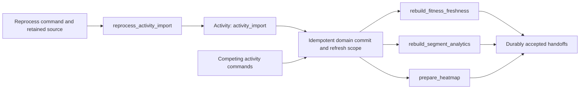

# Project Overview Specification

Bike is a multi-user activity and training app for cycling data. It imports activity data, normalizes it into a Bike-owned model, matches user-owned segments, and produces deterministic training analytics for XC and DH riding.

## Product Boundary

The current Bike product includes:

- authenticated multi-user accounts;
- manual FIT, TCX, and GPX activity uploads;
- server-side archive imports from shareable export URLs;
- Strava OAuth sync, manual re-sync, and webhook ingestion;
- normalized activity list/detail views with telemetry, route, laps, zones, and matched segments where data exists;
- private activity route previews and interactive maps, with personal cycling
  heatmaps available behind their feature flag;
- manual GPX/TCX segment import and activity-route segment builder flows;
- segment efforts, personal-best context, summaries, and comparison/race views;
- user-managed heart-rate zones, estimated FTP, and unit preferences;
- fitness/fatigue/form analytics;
- XC and DH training progress screens with deterministic recommendations;
- Grafana operational metrics, admin backfill, task, and integration-event tooling.

The current product does not treat training plans, Garmin cloud activity sync, Garmin workout push, multi-target event history, or power-zone planning as shipped behavior. Those ideas may become future features, but specs should not describe them as current functionality until implementation lands.

## Architecture

Bike follows the repo shape used by the surrounding workspace:

- `api`: Rust Axum API for auth integration, preferences, Strava connections,
  activity import endpoints, activity/segment/training read APIs, private map
  images and their cache, heatmap tiles, and admin operations.
- SQL `worker`: background processors for activity/archive import, reprocessing,
  segment regeneration, analytics rebuilds, XC backfills, heatmaps, and legacy email.
- Strava Temporal worker: provider workflows and Activities in `strava-temporal`.
- Bike task Temporal worker (conversion target): application workflows and
  Activities in a separate `bike-temporal` crate and worker registration.
- `migration`: SeaORM migrations for Bike-owned schema.
- `bike-ui`: shared Next.js frontend for rider and admin workflows.
- `map-renderer`: internal Go service running Chromium snapshots over gRPC.
  It owns browser lifecycle and rendering, with no activity database or PNG cache.

Bike owns auth, database wiring, feature flags, metrics, Strava callbacks, credentials, and provider requests in `bike-core`. PostgreSQL stores normalized data. Temporal runs Strava workflows.

The [maps specification](maps.md) owns image permissions, compatibility,
caching, the snapshot boundary, and its OpenTelemetry contract. The
[heatmap specification](heatmaps.md) owns preparation and tile behavior.

## Data Strategy

Bike uses a vendor-neutral activity pipeline. A source may be a provider connection, uploaded file, archive entry, or future import path, but it should converge on normalized activity records and derived data.

The source data should remain replayable enough to support parser improvements. Raw FIT data is especially valuable because it can preserve richer telemetry than provider summaries, including heart rate, cadence, power, laps, and device metadata.

Derived outputs such as heart-rate zones, segment efforts, activity analytics, fitness/fatigue/form, and activity training analysis are caches or read models. They should be rebuilt when source activity or segment data changes.

SeaORM entities declare database insert defaults with `default_value` and
`default_expr`. The [model specification](model-boundaries.md#insert-defaults-and-timestamps)
owns timestamp behavior and its workflow exceptions. Schema changes use new
migrations rather than modifying historical migrations.

## Background execution

- The [durable-work contract](durable-work-contract.md) owns shared identities,
  idempotent effects, cancellation/recovery, and acceptance scenarios. Provider
  and Bike workflow specs refine their own behavior without duplicating these rules.
- Converted tasks use native Temporal orchestration, retries, cancellation,
  and recovery. Activities reuse domain/model operations directly.
- Bike delegates sign-in and account verification/recovery email to its SSO
  provider. The legacy email task and Bike SMTP dependencies are retirement work.
- Keep Strava and Bike task workflow/Activity code and worker processes separate.
  Use `bike-strava` and `bike-tasks` queues, respectively, with independent
  workflow ID prefixes. Neither imports the other's workflow/Activity types.
- Share neutral storage/SDK infrastructure and domain operations. Strava keeps
  callbacks, OAuth, provider captures, and provider-specific manifests.
- Provider Activities report typed activity-change intents through a neutral
  domain scheduling interface; Bike tasks own derived-work coordination.
- Follow Strava's existing filesystem object-store pattern on the persistent
  uploads volume: immutable content-addressed bytes, atomic durable publication,
  and references containing `path`, `sha256`, and `bytes`, verified when read.
  Extract neutral storage primitives for reuse; preserve existing Strava paths
  and serialized references so retained executions can still replay.
- Persist large original inputs as soon as they arrive and retain large
  intermediate/results as objects too. Pass compact, owner-scoped references
  through workflows and database records; keep objects available for retry.
- Use separate `strava/` and `bike/tasks/` object prefixes and retention ownership.
  Both may use the same volume; cleanup must protect retained workflow/database
  references and cannot sweep the other concern's objects.
- For new user submissions, retain necessary input bytes/metadata, then start the
  workflow before business mutations. Confirm acceptance after Temporal
  acknowledges the start. A failed or uncertain submission shows a retryable
  error; retry reuses the retained
  object and request key. This contract does not require a custom outbox.
- A stable request key identifies one logical operation. Workflow ID policies
  and durable domain idempotency prevent repeated requests and Activity retries
  from duplicating writes or external effects. A new revision remains runnable.
- Coordinate conflicting user/activity/segment work across native workflows,
  Strava, and remaining SQL tasks. Fence obsolete attempts, including timed-out
  Activities that finish late, so stale results cannot overwrite newer data.
- Temporal owns execution state; domain status remains visible in Bike. Track
  source ingestion separately from eventual projection refresh. Collections can
  complete after source children and refresh handoffs; no per-request readiness
  receipt or aggregate publication barrier is required.
- The [conversion plan](../worker-conversion-plan.md) owns task order, status,
  verification evidence, and retirement gates. Existing provider callback
  intake remains governed by the [Strava specification](strava-temporal.md).

### Reprocess-first coordination

- Begin with `reprocess_activity_import`. Its dependency work establishes the
  native coordination contract used by later conversions.
- Temporal is the only orchestration owner for converted work. Do not introduce
  a SQL scheduling bridge, custom queue, task polling, lock table, or SQL batch
  barrier to make reprocessing appear converted. A native workflow must not
  enqueue `reprocess_activity_import` or its derived work into the SQL worker.
- Give each logical command a stable task/user/command workflow ID. Use resource
  coordinators where serialization or coalescing is needed: Strava source
  reconciliation, user fitness, global segment analytics, and activity heatmaps.
  Shared resource requests reach their owner through native Signal-With-Start
  with `UseExisting`; simple independent tasks need no extra coordinator. Never
  terminate a running workflow to promote a request. Strava remains separately owned.
- A request key identifies a logical command and survives HTTP retries. A
  resource revision identifies the input snapshot; different request keys for
  unchanged inputs may share the result. Neither a random Activity attempt ID
  nor a source checksum alone identifies an intentional new reprocessing command.
- Retain the selected original/provider artifact, checksum, import identity,
  parser version, and expected activity revision before starting the command.
  Reprocessing preserves activity/import identity and checks source ownership.
  Current `strava_sync` activities remain provider-owned; use Strava sync/backfill
  rather than reprocessing them through the file-import workflow.
- Source replay, activity publication, and derived readiness are separate steps.
  An import/reprocess workflow completes after derived requests are durably
  accepted by their named native workflows. It does not wait for publication or
  claim refreshed data is ready. Collections follow the same completion rule.
  Existing freshness information is sufficient to show pending/stale outputs.
- Use existing model versions, uniqueness constraints, and transactions to make
  retries safe. Add a version only where needed to reject stale publication;
  reuse existing dirty ranges or a retained plan where a refresh needs old
  dependencies. A full result ledger and revision receipt per output are not required.
- Workflow state accumulates the earliest dirty date, affected-ID unions, highest
  urgency, and latest revision. Duplicates do not extend quiet windows. Keep one
  Activity in flight per resource and one pending batch. A superseded publication
  carries its dirty inputs into the next batch. Continue-As-New only between
  Activities, carrying pending deadlines and the published revision watermark.
- Temporal serializes workflow commands, but timed-out Activity attempts can
  still finish late. Check expected source/resource revisions and any necessary
  effect fence in the same transaction as domain publication. A deletion tombstone
  or privacy change must reject an older publication; never recreate a deleted activity.
  These checks protect domain writes and do not schedule work.
- Native retries reuse command identity and preserve safe effects/refresh scope
  after lost completion. Accept cancellation before source apply/handoff or at
  safe batch boundaries; no new request handoffs after accepted cancellation.
  Downstream shared work completes independently. Failed work remains visible for
  operator retry or existing reconciliation, without a new generic recovery service.
- Cutover replaces every producer for this command and its shared mutation/output
  boundary together. The legacy user-wide import lock must not become the native
  coordinator. Batch parents must await native results instead of counting SQL
  child rows. Until that boundary is implemented and verified, groundwork is not
  a released task conversion.

| Existing producer or competitor                               | Required native boundary                                            |
| ------------------------------------------------------------- | ------------------------------------------------------------------- |
| Admin single-activity reprocess                               | Retry-stable command acknowledgement and native result/history      |
| User and archive-FIT reprocess batches                        | Bounded native children; await source and accepted refresh handoffs |
| Upload, archive resume, training backfill                     | Shared conditional domain writes; preserve committed progress       |
| Activity edit, delete, privacy changes and Strava writes      | Existing domain access/deletion rules and conditional writes        |
| Import completion, segment rematching, sync and fitness reads | Shared derived coordinators; no inline/SQL rebuild bypass           |

### Derived-work priority and debounce

- Follow the [named workflow and shared import Activity contract](bike-task-workflows.md).
  Import/batch workflows finish after durable derived handoff. Outputs converge
  independently; reuse existing freshness state instead of per-request waiters.
- Use Temporal's [Event Accumulator](https://docs.temporal.io/design-patterns/event-accumulator)
  and [Updatable / Debounced Timer](https://docs.temporal.io/design-patterns/updatable-timer)
  patterns with Signal-With-Start, stable change IDs, durable timers, and
  Continue-As-New carrying pending changes and deduplication state.
- Use native [Task Queue Priority and Fairness](https://docs.temporal.io/develop/task-queue-priority-fairness).
  Set priority on the processing Activity for each batch; a long-lived
  coordinator's initial Workflow priority must not fix every later batch's priority.

| Trigger for derived recalculation                      | Priority key | Quiet window | Debounce cap from first pending change |
| ------------------------------------------------------ | ------------ | ------------ | -------------------------------------- |
| Newly finished activity from upload or sync            | 1 (high)     | 2 seconds    | 10 seconds                             |
| Archive, historical backfill, deletion, routine repair | 5 (low)      | 60 seconds   | 5 minutes                              |

- Preserve bulk priority through every entry's derived requests. A newly inserted
  historical record does not become a high-priority ride. Prioritize fitness,
  segments, and achievements for newly finished activities; all outputs remain
  eventually consistent and may publish separately.

- These are initial configurable defaults. Priority orders queued work within
  queue partitions; it does not preempt running Activities. Bound worker
  concurrency and long work units; use per-user fairness and age low-priority
  backlog so continuous high-priority arrivals cannot strand it. Debounce caps
  bound buffering, not queue/execution latency; measure both separately.
- Put priority and fairness on each processing Activity and disable eager
  Activity dispatch so server matching applies. The pinned Rust SDK supports
  these options. Temporal Server 1.32.1 uses the priority matcher by default;
  enable `matching.enableFairness` for namespace `bike`, queue `bike-tasks`,
  as in the local dynamic configuration. Verify the same setting on deployment.
  See the [pinned server settings](https://github.com/temporalio/temporal/blob/v1.32.1/common/dynamicconfig/constants.go).
- Revisit backlog aging after the working proof of concept. A native
  Schedule-To-Start timeout with explicit promotion is a candidate policy;
  verify starvation behavior before production cutover. Preserve native high
  priority for new activity and low priority for deletion in the proof of concept.
- Group by user/output for fitness/training and by affected resource for other
  outputs. Merge earliest dirty date, affected-ID unions, latest revisions, and
  highest urgency. A high-priority change advances a waiting low-priority batch;
  a low-priority arrival cannot postpone an already scheduled high-priority flush.
- Run at most one publisher per resource. Changes during a rebuild accumulate
  into one next batch; already-covered/unchanged revisions do no extra work.
  Reuse incremental rebuilds and reject stale publication.
- All producers, including Strava sync, uploads, deletes, reprocessing, and page
  reads, use this contract. Remove per-activity full-user rebuilds and synchronous
  read-triggered rebuilds. Sync children persist sources and submit change intents
  without waiting for aggregate work; collection completion/offsets do not wait
  for final projections either.
- Deletes and their derived recalculation may settle slowly in the background.
  Existing access/privacy rules remain domain concerns. Show refreshing state
  when useful; repeated reads do not bypass debounce.

### Shared object storage

- Application code uses one shared object-storage service. Workflows and domain
  operations pass logical keys and `ObjectRef { path, sha256, bytes }` values;
  the existing `path` field retains the logical storage key.
- Inject the backend at the composition root using Apache's supported
  [`object_store` interface](https://docs.rs/object_store/). Local disk is the
  initial backend, with `fsync` enabled for durable publication. A later object
  service replaces that backend; tasks must not create storage-provider clients, join
  filesystem paths, open files, scan directories, or implement their own expiry.
- The shared service owns namespace validation, immutable content-addressed
  writes, checksum/size validation, named JSON descriptors and source references,
  error mapping, and retention configuration/eligibility. Conditional creation
  returns the retained winner when concurrent requests race; retries never
  overwrite a descriptor or return a different source than the one retained.
- Keep `strava/` and `bike/tasks/` namespaces separate on every backend. Storage
  replacement preserves logical keys, serialized references, and exact bytes.
  Copy and verify retained objects before switching backend injection so older
  histories and retries can still read their sources.
- Test shared storage semantics and TTL rules once, using the library's in-memory
  backend and shared fixtures. Keep a focused filesystem adapter restart check.
  Task and provider tests verify their business behavior through the shared
  service; they must not repeat path-layout or TTL test matrices per processor.
- Strava's existing byte/manifest wrapper delegates I/O to this service without
  changing its protocol or workflow ownership. After the Bike task conversions
  finish, migrate Strava's remaining storage composition, reference/pin inventory,
  and scheduled retention integration to the same service. The
  [conversion backlog](../TODO.md#worker-conversion) tracks that follow-up;
  provider encryption and response metadata remain Strava-owned.

### Object TTLs

| Object class                                | Initial configurable TTL                              |
| ------------------------------------------- | ----------------------------------------------------- |
| Uploaded input never accepted by a workflow | 24 hours since the last upload/retry                  |
| Successful workflow scratch                 | 14 days after the final execution in its chain closes |
| Failed/canceled workflow scratch            | 90 days after the final execution closes              |
| Canonical activity/import source            | Keep while referenced; no scratch TTL                 |

- Run native scheduled cleanup for each owned prefix. Expiry makes an object
  eligible only when no active/retained workflow, database record, or retry pin
  references it. Recheck references against concurrent writers before deletion;
  incomplete inventories defer cleanup. Retain input across failed submission.
- Persist object class, ownership, and expiry metadata outside Temporal history;
  the 14/90-day TTLs must survive shorter closed-history retention.
- Retention policy belongs to shared object storage, independently of its
  backend. Backend lifecycle/TTL features must not bypass database/workflow
  references, retry pins, canonical-source protection, or chain-close rules.
- Track each reference separately when content-addressed bytes are shared.
  Closing one successful request must not shorten another request's retry or
  failed-execution retention. Continue-As-New is not final chain closure.
- TTL policy returns candidates only. Native scheduled cleanup must collect
  complete reference inventories and recheck the reference/pin generation under
  deletion coordination. A candidate from a prior inventory is insufficient.
  The initial groundwork supplies the serializable lifetime contract and candidate
  policy; persistence, inventory, and deletion remain a cutover gate.
- Verify a dry run before enabling deletion; expose reclaimed files/bytes and
  failures. Preserve Strava's existing [retention contract](strava-temporal.md#event-and-source-retention).

### Large archive durability

- Retain the immutable archive plus a paged entry manifest on the persistent
  filesystem. Record content hashes; retries use saved references once capture
  finishes, even if the original download URL expires. Stream bytes with bounded
  memory and keep active archive/manifest/staging objects pinned against TTL cleanup.
- Use bounded batches of entries with stable owner/request/archive/entry identities.
  Await each batch's child outcomes before advancing its settled-entry cursor;
  completed child/Activity results are recorded in Temporal history. Persist exact
  success/duplicate/failure counts without incrementing them again on retry.
- Continue-As-New only at a settled batch boundary, carrying archive/manifest
  references, next entry cursor, cumulative counts, and pending derived revisions.
  Keep manifests and large result lists outside workflow payloads; history and
  memory usage must stay bounded as archive size grows.
- Long download/extraction Activities send [native heartbeats](https://docs.temporal.io/encyclopedia/detecting-activity-failures#activity-heartbeat)
  with compact stage/cursor/committed-offset details. Set explicit heartbeat and
  Activity timeouts/retries. On retry, read the last received details, validate the
  archive identity, and resume only from a fully durable checkpoint.
- Heartbeats can be throttled or undelivered when a worker crashes. An older
  checkpoint can repeat a tail of work; idempotent entry writes, result accounting,
  and stale-attempt fencing make that safe. Heartbeats track progress inside one
  Activity; workflow history tracks completed steps and batches.
- For compressed archives, resume from a stable manifest entry or staged extracted
  chunk. Resume partial downloads by byte range only when the source supports it
  and its validator matches; otherwise restart that download stage safely.
- Cancellation retains committed progress and input references for explicit resume.
  A resumed request preserves logical entry identity and recovered counts. Do not
  release archive pins or report full success until children and derived targets
  finish; failed entries remain visible.
- Worker/server process recovery relies on the Temporal database and persistent
  input volume surviving. No required cursor, source, or result exists only in a
  worker's memory, temporary filesystem, or local timer.

## Integrations Strategy

Strava is the first live cloud activity integration. The Rust API accepts durable Strava events. Named native Temporal workflows fetch and normalize activities, write domain data, and publish derived data. See [the Strava specification](strava-temporal.md).

Manual Garmin export import is a first-class ingestion path. Official Garmin cloud activity sync is additive if it becomes available; Bike should not depend on private or reverse-engineered Garmin Connect endpoints for core behavior.

## Generated coverage reports

- Coverage reports are generated artifacts published on `gh-pages`; application
  source history remains on `main`.
- Each report commit uses its source revision's author name and email for both
  author and committer. Publishing credentials grant access without defining a
  separate contributor named `coverage`.

## Product Risks

Garmin cloud access can be uncertain, so manual FIT/TCX/GPX import must remain a durable path.

Strava rate limits should be handled with webhook-driven incremental sync, resumable worker jobs, and visible integration history.

Duplicate activities are likely when Garmin activities are mirrored into Strava. Deduplication must combine provider ids, file checksums, timing, distance, duration, and user scope.

Parser drift and upstream payload quirks are expected. Retaining replayable source data is the mitigation.

Segment correctness should favor transparent user-owned matching and personal comparison over trying to reproduce every Strava leaderboard edge case.

## Code Anchors

- App wiring: `bike-rs/api/src/lib.rs`, `bike-rs/api/src/controllers/mod.rs`
- Worker entry points: `bike-rs/worker/src/tasks/processors`
- Migrations: `migration/src`
- Frontend routes: `bike-ui/app`
- Local tasks: `mise.toml` (`mise tasks`)
- Compose dev environment: `compose.yaml`

## Potential product directions

Training plans, official Garmin cloud sync, power-zone planning, and cross-user segment leaderboards are uncommitted product directions, not active work. If one is requested or becomes viable, record its scope once in the [Bike TODO](../TODO.md) and use this overview for architecture context.
