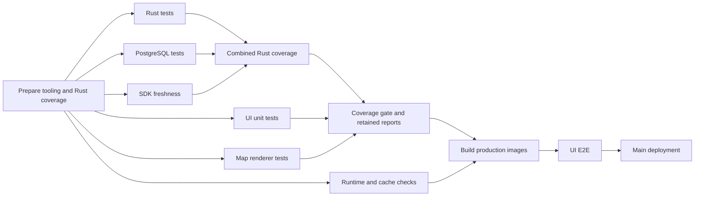

# Rust CI verification and reuse

- The existing Cargo workspace remains the backend boundary. Splitting crates or
  repositories is not required to avoid Rust compilation for UI changes.
- Cargo-chef and persistent BuildKit own release-image dependency reuse. Native
  Cargo checks use the runner cache and must not assume that release artifacts
  satisfy debug, Clippy, or instrumented coverage builds.
- All ordinary Rust tasks use the same warning-denying compiler flags. Binary
  generation must reuse compatible dependencies built by integration tests.
- OpenAPI and TypeScript-client generation are explicit developer commands.
  Automatic freshness checks are retired from CI, local check tasks, and prek;
  do not reintroduce the Rust generator compilation as a validation gate.
- Preserve LLVM coverage instrumentation and its separate target. CI uses debug
  level 1 and disables incremental objects to reduce disk without disabling
  coverage or debug assertions.
- The complete native CI cache has a 32 GiB high-water guard, sampled before and
  every five seconds during Rust checks. Exceeding it stops the compiler process
  group. Idle infrastructure retention runs every fifteen minutes and reduces
  retained Cargo targets to 16 GiB, including `main` in that budget. The guard is
  not a filesystem quota and may overshoot between samples.

## Completed verification

- CI may reuse successful backend verification only when its complete inputs
  match, regardless of commit, branch, or PR identity.
- Inputs include all Rust sources, manifests, lockfiles, fixtures, vendored and
  generated packages, HTTP/vendor/protobuf contracts, scripts, workflow/image
  definitions, version pins, coverage policy, and runner OS/architecture.
- UI and documentation changes alone do not invalidate backend results. UI
  checks, image builds, browser tests, and the current changed-line coverage gate
  still run.
- A reusable result requires successful formatting, Clippy, unit tests, native
  HTTP integration tests, doctests, generated SDK checks,
  worker/Strava PostgreSQL tests, and combined coverage reporting.
- A successful unit step alone never publishes a reusable result. Failed or
  interrupted checks cannot create a passing entry.
- Store complete API, worker, and core coverage reports with a checksum and the
  original verified commit/pipeline. Log whether each stage ran or reused that
  verification. Never manufacture coverage for skipped tests.
- Restore complete entries once during preparation, before parallel tests start.
  Keep that validated snapshot for the current pipeline even if retention evicts
  the reusable entry afterward. Missing or corrupt entries rerun validation.
- Publish complete entries atomically under a per-input lock, only after both
  Rust stages, the SDK freshness stage, and combined reporting succeed.
- Reject reuse from a dirty source checkout. Manual pipelines force fresh checks.
- Use the existing runner volume at `/cache/bike/rust-checks/v1`; store reports,
  not duplicate compiler targets. Remove entries unused for more than seven days
  when publishing a new result, while respecting readers and writers.
- A new input set or empty/evicted cache needs one full successful run before
  reuse. This does not make a cold build free or share compiler outputs between
  incompatible profiles.

## Coverage handoff and acceptance

- Preparation restores completed verification or runs
  `cargo llvm-cov clean --workspace` once before the parallel stages begin.
- `test-rust`, `test-worker-postgres`, SDK freshness, UI unit tests, map-renderer tests, runtime
  checks, and applicable cache regressions depend only on preparation. No test
  stage depends on another test stage or the production image build.
- The PostgreSQL stage uses a native, disposable Woodpecker service and the
  compiler-equipped runner. Its generated image reference comes from mise's
  `postgres_image` pin, synchronized by `pins:sync` and checked by `ci:check`.
  It does not require the E2E Docker daemon or a built checks image.
- SDK generation requires Docker and runs separately in `test-strava-sdk`, with
  the pinned official Docker CLI and a native, disposable engine service. This
  service uses the same engine lifecycle as E2E and stops cleanly when SDK
  validation finishes. Its image pin is synchronized by `pins:sync`; no
  production image must be built to start it.
- Rust stages share the existing Cargo dependency/coverage target. Cargo owns
  serialization of writes during compilation; test stages have independent
  scheduling. Neither stage cleans profiles or generates final reports while
  the other runs. Keep collection commands on `--no-report`.
- Join Rust measurements after both stages pass, then render combined coverage
  and publish a completed verification receipt. After reporting, clean raw
  profiles only; preserve compiled dependencies.
- Enforce changed-line coverage after all unit/native reports are ready and
  before `build-images`. Retain those reports for publication in the browser
  workflow; restoring reports must never replace an active collection.
- `test-ui-e2e` waits for the image-build workflow and runs against that
  revision's production images. Deployment remains gated on all tests and E2E.

- Shell regressions exercise the actual result cache and report transfer with
  explicit fake expensive suites: a new PR changing only UI invokes zero backend
  commands; source, dependency, contract, protocol, and tooling changes rerun
  checks; failures, dirty inputs, and corrupt/missing entries cannot pass by reuse.
  A barrier fixture verifies that both Rust stages can start independently and
  that neither a partial nor failed run publishes completed verification.
- A separate real Cargo fixture collects unit and integration measurements
  concurrently, then verifies combined coverage, warm dependency reuse,
  removed-source cleanup, and integration-test to binary-build dependency reuse.
- Run the real Cargo fixture in CI when its owning tooling changes; UI-only
  pipelines must not install Rust merely to test the cache harness.
- Local fixture evidence and live pipeline evidence are reported separately.
