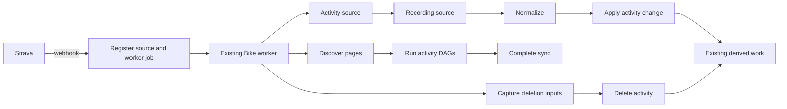

# Strava integration

- Bike Rust owns Strava OAuth, webhook receipt, provider requests, activity changes,
  sync and backfill.
- The Rust API accepts webhooks; Bike's existing durable workers execute DAGs.
- Use the existing PostgreSQL database and uploads volume.
- Task status belongs in [the backlog](../TODO.md).
- Follow [the cutover plan](../plans/strava-consolidation.md); do not copy or replay
  gateway work or artifacts.

## Client

- All external requests use the standard generated SDK in `bike-rs/strava-sdk`.
- Pin the vendor contract and generator; check generated files for freshness.
- Never edit generated source, customize its request encoding, or use custom
  generator templates.
- Bike's wrapper owns cache lookup, quota reservation, observability and transforms.
- Supported middleware observes the encoded request without changing it.
- Retain exact request and response bytes, status and all headers in encrypted
  exchange objects before SDK decoding; forward the unchanged response to the SDK.
- Retain activity response bodies separately for reuse. OAuth responses are
  encrypted, including the cached token exchange.
- No HTTP failure is evidence that an activity was deleted.

## Workflows

| Action                          | DAG                                              |
| ------------------------------- | ------------------------------------------------ |
| Insert, update, upsert          | activity → streams → normalize → apply → derived |
| Delete                          | capture_delete → delete → derived                |
| Sync                            | discover → children → complete                   |
| Backfill                        | discover → children → complete                   |
| Disconnect or vendor revocation | capture_cleanup → revoke → cleanup               |

- The DAG's topological order drives execution; the graph is not a separate
  documentation-only representation.
- Webhook acceptance stores the original body, a stable workflow identity and
  its existing Bike worker job before acknowledging success.
- Duplicate callbacks return success without creating another workflow/job.
- Preserve every stage output and persist its checkpoint before proceeding.
- A retry verifies and loads a saved checkpoint before executing that stage.
- Sync retains each listing page and the child workflow results; retries reuse
  completed pages and children.
- Backfill uses the same DAG with an unrestricted history cutoff.
- **Hard rule: new-user signup and first Strava connection automatically backfill
  only the previous 15 days.** Queue a fixed `after = accepted time - 15 days`
  cutoff and send it on every listing page. Never enqueue an unrestricted history
  request during signup, OAuth connection or automatic reconciliation without a
  cursor. This rule applies to every automatic initial-sync entrypoint.
- Incremental sync uses the existing cursor with a one-day overlap.
  Full historical backfill requires the user's explicit backfill request.
- `POST /api/strava/sync` queues sync; `POST /api/strava/backfill` queues backfill.
- Scheduled reconciliation queues sync every six hours.
- User disconnect queues SDK revocation and provider-owned activity cleanup.
  Vendor revocation performs local cleanup without another revocation request.
- Reauthorization establishes a new connection generation; old work cannot change
  that generation's activities.

## Correlation and visibility

- Carry athlete ID, vendor activity ID, workflow ID and parent workflow ID
  through sources, child work, stage logs, outputs and derived job metadata.
- The vendor activity ID is the primary activity correlation, including deletes.
- `correlation_id` is the vendor activity ID as a string, or the workflow ID for
  collection/account actions. Export it alongside workflow/parent IDs in logs
  and Tempo span attributes. Record trace IDs for Loki-to-Tempo navigation.
- Integration history records acceptance, stage completion and stage failure,
  with source/output object references and quota retry times.
- Keep event payloads compact: refer to retained objects instead of embedding
  full activity streams or recording arrays in the integration feed.
- Existing worker administration exposes queue state, attempt history, progress,
  failures and stuck-work detection.
- Report unchanged, excluded, stale and already-absent outcomes accurately.
  An unchanged sync is not an applied update; repeated delete is already absent.
- Failed reads retain their exchange evidence and remain visible failures.
- The Strava Grafana dashboard searches retained Loki logs and Tempo traces by
  activity or workflow ID within the selected range. Prometheus metrics stay
  aggregate by provider/action/task, without activity-ID labels. Quota gauges
  are explicitly current ledger state; event counts use the selected range.
- `admin/integrations?provider=strava` retains native acceptance, stage completion
  and failure events. Apply/delete events carry local activity/import IDs when
  available, so existing admin filters continue to work.
- `admin/imports` lists native Strava imports as `strava_sync`. Import detail
  exposes retained artifacts and processing attempts; replay uses local sources
  without another Strava request. Processing state includes active native
  collection workflows even when a legacy import lock is absent.

## Retention and reuse

- Store sources under `strava/{athlete}/{activity}/raw/{revision}/{resource}`.
- Store each transform under its own
  `strava/{athlete}/{activity}/transforms/{stage}/{version}/{input-hash}` path.
- Collection sources use `strava/{athlete}/runs/{workflow}/raw/pages/{page}`.
- Objects are immutable and content addressed; verify checksum and length on read.
- Publish files atomically, without overwriting an existing object.
- Check saved sources before calling Strava. Check saved stage outputs before
  repeating a transform.
- A changed webhook revision may require a new activity detail request.
- Metadata changes reuse recording streams when the recording identity matches.
- Listing refreshes are necessary to discover remote changes; a retry of the same
  listing run reuses its saved pages.
- Preserve legacy payloads with their original provenance. They are useful sources,
  but they cannot establish the exact original HTTP exchange.
- Retain originals and transforms after activity removal for diagnosis and replay.
- A received response is saved before decoding. A process failure before durable
  capture can still require another request; local checkpoints cannot promise
  exactly-once execution at the remote service.

## Idempotency

- Serialize provider execution for one connection using PostgreSQL's
  transaction-scoped advisory lock, including token refresh.
- Enforce unique workflow IDs and activity source correlations.
- Apply identical content without rewriting activity data or scheduling new work.
- Check the currently selected provider artifact's hash, not an obsolete artifact.
- Preserve the Bike-owned training/race classification on provider updates.
- Store deletion inputs before removal, so a retry can finish derived cleanup.
- Persist each derived-job enqueue and its retry guard in one database transaction.
  Use the existing Bike job queue; introduce no delivery outbox or gateway.
- Ignore stale events after a newer update/delete. Never resurrect data from an
  older connection generation.
- Provider errors do not become deletion or non-cycling classification.
- Cycling kinds enter Bike's existing import DAG. Retain non-cycling source
  metadata, skip streams and remove any previously mapped cycling activity.

## API limits

- Reserve quota transactionally in the existing
  `provider_rate_limit_buckets` ledger before any new SDK request.
- Overall limits default to 400 requests per 15 minutes and 4,000 per day.
- Read limits default to 200 requests per 15 minutes and 2,000 per day.
- Reads consume both read and overall buckets; other operations consume overall.
- Reconcile provider-reported limits, usage, resets and retry headers.
- Saved-source reuse consumes no provider quota.
- On local exhaustion or remote 429, persist the pause and schedule the same
  workflow for its eligible time. Do not sleep in a worker or fetch around the gate.
- Token exchanges and subscription operations also use this wrapper and ledger.
- Only Bike Rust consumes this Strava application's quota after cutover.

## Verification

- Standard SDK byte freshness and recorded HTTP/OAuth encoding at a fake vendor.
- Raw byte retention, checksum verification and interrupted manifest recovery.
- Functional tests send fake activity callbacks through the Rust HTTP handler and
  queued worker processor, using real PostgreSQL and a fake vendor.
- Assert each DAG stage, its retained inputs/outputs, vendor correlation, activity
  changes and exact vendor request counts.
- Pair these integration tests with individual happy-path unit tests.
- Assert the initial 15-day listing cutoff and exclusion of older activities.
- Exercise the admin import list, detail, retained-source replay and filtered
  integration-events HTTP routes after a native Strava workflow.
- Insert, update, upsert, delete, sync and backfill, including retries and duplicates.
- Metadata update reuses streams; unchanged sync does not rewrite activities.
- Failed HTTP reads preserve activities; stale events cannot resurrect deletions.
- Stage retry does not duplicate derived jobs; quota exhaustion makes no request.
- Production recovery requires image, migration, readiness and user-visible
  activity/history evidence. Fake-vendor tests do not establish live behavior.
