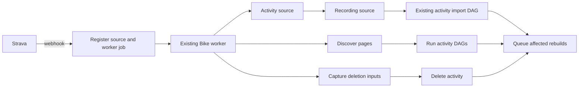

# Strava integration

- Bike Rust owns Strava OAuth, webhook receipt, provider requests, activity changes,
  sync and backfill.
- The Rust API accepts webhooks; Bike's existing durable workers execute DAGs.
- OAuth initial sync, user requests and reconciliation queue the same native
  workflows. Historical `strava_sync` jobs adapt into that queue; the retired
  direct-sync and inline webhook implementations are removed.
- New work queues native workflows directly. Historical-job producers and unused
  in-process subscription registration are removed; the API keeps subscription
  handshake verification and callback receipt.
- Use the existing PostgreSQL database and uploads volume.
- Task status belongs in [the backlog](../TODO.md).
- Follow [the cutover plan](../plans/strava-consolidation.md); do not copy or replay
  gateway work or artifacts.

## Client

- All external requests use the standard generated SDK in `bike-rs/strava-sdk`.
- Pin the vendor contract and generator; check generated files for freshness.
- Never edit generated source, customize its request encoding, or use custom
  generator templates.
- Bike's wrapper owns cache lookup, quota reservation, observability and transforms.
- Supported middleware observes the encoded request without changing it.
- Retain exact request and response bytes, status and all headers in encrypted
  exchange objects before SDK decoding; forward the unchanged response to the SDK.
- Retain activity response bodies separately for reuse. OAuth responses are
  encrypted, including the cached token exchange.
- No HTTP failure is evidence that an activity was deleted.

## Workflows

| Action                          | DAG                                              |
| ------------------------------- | ------------------------------------------------ |
| Webhook create/update           | activity → streams → apply → rebuild              |
| Webhook delete                  | capture_delete → delete → rebuild                 |
| Sync                            | discover from offset → children → rebuild         |
| Backfill                        | discover last 15 days → children → rebuild        |
| Disconnect or vendor revocation | capture_cleanup → revoke → cleanup               |

- Workflows are explicit stage chains. Each stage consumes retained results
  from its prerequisites; tests verify the stage catalog against execution.
- Webhook acceptance stores the original body, a stable workflow identity and
  its existing Bike worker job before acknowledging success.
- Duplicate callbacks return success without creating another workflow/job.
- Preserve every stage output and persist its checkpoint before proceeding.
- Fetched activity and stream checkpoints point directly to the retained raw
  response object. Listing summaries and legacy inputs retain their local
  transforms. Apply uses the existing import DAG for parsing, saving and activity
  analytics. Rebuild completes changed imports and queues fitness, heatmap
  preparation through the fitness worker, and affected segment analytics.
- Collection children only acquire and apply their activity. The parent combines
  changed import IDs, segment IDs and the earliest changed day, then rebuilds once
  at the end. Unchanged work queues no rebuilds. Rebuild retries reuse the existing
  transactional job guards and do not duplicate jobs.
- A retry verifies and loads a saved checkpoint before executing that stage.
- Sync retains each listing page and the child workflow results; retries reuse
  completed pages and children.
- Discovery outputs contain page references and observation times. Child sources
  reference their listing page and select the activity by vendor ID; neither
  checkpoints nor new workflow rows embed copies of the listing or streams.
- Sync pulls pages strictly after the saved activity-start offset. With no offset,
  start 15 days before acceptance. Advance the offset only after rebuild succeeds.
- Backfill uses the same steps with a fixed cutoff 15 days before acceptance,
  regardless of the saved offset. Send the accepted cutoff on every listing page.
- Saved pages from an older unrestricted run cannot apply activities outside the
  accepted cutoff. Already imported activities remain retained.
- **Hard rule: new-user signup and first Strava connection automatically backfill
  only the previous 15 days.** Queue a fixed `after = accepted time - 15 days`
  cutoff and send it on every listing page. Never enqueue an unrestricted history
  request during signup, OAuth connection or automatic reconciliation without a
  cursor. This rule applies to every automatic initial-sync entrypoint.
- `POST /api/strava/sync` queues sync; `POST /api/strava/backfill` queues backfill.
- Scheduled reconciliation queues sync every six hours.
- User disconnect queues SDK revocation and provider-owned activity cleanup.
  Vendor revocation performs local cleanup without another revocation request.
- Reauthorization establishes a new connection generation; old work cannot change
  that generation's activities.

## Correlation and visibility

- Carry athlete ID, vendor activity ID, workflow ID and parent workflow ID
  through sources, child work, stage logs, outputs and derived job metadata.
- The vendor activity ID is the primary activity correlation, including deletes.
- `correlation_id` is the vendor activity ID as a string, or the workflow ID for
  collection/account actions. Export it alongside workflow/parent IDs in logs
  and Tempo span attributes. Record trace IDs for Loki-to-Tempo navigation.
- Integration history records acceptance, stage completion and stage failure,
  with source/output object references and quota retry times.
- Keep event payloads compact: refer to retained objects instead of embedding
  full activity streams or recording arrays in the integration feed.
- Existing worker administration exposes queue state, attempt history, progress,
  failures and stuck-work detection.
- Report unchanged, excluded, stale and already-absent outcomes accurately.
  An unchanged sync is not an applied update; repeated delete is already absent.
- Failed reads retain their exchange evidence and remain visible failures.
- The Strava Grafana dashboard searches retained Loki logs and Tempo traces by
  activity or workflow ID within the selected range. Prometheus metrics stay
  aggregate by provider/action/task, without activity-ID labels. Quota gauges
  are explicitly current ledger state; event counts use the selected range.
- `admin/integrations?provider=strava` retains native acceptance, stage completion
  and failure events. Apply/delete events carry local activity/import IDs when
  available, so existing admin filters continue to work.
- `admin/imports` lists native Strava imports as `strava_sync`. Import detail
  exposes retained artifacts and processing attempts; replay uses local sources
  without another Strava request. Processing state includes active native
  collection workflows even when a legacy import lock is absent.

## Retention and reuse

- Store sources under `strava/{athlete}/{activity}/raw/{revision}/{resource}`.
- Store each transform under its own
  `strava/{athlete}/{activity}/transforms/{stage}/{version}/{input-hash}` path.
- Collection sources use `strava/{athlete}/runs/{workflow}/raw/pages/{page}`.
- Objects are immutable and content addressed; verify checksum and length on read.
- Publish files atomically, without overwriting an existing object.
- Check saved sources before calling Strava. Check saved stage outputs before
  repeating a transform.
- Read cached sources before opening or refreshing credentials. Fully local
  retries, stale events, deletes and vendor revocations need no token refresh;
  local work can finish while provider requests are paused. Cache misses use the
  connection's current credentials and the normal quota gate.
- A changed webhook revision may require a new activity detail request.
- Metadata changes reuse recording streams when the recording identity matches.
- Listing refreshes are necessary to discover remote changes; a retry of the same
  listing run reuses its saved pages.
- Preserve legacy payloads with their original provenance. They are useful sources,
  but they cannot establish the exact original HTTP exchange.
- Run storage retention at worker startup and hourly. Temporary responses,
  transforms, exchange captures and completed workflow history expire after
  30 days. File age uses modification time; history age uses completion time.
- Keep the current provider JSON (including streams) and every referenced original
  FIT/TCX/GPX without a TTL. Recalculation and recording reuse read these local
  sources even after the temporary request cache expires. Do not generate a
  substitute GPX/TCX when an original recording file is unavailable.
- Store new provider JSON content-addressed under `strava/sources/{user}`.
  Existing import paths remain supported. Prune superseded `strava_*.json`
  payloads only when no import or artifact references them and they are 30 days old.
- Keep unfinished workflows, recent completed workflows, their parent/child
  dependencies, completed work awaiting its queue acknowledgement, and recursively
  referenced input/output objects. Preserve whole
  response/reference directories so retained manifests cannot point to deleted bytes.
- Serialize retention with provider execution and other retention workers. Build
  and verify the protected object set before deleting anything. Never follow
  symlinks or prune unrelated uploads. Interrupted cleanup is safe to retry.
- Publish actual stored file counts and bytes by bounded kind (`source`, `raw`,
  `transform`, `metadata`), successful scan time, and files/bytes pruned counters.
  Retention errors use the existing worker error counter and correlated log line;
  database history is not an alert source.
- A received response is saved before decoding. A process failure before durable
  capture can still require another request; local checkpoints cannot promise
  exactly-once execution at the remote service.

## Idempotency

- Serialize provider execution for one connection using PostgreSQL's
  transaction-scoped advisory lock, including token refresh.
- Enforce unique workflow IDs and activity source correlations.
- Apply identical content without rewriting activity data or scheduling new work.
- Check the currently selected provider artifact's hash, not an obsolete artifact.
- Preserve the Bike-owned training/race classification on provider updates.
- Store deletion inputs before removal, so a retry can finish derived cleanup.
- Persist each derived-job enqueue and its retry guard in one database transaction.
  Use the existing Bike job queue; introduce no delivery outbox or gateway.
- Ignore stale events after a newer update/delete. Never resurrect data from an
  older connection generation.
- Provider errors do not become deletion or non-cycling classification.
- Cycling kinds enter Bike's existing import DAG. Retain non-cycling source
  metadata, skip streams and remove any previously mapped cycling activity.

## API limits

- Reserve quota transactionally in the existing
  `provider_rate_limit_buckets` ledger before any new SDK request.
- Overall limits default to 400 requests per 15 minutes and 4,000 per day.
- Read limits default to 200 requests per 15 minutes and 2,000 per day.
- Reads consume both read and overall buckets; other operations consume overall.
- Reconcile provider-reported limits, usage, resets and retry headers.
- Saved-source reuse consumes no provider quota.
- On local exhaustion or remote 429, persist the pause and schedule the same
  workflow for its eligible time. Do not sleep in a worker or fetch around the gate.
- Token exchanges and subscription operations also use this wrapper and ledger.
- Only Bike Rust consumes this Strava application's quota after cutover.
- API metrics scrapes reload quota gauges from the persisted ledger, including
  after a process restart without another provider request. Expired windows
  report zero current usage and their full remaining limit; the recorded reset
  deadline remains visible. Missing buckets remain unknown. Database failures
  fail the scrape rather than presenting a fresh successful snapshot.

## Verification

- Standard SDK byte freshness and recorded HTTP/OAuth encoding at a fake vendor.
- Raw byte retention, checksum verification and interrupted manifest recovery.
- Remove source-stage references and database checkpoints while retaining raw
  responses, expire credentials and pause provider work; recovery must make zero
  activity, stream, listing or token requests and enqueue no duplicate jobs.
- A new remote revision with an expired token refreshes once on its cache miss.
- Resume workflows accepted before the object-reference source format changed.
- Sync sends the exact saved offset; backfill excludes older than 15 days even
  when an offset exists. A changed collection schedules one final fitness rebuild,
  with no rebuild jobs from children. Retry preserves job counts and terminal status.
- Functional tests send fake activity callbacks through the Rust HTTP handler and
  queued worker processor, using real PostgreSQL and a fake vendor.
- OAuth callback tests prove connection creation and native initial-sync queueing
  with the 15-day cutoff, followed by the same worker stages.
- Assert each DAG stage, its retained inputs/outputs, vendor correlation, activity
  changes and exact vendor request counts.
- Pair these integration tests with individual happy-path unit tests.
- Assert the initial 15-day listing cutoff and exclusion of older activities.
- Exercise the admin import list, detail, retained-source replay and filtered
  integration-events HTTP routes after a native Strava workflow.
- Insert, update, upsert, delete, sync and backfill, including retries and duplicates.
- Metadata update reuses streams; unchanged sync does not rewrite activities.
- Failed HTTP reads preserve activities; stale events cannot resurrect deletions.
- Stage retry does not duplicate derived jobs; quota exhaustion makes no request.
- Production recovery requires image, migration, readiness and user-visible
  activity/history evidence. Fake-vendor tests do not establish live behavior.
