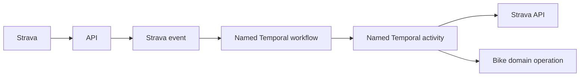

# Strava integration

- This is a new, forward-only implementation. Temporal owns orchestration,
  retries, step results, child workflows, cancellation, and execution history.
- The Rust API owns callbacks and OAuth; Temporal owns execution.
- Existing migrations remain unchanged. New migrations retire obsolete schema.
- Remove Strava's SQL worker processors and custom workflow checkpoints.
- Reuse provider SDK, storage, and activity domain functions only. Native Temporal
  activities must not call old processors or enqueue SQL worker tasks.
- SQL import recovery, batch reprocessing, and direct replay must exclude Strava
  imports, including interrupted native publication. Historical source repair
  cannot enqueue Strava replay; request native sync or backfill instead.
- Bike uses the shared Temporal service in production and Docker Compose locally.
- API path: Strava → `/api/strava/webhook` → durable Strava event → Temporal
  workflow → named activity → Strava or Bike domain operation.
- Preserve `/webhooks/strava-gateway` and `/oauth/gateway/callback`, already
  registered externally, as aliases to the same native handlers. Keep ingress
  routing and the existing TLS secret. These aliases do not retain gateway code.

## Callback security

- `/oauth/gateway/callback` completes **Connect Strava**: verify Bike's signed
  OAuth `state`, exchange the authorization code with Strava, save the connection,
  and request sync. It does not authenticate webhook POSTs.
- Strava returns the OAuth `state` that Bike supplied; this is a Bike signature,
  not a Strava signature. State must also be bound to the initiating browser
  session, consumed once, and verified with the HMAC library's constant-time check.
- The webhook GET `hub.verify_token` check verifies subscription setup only.
  [Strava's published webhook protocol](https://developers.strava.com/docs/webhooks/)
  does not document a signature header for event POSTs.
- Subscription ID, athlete ID, event time, deduplication, and connection-generation
  checks do not authenticate the sender. TLS protects transport, not sender identity.
- Accept unsigned event POSTs on the registered callback routes. The absence of
  sender authentication is an accepted Strava protocol limitation, not a release gate.
  Do not require unavailable signatures or provider confirmation before processing
  supported delete and deauthorization events.
- Keep configured subscription checks, connected-athlete lookup, ownership and
  connection-generation validation, deduplication, and event ordering. These are
  processing checks; they do not prove the sender's identity.
- Track OAuth state hardening separately from webhook delivery. Cover webhook
  validation/deduplication and OAuth state protections with isolated mocked units.
- Connect creates a random, HttpOnly `strava_oauth_session` cookie and a signed
  state for the authenticated Bike user. The cookie is host-only, `SameSite=Lax`,
  has path `/` for both callback aliases, and lasts ten minutes. HTTPS uses the
  Secure `__Host-strava_oauth_session` cookie; sibling domains cannot set it.
- Verify the state signature and browser binding with `Hmac::verify_slice` before
  consuming it from the existing `oauth_states` store under provider `strava`.
  Reject malformed, future, expired, mismatched, or already consumed state before
  exchanging any provider code. Consume valid denied callbacks too; clear the
  cookie on every callback. A failed exchange requires a new Connect request.
- Test handler policy with fixture providers, in-memory object storage, and mocked
  persistence. No unit test opens a database or contacts a running service.

## Types and mutation status

- Use enums for Strava operations, activity mutation status, and attempt status.
  Workflows and activity references use Temporal's generated typed definitions.
  Wire names remain declared once at the SDK or queue boundary.
- `strava_events.status` is the authoritative mutation status: `pending`,
  `applied`, `unchanged`, `deleted`, `already_absent`, or `superseded`.
  `captured` is the transient deletion input before a mutation is committed.
- One event has one mutation status, so no status relation is needed. Store
  status and retry dependencies atomically; JSON contains no copy of status.
  Collection counts filter the status column.
- Add a new migration to promote existing mutation values into the status column.
  Preserve every earlier migration unchanged.
- Connection checks load the owning connection, validate its generation, and
  validate the customer through separate functions. Preserve database failures
  as server errors and missing customers as not found.
- `StravaEvent` owns required activity ID validation. The activity-state model
  owns the composite key lookup and absence check; content and supersession
  methods name their predicate and return false for absent state.
- Deletion checks the stored mutation, opens a transaction, checks supersession,
  removes the owned remote activity, and records its status and dependencies.
  Failed writes roll back; retries reuse the stored mutation.
- Scheduled sync reads as get request → get page → get children → complete children
  → continue or finish. Await every started child and carry the total failures
  across pages; use a shared helper to construct non-retryable workflow errors.
- Use at most two expressions per boolean condition and named ownership predicates.
  A shared typed activity function adapts SDK calls and failures; each workflow
  still names its activity steps explicitly.
- Use SeaORM's primary-key-aware `save` for import/artifact create or update.
  Separate active-model construction from saving and linking the provider artifact.
- API-to-Temporal handoff logs share one correlation span. Both success and failure
  include its customer, remote, event, namespace, and workflow fields in structured JSON.

## IDs and logs

- Use **Strava event**, never receipt. A Strava event ID is assigned by Bike;
  [Strava's webhook payload](https://developers.strava.com/docs/webhooks/)
  contains no unique event ID.
- `correlation_id`: the root Strava event ID; unchanged across child workflows.
- `strava_event_id`: this event's Bike-assigned ID.
- `bike_customer_id`: Bike's public customer UUID.
- `bike_user_id`: Bike's internal user ID.
- `bike_activity_id`: Bike's activity ID, when one exists.
- `strava_athlete_id`: the remote `owner_id`.
- `strava_activity_id`: remote `object_id` for an activity event.
- Retain remote `object_type`, `aspect_type`, `event_time`, `subscription_id`,
  and `updates` unchanged. Deduplicate identical callbacks within a connection generation.
- Record `temporal_namespace`, `temporal_workflow_id`, `temporal_run_id`,
  `temporal_activity_id`, and `temporal_attempt` separately.
- Provider exchanges also record `exchange_id`, request method/path, HTTP status,
  and the provider's request ID if present. Never log credentials or provider bodies.
- Carry customer/event/activity context in typed workflow and activity inputs.
  Log it on acceptance, every activity attempt, every provider exchange, and completion/failure.
- Collection, wrapper, disconnect, and scheduled child calls log the child's
  Temporal workflow/run IDs together with the parent's workflow/run IDs.
  Children retain the root correlation ID, request ID, and original trace carrier.
- Workflow lifecycle logs distinguish completion, failure, cancellation, and
  continue-as-new. Suppress logs during replay; never change workflow inputs or
  decisions based on tracing state. Keep request, trace, and parent event IDs on
  activity attempts and provider exchange logs too.
- Index events by customer, remote athlete, remote activity, and workflow ID.
  Support those searches in Temporal and the integration history view.

## Workflows

- Call steps as `run(ctx, RevokeConnection, event).await?` using the SDK's typed
  activity markers. The shared helper applies retry/cancellation policies and
  derives the display summary from the registered name; callers supply no strings.

| Strava webhook | Native worker implementation |
| --- | --- |
| Activity `create` | [CreateActivity](../../bike-rs/strava-temporal/src/workflows/activity_create.rs) |
| Activity `update` (title, type, privacy) | [UpdateActivity](../../bike-rs/strava-temporal/src/workflows/activity_update.rs) |
| Activity `delete` | [DeleteActivity](../../bike-rs/strava-temporal/src/workflows/activity_delete.rs) |
| Athlete `update`, `authorized=false` | [DisconnectStrava](../../bike-rs/strava-temporal/src/workflows/disconnect.rs), without remote revoke |

- GET verification uses the [Rust handler](../../bike-rs/api/src/controllers/strava.rs).
- Other webhook combinations and unconnected athletes are acknowledged and ignored.
- [Intake](../../bike-rs/bike-core/src/strava/events/intake.rs) maps each supported
  operation to one typed event. [Registration](../../bike-rs/strava-temporal/src/client.rs)
  starts its dedicated workflow. There is no generic Strava processor.

| Workflow | Input | Steps | Output |
| --- | --- | --- | --- |
| Create activity | Strava event | Upsert child workflow | Bike activity ID and status |
| Update activity | Strava event | Upsert child workflow | Bike activity ID and status |
| [UpsertActivity](../../bike-rs/strava-temporal/src/workflows/activity_upsert.rs) | Strava event + remote activity ID | Fetch activity → fetch streams → normalize → persist → publish derived results | Published Bike activity ID and status |
| Delete activity | Strava event + remote activity ID | Capture dependencies → delete → rebuild affected results | Deleted/already absent |
| [SyncActivities](../../bike-rs/strava-temporal/src/workflows/sync.rs) | Strava event + saved offset | List pages → upsert children → commit offset | Counts and new offset |
| [BackfillActivities](../../bike-rs/strava-temporal/src/workflows/backfill.rs) | Strava event + start/end dates | List pages in range → upsert children | Counts; no incremental offset change |
| Disconnect | Strava event + revoke flag | Delete children → optional provider revoke → remove connection | Disconnected |
| [ScheduledSync](../../bike-rs/strava-temporal/src/workflows/scheduled_sync.rs) | Schedule context | List connections → sync children | Per-connection results |

All processors below are separate [native activity methods](../../bike-rs/strava-temporal/src/activities.rs).
Inputs/outputs are [typed domain values](../../bike-rs/bike-core/src/strava/native/types.rs).
Object references point to retained source files; provider bodies are not carried in workflow history.

| Temporal activity | Input → output |
| --- | --- |
| `strava_fetch_activity` | StravaEvent → ActivitySource (activity object reference) |
| `strava_fetch_streams` | ActivitySource → ActivitySources (activity + streams references) |
| `strava_normalize_activity` | ActivitySources → NormalizedActivity (source + optional parsed reference) |
| `strava_persist_activity` | NormalizedActivity → ActivityChange (Bike ID, status, affected dependencies) |
| `strava_capture_deletion` | StravaEvent → ActivityChange |
| `strava_delete_activity` | ActivityChange → ActivityChange |
| `strava_delete_source` | ActivityChange → ActivityChange |
| `strava_rebuild_activity`, `strava_rebuild_segments`, `strava_rebuild_fitness`, `strava_publish_heatmap`, `strava_complete_activity` | ActivityChange → ActivityChange; each method performs its named step |
| `strava_resolve_collection_window` | StravaEvent → CollectionInput (fixed date range) |
| `strava_list_activity_page` | PageInput → ActivityPage (IDs, next page, latest start) |
| `strava_accept_child_event` | ChildEvent → canonical StravaEvent |
| `strava_complete_sync`, `strava_complete_backfill` | CollectionResult → CollectionResult; only sync advances the offset |
| `strava_begin_disconnect` | StravaEvent → up to 50 owned remote IDs; blocks new writes |
| `strava_revoke_connection`, `strava_remove_connection` | StravaEvent → StravaEvent |
| `strava_scan_connections` | ScanRequest → ScanPage (up to 20 customer sync events) |

## Rules

- Acknowledge a webhook only after its event is stored. Handoff retries use a
  deterministic workflow ID and cannot create duplicate executions.
- Validate ownership and connection generation before any provider call or write.
- Ignore athlete deauthorization older than the current OAuth connection.
  Strava timestamps have second precision; ordering within a second is unavailable.
- Reject stale mutations; a delete wins a tie at the same remote event timestamp.
- Activity retries must not duplicate database writes. Temporal history supplies
  step progress; domain transactions enforce unique activity identity.
- The event's atomic mutation result retains write idempotency and affected
  dependencies. It stores no step execution status or workflow checkpoint.
- Associate the Bike activity ID with its audit event in the same domain transaction,
  so the admin activity filter can find the native execution after create or delete.
- Parent success and sync offset advancement require successful children and
  completed publication. A failed or canceled child cannot produce success.
- Cancellation reaches native child workflows and activities. It does not undo
  committed domain changes.
- Keep dedicated workflow types and explicit typed activity calls. No generic
  operation processor, SQL continuation task, or custom DAG/checkpoint engine.
- Migrations retire obsolete tables and metadata. Do not import old jobs,
  gateway delivery history, or checkpoints into Temporal.

## Verification

- Current scope: isolated unit tests only. Mock external dependencies with the
  checked-in fake Strava responses. No PostgreSQL, E2E tests, containers, or
  live Temporal server in this unit suite.
- Execute actual workflow code with the pinned SDK's in-process runner;
  [the test adapter](../../bike-rs/strava-temporal/src/tests/runtime.rs) supplies
  mocked activity and child-workflow completions. It is test-only SDK glue.
- Cover all eight happy paths and decisions about publication, supersession,
  failure, cancellation, offsets, pagination, and customer failures.
- Assert customer/remote/Temporal IDs in structured logs using an in-memory writer.
- Assert parent/child native run links, inherited request/trace context, failure,
  cancellation, and continuation logs. Replay emits the same commands and inputs
  without duplicate logs; resumed activations recheck replay state.
- Verify a real child activity restores the incoming trace and tracestate through
  an in-memory OpenTelemetry provider while storage remains mocked.
- Exercise real named handlers through Temporal's in-process `ActivityEnvironment`.
  Test provider and storage failures, normalization, create/update persistence,
  deletion retry/rollback, incremental windows, and backfill cursor preservation.
- Test OAuth browser binding, signed fields, one-time/concurrent consumption,
  expiry, denial, failed exchange, and production cookie protections. Webhook
  units cover supported events, validation, reconnect fences, and durable deduplication.
- Persistence/migration, provider HTTP, replay/retry timing, and deployed delivery
  remain separate verification gaps. Do not infer them from mocked unit results.

## Find a job

- Open the admin integration feed, filter by Bike user, and select **View job in Temporal**.
- Local Temporal: `http://localhost:8080/namespaces/bike/workflows`.
- Search `BikeCustomerId = 'customer-uuid'` or `StravaActivityId = 'remote-id'`.
- Select the execution to see its steps, typed inputs/outputs, attempts, and children.
- Search logs by the same customer, activity, correlation, workflow, or run ID.
- Accepted-event history records requests. Temporal supplies execution status.
- The account's sync status reflects the connection state; its event feed shows
  accepted requests and refreshes on terminal status changes. Do not reconstruct
  removed SQL workflow stages or invent completion events.
- Scheduled scans use the first native run UUID as correlation ID across customer children.

## Evidence and remaining gaps

- 2026-10-14: the release has an explicitly approved one-release exception to
  the 80% changed-line coverage gate. Tests, lint, coverage report retention,
  image builds, and existing release checks remained blocking. The follow-up
  restores blocking coverage after rollout; isolated adapter/startup coverage
  remains on the TODO.
- 2026-10-13: read-only Strava API confirmed subscription `374570` uses
  `https://bike.nibelheim.dev/webhooks/strava-gateway`. Live GET challenge passed;
  OAuth rejection returned HTTP 303. Ingress routes both aliases to `api:3000`.
- The current unit suite executes all eight workflows with mocked dependencies
  and fixture responses. It requires no running services. The earlier database
  workflow test and its CI setup have been removed from this PR.
- The suite also covers connection validation, mutation status/counts, deletion
  idempotency and rollback with SeaORM mocks, shared recovery configuration, and
  stable queue payloads. No PostgreSQL or SQLite database is opened by these tests.
- 2026-10-13: 92 isolated units passed: 38 domain/persistence, 14 OAuth, nine
  webhook, 28 Temporal workflow/handler/logging, and three configuration/queue tests.
- 2026-10-14: revision `1a7b33e6` deployed with all five Bike workloads ready
  and all three new migrations applied. Both native worker exporters are
  scraped successfully. All six correlation search attributes are registered.
  Public GET verification passed on both webhook routes; both OAuth aliases
  rejected invalid state with HTTP 303. The existing release suite passed
  83 browser checks. A real scheduled sync fetched activity `20424619693` and
  its streams with HTTP 200, upserted Bike activity `1676`, and completed all
  three parent/child workflows with zero failures. Root correlation ID:
  `01a13a17-43ff-7af6-999c-e5f409989648`.
- The live job exposed a trace filter gap: new native crate targets were omitted.
  Include them as application trace roots. An isolated in-memory tracer unit
  verifies that a filtered scan produces a carrier and its child retains the
  same trace ID. Revision `bd300cf8` passed the restored coverage gate and
  deployed successfully. A repeated real sync returned one unchanged activity
  and zero failures. Its customer and activity events retained the same carrier;
  list, activity, and streams exchanges shared trace
  `8d61988be672f15ffda11303fee1fe77`.
- Both backup disks validated generation `20261014T110418Z` after pausing and
  resuming API, SQL worker, and native Temporal worker.
- Unit guarantees remain bounded; deployment readiness and callback checks do
  not establish production behavior for every operation. Natural webhook POST
  delivery, backfill, create, delete, and disconnect still lack live evidence.
- [TODO](../TODO.md) tracks production worker/scrapes/UI, cutover, coordinated
  backups, source retention, replay under restart, large histories, and load.

## Alerts and isolated coverage

- Sample all events with `submitted_at IS NULL` every 30 seconds, including
  delayed retries. This measures durable handoff, not running workflows.
- Export pending count, oldest acceptance timestamp (zero when empty), and last
  successful sample timestamp on the native worker's provider endpoint.
- Failed sampling preserves the previous values and timestamp. IDs remain in
  logs and Temporal search attributes; backlog gauges have no custom labels.
- Use Temporal's `temporal_workflow_failed_total` for terminal failures.
  Activity retries are a separate metric and do not page as workflow failures.
- Unit-test HTTP adapters, all named activity handlers, workflow start mapping,
  schedule configuration, duplicate starts, handoff retries, and shutdown.
  Use SeaORM mocks, fixture provider/storage, SDK ActivityEnvironment, and the
  SDK callback-based RPC override; use no database or Temporal server.
- Keep the 80% changed-line coverage requirement independently for each service.
  CI publishes the measured reports; source checks alone do not prove coverage.
- Shut down and drain the worker when handoff, metrics, or signal handling ends,
  including errors. Dropping the SDK metrics owner aborts its task on every exit.

### BikeStravaWorkflowFailed

- Fires after one minute when a native workflow fails within the last six hours,
  including the first observed failure counter series and counter resets.
- Prometheus sends the warning to Alertmanager and its existing ntfy receiver.
  Activity retries, successful workflows, and other queues do not trigger it.
  Root and child failures can produce two workflow alerts for one customer incident;
  workflow/event/activity IDs stay in history and correlated logs, not metric labels.
- 2026-10-14: the real failure of
  `strava-507437e9-5cbd-4623-996e-1710b3129bdd` and its `:upsert` child triggered
  Prometheus alerts at `16:13:18 UTC`. Alertmanager marked both active and routed
  them to ntfy; notification `nELxsbEcvAda` arrived at `16:13:48 UTC`. No synthetic
  workflow or manual alert was injected. Only this rule was enabled; handoff
  backlog/freshness alerts await the corresponding exporter rollout.
- Open failed history in Temporal, then search logs by workflow/event/customer/
  activity ID. Check the failed step before retrying; partial writes may exist.

### BikeStravaHandoffStalled

- Fires when an accepted event is over five minutes old for five more minutes,
  while backlog samples are less than ninety seconds old.
- Search `strava.handoff` logs and `handoff_error`; check Temporal availability,
  namespace/search attributes, and database access. Events retry automatically.
- Do not delete pending events or create generic SQL worker tasks to recover.

### BikeStravaHandoffTelemetryStale

- Fires after two minutes when samples are over ninety seconds old or absent.
  Backlog health is unknown; the stale backlog alert is suppressed.
- Check native worker startup, `Strava handoff backlog sample failed` logs,
  database access, and the provider metrics endpoint.
- Scrape health also monitors both native `provider` and `sdk` endpoints.

### Coverage evidence

- CI 394 on `1496503a` passed the unchanged 80% changed-line gate:
  API 89.74%, worker 94.44%, Temporal 96.58%, core 100%.
- All 72 focused isolated units, formatting, and Clippy passed.
- These are changed-line values, not a guarantee for the entire integration.
  Process bootstrap, SDK metrics-exporter startup, and OS signal wiring still
  need isolated coverage; deployment and alert delivery remain on the TODO.
