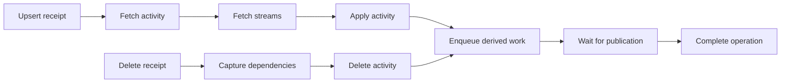
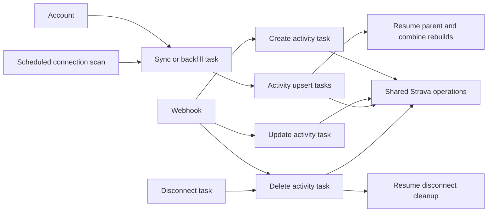

# Strava worker workflows

- Target the shared Temporal service in production. Bike owns its Rust workflows
  and workers; infrastructure owns the Temporal service. Use the `bike` namespace.
- Local Docker Compose starts Temporal and its UI alongside Bike. Use the same
  server version as the shared service and separate `temporal` and
  `temporal_visibility` databases on the local PostgreSQL instance.
- Local setup must be repeatable and preserve existing databases and history.
  Create schemas and the namespace before starting the Temporal UI.
- Keep local Temporal out of the release and browser-test Compose runtime until
  those workflows migrate. Public webhook and account requests still use the
  existing queue until the durable Temporal handoff is implemented.

## Temporal pilot

- The Rust worker registers exactly two workflows: `StravaActivityUpsert` and
  `StravaActivityDelete`. Each calls named activities directly. No generic
  Strava task dispatches operations.
- [Workflows](../../bike-rs/worker/src/temporal/workflows.rs),
  [activity processors](../../bike-rs/worker/src/temporal/activities.rs),
  [domain steps](../../bike-rs/bike-core/src/strava/workflow/steps/mod.rs), and
  [input/output types](../../bike-rs/bike-core/src/strava/workflow/steps/types.rs).
- Input: an existing durable receipt ID, also used as the Temporal workflow ID.
  Reject mismatched identities and operation types before provider calls.
- Keep provider bodies in Bike's object store. Temporal carries object references
  and small typed results, without OAuth credentials or whole recordings.
- Existing SQL processors still build derived results. The publication activity
  waits for their real completion and required output publication. Missing,
  failed, canceled, and unknown task states block success.
- Preserve connection generation checks, stale event rejection, stage checkpoints,
  content checksums, and transactional derived-task deduplication.
- Provider failures retry; provider quota deadlines set the next retry delay.
  Invalid inputs fail immediately. Steps have a two-minute timeout, 30-second
  heartbeat timeout, and at most 12 attempts. Publication gets 30 minutes per attempt.
- Cancellation stops subsequent Temporal steps and cooperatively stops active
  activities. It does not undo committed writes or cancel existing SQL children.
- Temporal UI provides execution history, step inputs/outputs, attempts, errors,
  and final results. A connected graph with processor links remains a TODO.
- This is a local pilot. API handoff, create/update workflows, collections,
  disconnect, terminal status mapping, and production cutover remain unfinished.

| Activity                      | Input                                | Output                                      |
| ----------------------------- | ------------------------------------ | ------------------------------------------- |
| `strava_fetch_activity`       | Receipt ID                           | Activity object reference or superseded     |
| `strava_fetch_streams`        | Receipt ID + activity reference      | Streams object reference or superseded      |
| `strava_apply_activity`       | Receipt ID + both references         | Outcome, Bike IDs, rebuild requirements     |
| `strava_capture_deletion`     | Receipt ID                           | Dependency snapshot reference or superseded |
| `strava_delete_activity`      | Receipt ID + snapshot reference      | Outcome, Bike IDs, rebuild requirements     |
| `strava_enqueue_derived_work` | Receipt ID + mutation result         | Receipt ID + pipeline ID                    |
| `strava_wait_for_publication` | Receipt ID + pipeline ID             | Same IDs, after publication                 |
| `strava_complete_operation`   | Mutation result + publication result | Final outcome and Bike IDs                  |

## Current webhook routing

| Strava event                             | Worker                                                            |
| ---------------------------------------- | ----------------------------------------------------------------- |
| Activity create                          | [Create](../../bike-rs/worker/src/tasks/strava/create.rs)         |
| Activity update: title, type, or privacy | [Update](../../bike-rs/worker/src/tasks/strava/update.rs)         |
| Activity delete                          | [Delete](../../bike-rs/worker/src/tasks/strava/delete.rs)         |
| Athlete update: `authorized=false`       | [Disconnect](../../bike-rs/worker/src/tasks/strava/disconnect.rs) |

- Path: Strava gateway → Rust `/webhooks/strava-gateway` (alias
  `/api/strava/webhook`) → [controller](../../bike-rs/api/src/controllers/strava.rs)
  → [durable receipt and enqueue](../../bike-rs/bike-core/src/strava/workflow/inbox.rs)
  → operation-specific SQL worker above.
- [Legacy generic processor](../../bike-rs/worker/src/tasks/strava/legacy.rs)
  remains registered for previously queued jobs. Remove it after draining.

## Current gaps

- Existing SQL operation tasks run their stages inline; those stages are not
  independently scheduled workflow activities. SQL job success can precede
  derived output publication. The Temporal pilot fixes this for its two workflows.
- Backfill is limited to 15 days. Incremental sync uses an activity start-time
  cursor, which does not repair missed older uploads, updates, or deletes.
- Existing SQL cancellation does not stop a running processor or its children.
  The pilot stops Temporal steps, but SQL child cancellation remains unfinished.
- Equal event timestamps have no defined delete precedence. Worker recovery
  across writes and the durable API handoff still need runtime verification.
- Confidence: the local pilot is verified with fake provider data. Live Strava,
  production routing, and a complete migration are not verified; there is no
  production reliability guarantee.

## Existing queue requirements

- Keep Strava application code under `bike-core/src/strava/`, including `client`,
  `transport`, credentials, connection management, activity operations, object
  storage, retention, and workflow orchestration. Workers live under
  `worker/src/tasks/strava/` with an explicit module per operation.
- Register distinct durable worker processors for activity create, update,
  upsert, delete, sync, backfill, and disconnect. Webhooks and account actions
  enqueue the corresponding processor with a typed workflow identity.
- Create and update share the internal upsert operation. Sync/backfill enqueue
  activity upsert tasks; disconnect enqueues activity deletion tasks. These
  child operations have real task IDs, attempts, retries, and causal history.
- Keep the scheduled connection scan separate from per-connection sync work.
- The parent collection resumes after queued child work. Advance its cursor,
  publish its completion, and queue its combined rebuild only after every child
  completed successfully. Child failures and cancellation cannot produce a
  successful parent; duplicate deliveries cannot enqueue duplicate children.
- Record one account-visible completion event alongside the connection's final
  sync counts and cursor. Retrying from retained sources keeps that event unique.
- Preserve retained checkpoints and source objects, activity revision ordering,
  connection-generation checks, rate-limit deferral, connection leases, and
  transactional acceptance/enqueue. Recovery uses existing worker semantics.
- Decode workflow actions once into a domain type. Reject unsupported actions
  and mismatched processor/workflow types before calling the provider.
- Centralize object-key construction in the Strava storage layout. Preserve
  existing retained paths and references so pending work remains resumable.
- A small compatibility processor may consume already persisted generic jobs;
  new work always uses the operation-specific processors. Preserve existing
  connection-specific sync jobs without adding new legacy queue producers.
- Verify enqueue/routing, parent/child history, duplicate suppression, waiting,
  terminal failures, and processor registration with unit fixtures. Reuse the
  fake provider and isolated PostgreSQL workflow suite for persistence/recovery
  behavior. Run focused Docker checks locally and the full gates in CI.

