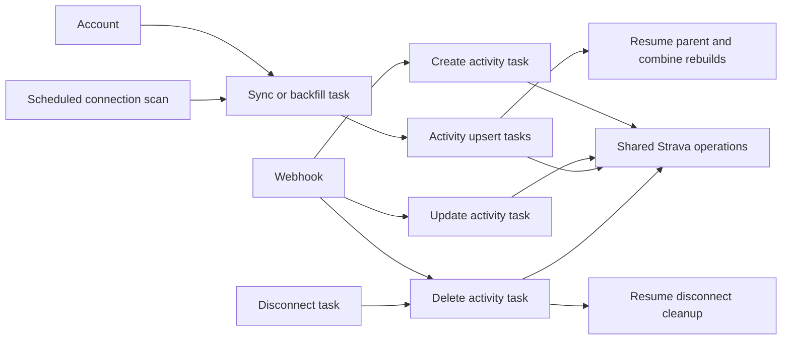

# Strava worker workflows

- Keep Strava application code under `bike-core/src/strava/`, including `client`,
  `transport`, credentials, connection management, activity operations, object
  storage, retention, and workflow orchestration. Workers live under
  `worker/src/tasks/strava/` with an explicit module per operation.
- Register distinct durable worker processors for activity create, update,
  upsert, delete, sync, backfill, and disconnect. Webhooks and account actions
  enqueue the corresponding processor with a typed workflow identity.
- Create and update share the internal upsert operation. Sync/backfill enqueue
  activity upsert tasks; disconnect enqueues activity deletion tasks. These
  child operations have real task IDs, attempts, retries, and causal history.
- Keep the scheduled connection scan separate from per-connection sync work.
- The parent collection resumes after queued child work. Advance its cursor,
  publish its completion, and queue its combined rebuild only after every child
  completed successfully. Child failures and cancellation cannot produce a
  successful parent; duplicate deliveries cannot enqueue duplicate children.
- Record one account-visible completion event alongside the connection's final
  sync counts and cursor. Retrying from retained sources keeps that event unique.
- Preserve retained checkpoints and source objects, activity revision ordering,
  connection-generation checks, rate-limit deferral, connection leases, and
  transactional acceptance/enqueue. Recovery uses existing worker semantics.
- Decode workflow actions once into a domain type. Reject unsupported actions
  and mismatched processor/workflow types before calling the provider.
- Centralize object-key construction in the Strava storage layout. Preserve
  existing retained paths and references so pending work remains resumable.
- A small compatibility processor may consume already persisted generic jobs;
  new work always uses the operation-specific processors. Preserve existing
  connection-specific sync jobs without adding new legacy queue producers.
- Verify enqueue/routing, parent/child history, duplicate suppression, waiting,
  terminal failures, and processor registration with unit fixtures. Reuse the
  fake provider and isolated PostgreSQL workflow suite for persistence/recovery
  behavior. Run focused Docker checks locally and the full gates in CI.

